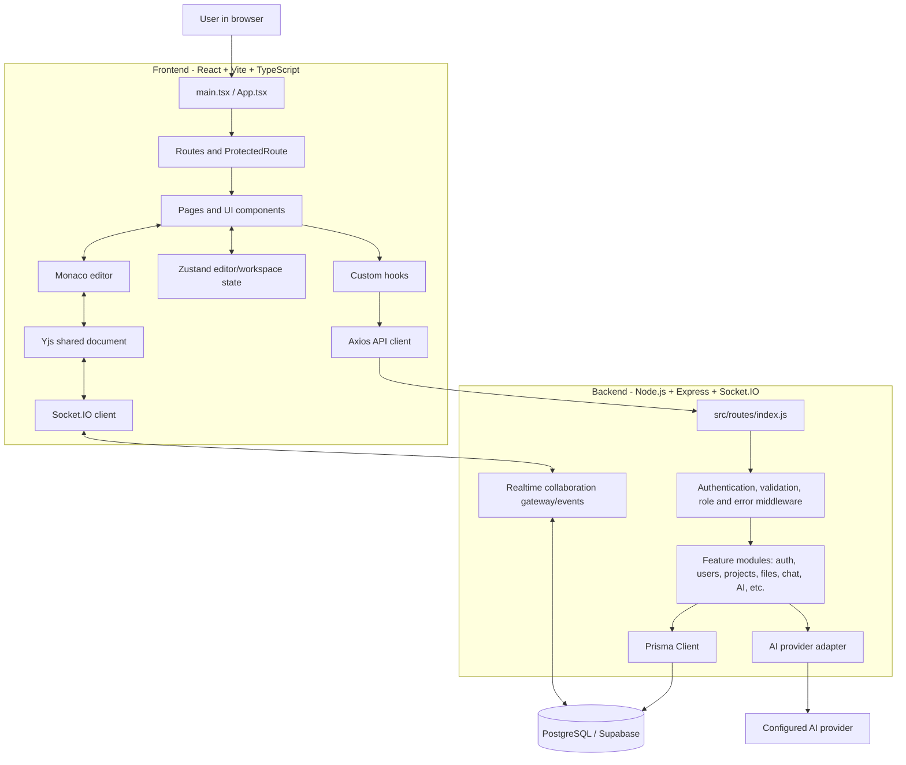
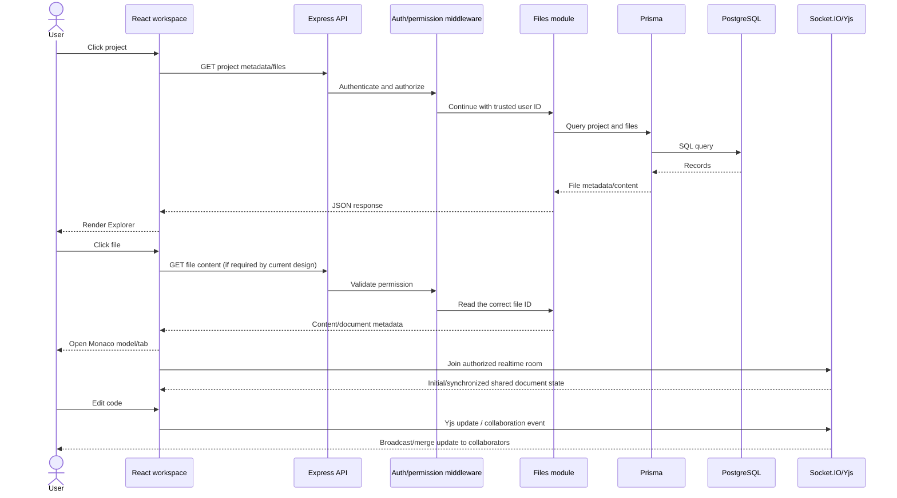
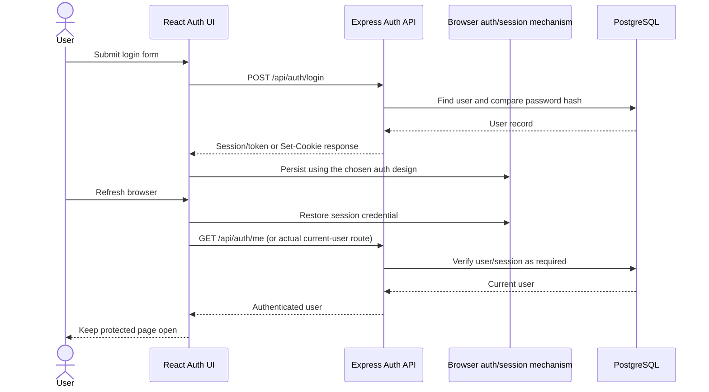

# CodeCollabAI — Full-Stack Architecture, Workflow & Interview Guide

This is the master technical learning guide for **CodeCollabAI (AI Collaborative Coding Workspace)**. It explains the backend architecture already documented below and adds the frontend, end-to-end flows, file/folder responsibilities, libraries/frameworks, tools, debugging practices, code examples, and interview preparation.

> **Accuracy note:** The current screenshots show a TypeScript/React frontend (`.tsx` files) and a modular JavaScript backend. The visible tree does not reveal every nested file or each `package.json`; exact dependency versions, hidden subfiles, route signatures, event names, and response schemas must be verified in the actual repository. Architecture diagrams and code snippets marked illustrative explain the pattern rather than claiming to reproduce every current implementation line-for-line.

## How to use this guide

- Sections 1–73: backend architecture, API/security/database/realtime/AI workflows, backend file responsibilities and study order.
- Sections 74–80: full-stack diagrams, frontend structure, frontend file/folder responsibilities and state model.
- Sections 81–87: library/framework explanations and interview-oriented code examples.
- Sections 88–94: engineering rules, end-to-end tests, interview study plan, tooling and final architecture model.

Read the source code alongside this document. If this guide and the checked-out implementation differ, the checked-out code, schema, package scripts and actual API responses are the source of truth.

### Quick navigation

- [Project overview](#1-project-overview) · [Technology stack](#4-technology-stack) · [Backend folder structure](#5-backend-folder-structure)
- [Authentication workflow](#11-authentication-workflow) · [RBAC/permissions](#15-role-based-access-control) · [Files and folders](#17-file-and-folder-architecture)
- [Realtime collaboration](#19-real-time-collaboration) · [AI assistant](#29-ai-coding-assistant-architecture) · [Database models](#33-database-architecture)
- [Backend file responsibilities](#60-what-each-major-file-does) · [Recommended backend study order](#73-recommended-study-order)
- [Frontend architecture](#part-ii--frontend-architecture-and-learning-guide) · [Frontend file/folder responsibilities](#77-what-each-visible-frontend-file-and-folder-does)
- [Frontend/backend library guide](#79-frontend-technology-and-library-reference) · [Backend folder guide](#80-backend-structure-from-the-current-screenshot)
- [End-to-end workflows](#82-end-to-end-workflow-open-a-project-and-edit-a-file) · [Interview code examples](#87-interview-focused-code-examples)
- [Testing checklist](#89-end-to-end-test-checklist) · [Interview study plan](#90-how-to-study-this-project-for-interviews) · [Tooling reference](#92-tooling-reference)

---

# 1. Project Overview

## 1.1 What are we building?

The **AI Collaborative Coding Workspace** is a shared development environment for student project teams.

Instead of using separate applications for:

- coding
- file sharing
- team communication
- user presence
- project management
- access control
- activity tracking
- AI coding help

we combine these capabilities into one focused workspace.

The project's presentation identifies the main feature set as:

- Real-time collaborative coding
- File and folder management
- Team communication
- User presence and activity tracking
- Access control
- AI coding assistance

The literature survey identifies **WebSocket** and **CRDT** as important technologies for synchronizing collaborative editing.

---

# 2. What the Backend Is Responsible For

The frontend is responsible mainly for the user interface.

The backend is responsible for the application's rules, data, security, and real-time coordination.

Conceptually:

```text
                    AI COLLABORATIVE CODING WORKSPACE
                                      |
                +---------------------+---------------------+
                |                     |                     |
                v                     v                     v
            FRONTEND              BACKEND                AI SERVICE
          React/Vite UI       Node.js/Express          Gemini/OpenAI
                |                     |
                |          +----------+----------+
                |          |          |          |
                |          v          v          v
                |       REST API   Socket.IO   Database
                |          |          |        PostgreSQL
                +----------+----------+----------+
```

The backend is therefore the **central coordination layer**.

---

# 3. High-Level Backend Architecture

```text
                           CLIENTS
                  +----------+----------+
                  |                     |
              Student A             Student B
                  |                     |
                  +----------+----------+
                             |
                  HTTP / WebSocket
                             |
                             v
                 +------------------------+
                 |      Node.js Server     |
                 |  Express + Socket.IO    |
                 +-----------+------------+
                             |
          +------------------+------------------+
          |                  |                  |
          v                  v                  v
     REST API Layer    Realtime Layer       AI Layer
     (Express)         (Socket.IO)       (Gemini/OpenAI)
          |                  |                  |
          v                  v                  |
    Controllers         Collaboration          |
          |              Gateway               |
          v                  |                  |
      Services         Room/Presence            |
          |                  |                  |
          v                  v                  |
     Repositories       Yjs / CRDT              |
          |                  |                  |
          +---------+--------+------------------+
                    |
                    v
              Prisma ORM
                    |
                    v
             PostgreSQL DB
```

---

# 4. Technology Stack

## 4.1 Core backend

### Node.js

Node.js runs the backend JavaScript outside the browser.

It is useful here because the application needs to handle:

- HTTP requests
- asynchronous database operations
- WebSocket connections
- many simultaneous users
- AI API requests

### Express.js

Express provides the HTTP server and REST API layer.

It gives us:

- routes
- middleware
- request/response handling
- error handling

### PostgreSQL

PostgreSQL stores persistent application data such as:

- users
- projects
- memberships
- files/folders
- messages
- activities
- AI conversations
- notifications

### Prisma

Prisma is the ORM/data-access layer between our Node.js backend and PostgreSQL.

The conceptual flow is:

```text
Application
    |
    v
Prisma Client
    |
    v
PostgreSQL
```

Prisma gives us a typed/structured way to query the database without writing SQL for every normal operation.

### JWT

JWT is used for authentication.

The login flow is approximately:

```text
User submits credentials
          |
          v
Backend verifies password
          |
          v
Backend creates JWT
          |
          v
Client sends JWT on protected requests
          |
          v
Auth middleware verifies JWT
          |
          v
Request becomes authenticated
```

### bcrypt / bcryptjs

Used for password hashing.

Passwords must **never** be stored in plain text.

### Zod

Used to validate incoming request data before business logic runs.

Example:

```text
Request Body
    |
    v
Zod Validation
    |
    +---- invalid ----> 400 response
    |
    +---- valid ------> controller
```

### Helmet

Adds common HTTP security headers.

### CORS

Controls which frontend origins can make requests to the backend.

### Rate limiting

Helps reduce abusive or excessive requests, especially around authentication and AI endpoints.

### Socket.IO

Provides the realtime communication layer.

Used for:

- project rooms
- editor events
- presence
- chat events
- connection/disconnection handling

### Yjs / CRDT

Yjs is the recommended implementation technology for the collaborative document layer.

The important idea is that multiple clients can modify the same shared document and converge to a consistent state.

We should use an existing CRDT implementation such as Yjs instead of inventing a CRDT algorithm from scratch.

### AI provider SDK/API

The AI module uses a provider abstraction so the application can call:

- Gemini as the primary provider
- OpenAI as an optional provider

The application should talk to `ai.service.js`, not directly to a provider from the controller.

---

# 5. Backend Folder Structure

```text
backend/
|
+-- prisma/
|   +-- schema.prisma
|   +-- seed.js
|
+-- src/
|   +-- config/
|   |   +-- env.js
|   |   +-- database.js
|   |   +-- ai.js
|   |
|   +-- middlewares/
|   |   +-- auth.middleware.js
|   |   +-- role.middleware.js
|   |   +-- error.middleware.js
|   |   +-- validation.middleware.js
|   |   +-- rateLimit.middleware.js
|   |
|   +-- routes/
|   |   +-- index.js
|   |
|   +-- modules/
|   |   +-- auth/
|   |   |   +-- auth.controller.js
|   |   |   +-- auth.service.js
|   |   |   +-- auth.repository.js
|   |   |   +-- auth.routes.js
|   |   |   +-- auth.validator.js
|   |   |
|   |   +-- users/
|   |   |   +-- user.controller.js
|   |   |   +-- user.service.js
|   |   |   +-- user.repository.js
|   |   |   +-- user.routes.js
|   |   |   +-- user.validator.js
|   |   |
|   |   +-- projects/
|   |   |   +-- project.controller.js
|   |   |   +-- project.service.js
|   |   |   +-- project.repository.js
|   |   |   +-- project.routes.js
|   |   |   +-- project.validator.js
|   |   |
|   |   +-- members/
|   |   |   +-- member.controller.js
|   |   |   +-- member.service.js
|   |   |   +-- member.repository.js
|   |   |   +-- member.routes.js
|   |   |   +-- member.validator.js
|   |   |
|   |   +-- files/
|   |   |   +-- file.controller.js
|   |   |   +-- file.service.js
|   |   |   +-- file.repository.js
|   |   |   +-- file.routes.js
|   |   |   +-- file.validator.js
|   |   |
|   |   +-- collaboration/
|   |   |   +-- collaboration.gateway.js
|   |   |   +-- collaboration.service.js
|   |   |   +-- room.service.js
|   |   |   +-- presence.service.js
|   |   |   +-- yjs/
|   |   |   |   +-- yjs.service.js
|   |   |   |   +-- document.manager.js
|   |   |   |   +-- document.persistence.js
|   |   |   +-- events/
|   |   |       +-- connection.events.js
|   |   |       +-- editor.events.js
|   |   |       +-- presence.events.js
|   |   |       +-- room.events.js
|   |   |
|   |   +-- chat/
|   |   |   +-- chat.controller.js
|   |   |   +-- chat.service.js
|   |   |   +-- chat.repository.js
|   |   |   +-- chat.routes.js
|   |   |   +-- chat.gateway.js
|   |   |
|   |   +-- activities/
|   |   |   +-- activity.controller.js
|   |   |   +-- activity.service.js
|   |   |   +-- activity.repository.js
|   |   |   +-- activity.routes.js
|   |   |
|   |   +-- permissions/
|   |   |   +-- permission.service.js
|   |   |   +-- permission.repository.js
|   |   |   +-- permission.constants.js
|   |   |
|   |   +-- ai/
|   |   |   +-- ai.controller.js
|   |   |   +-- ai.service.js
|   |   |   +-- ai.routes.js
|   |   |   +-- ai.validator.js
|   |   |   +-- providers/
|   |   |       +-- gemini.provider.js
|   |   |       +-- openai.provider.js
|   |   |
|   |   +-- notifications/
|   |       +-- notification.service.js
|   |       +-- notification.repository.js
|   |
|   +-- common/
|   |   +-- errors/
|   |   |   +-- AppError.js
|   |   |   +-- errorCodes.js
|   |   |
|   |   +-- utils/
|   |   |   +-- jwt.js
|   |   |   +-- password.js
|   |   |   +-- response.js
|   |   |   +-- logger.js
|   |   |
|   |   +-- constants/
|   |       +-- roles.js
|   |       +-- projectRoles.js
|   |
|   +-- app.js
|   +-- server.js
|
+-- tests/
|   +-- auth/
|   +-- projects/
|   +-- files/
|   +-- collaboration/
|   +-- ai/
|
+-- docs/
|   +-- architecture.md
|   +-- api.md
|   +-- database.md
|   +-- collaboration.md
|   +-- ai.md
|   +-- setup.md
|
+-- .env
+-- .env.example
+-- .gitignore
+-- package.json
+-- package-lock.json
+-- README.md
```

---

# 6. How the Folders Are Connected

The backend is organized by responsibility.

## Layer 1 — Configuration

```text
src/config/
```

Contains environment and external-service configuration.

Examples:

- database connection
- environment variables
- AI provider settings

## Layer 2 — Middleware

```text
src/middlewares/
```

Middleware runs between the request and the final handler.

Typical request path:

```text
Request
  |
  v
CORS / Security
  |
  v
Rate Limit
  |
  v
Authentication
  |
  v
Validation
  |
  v
Authorization
  |
  v
Controller
```

## Layer 3 — Routes

```text
src/routes/
```

Central routing entry point.

It connects feature-specific route files into Express.

Example:

```text
/api/auth
/api/users
/api/projects
/api/ai
```

## Layer 4 — Modules

```text
src/modules/
```

This is where business functionality lives.

Each feature has its own folder.

Examples:

```text
auth/
projects/
files/
chat/
ai/
```

## Layer 5 — Common

```text
src/common/
```

Reusable helpers and shared constants.

## Layer 6 — Prisma

```text
prisma/
```

Database schema and seed logic.

---

# 7. Controller → Service → Repository Pattern

This is one of the most important concepts in the backend.

For example, creating a project:

```text
POST /api/projects
        |
        v
project.routes.js
        |
        v
project.controller.js
        |
        v
project.service.js
        |
        v
project.repository.js
        |
        v
Prisma
        |
        v
PostgreSQL
```

## Controller

The controller receives the HTTP request and sends the response.

It should NOT contain most of the business logic.

Example:

```js
async function createProject(req, res, next) {
  try {
    const project = await projectService.createProject({
      userId: req.user.id,
      name: req.body.name,
      description: req.body.description,
    });

    return res.status(201).json({
      success: true,
      data: project,
    });
  } catch (error) {
    next(error);
  }
}
```

### What is happening?

`req.user.id` comes from authentication middleware.

`req.body.name` comes from the incoming JSON body.

The controller passes those values to the service.

The service decides what should happen.

---

# 8. Service Layer

The service contains business rules.

Example:

```js
async function createProject({ userId, name, description }) {
  const project = await projectRepository.create({
    name,
    description,
  });

  await memberRepository.create({
    projectId: project.id,
    userId,
    role: "OWNER",
  });

  return project;
}
```

Why is this better than putting everything inside the controller?

Because the business rule:

> "When a user creates a project, that user becomes OWNER."

belongs to the service layer.

---

# 9. Repository Layer

Repositories contain database access.

Example:

```js
async function create(data) {
  return prisma.project.create({
    data,
  });
}
```

The repository does not decide whether the current user is allowed to create a project.

That is a service/authorization concern.

The repository is primarily responsible for talking to the database.

---

# 10. Main Request Workflow

A normal REST request follows this path:

```text
                    CLIENT
                      |
                      | HTTP Request
                      v
                Express Server
                      |
                      v
                  Route
                      |
                      v
                 Middleware
          +-----------+-----------+
          |           |           |
        Auth      Validation   Rate Limit
          |           |           |
          +-----------+-----------+
                      |
                      v
                 Controller
                      |
                      v
                   Service
                      |
                      +------> Permission Check
                      |
                      v
                 Repository
                      |
                      v
                    Prisma
                      |
                      v
                 PostgreSQL
                      |
                      v
                  Response
                      |
                      v
                    CLIENT
```

---

# 11. Authentication Workflow

## Register

```text
User
 |
 | POST /api/auth/register
 v
auth.routes.js
 |
v
Validation
 |
v
auth.controller.js
 |
v
auth.service.js
 |
+--> password.hash()
 |
v
User repository
 |
v
Prisma
 |
v
PostgreSQL
 |
v
Response
```

The password stored in the database is the hash, never the plain password.

## Login

```text
Email + Password
       |
       v
Validate input
       |
       v
Find user
       |
       v
Compare password
       |
       v
Generate JWT
       |
       v
Return token
```

## Protected Request

```text
Client
 |
 | Authorization: Bearer <JWT>
 v
Express
 |
v
auth.middleware.js
 |
v
Verify JWT
 |
+---- invalid ----> 401
 |
valid
 |
v
req.user = decoded identity
 |
v
Controller
```

---

# 12. User Identity Flow

After authentication, later backend code can use:

```js
req.user.id
req.user.email
```

Conceptually:

```text
JWT
 |
v
Auth Middleware
 |
v
Decoded User Identity
 |
v
req.user
 |
+--> Project authorization
+--> File authorization
+--> Chat authorization
+--> Activity logging
+--> AI conversation ownership
```

---

# 13. Project Workflow

A project is the main collaboration container.

```text
User creates Project
        |
        v
Project record created
        |
        v
ProjectMember created
        |
        v
Creator gets OWNER role
        |
        v
Project workspace available
```

A project can contain:

- members
- folders
- files
- messages
- activities
- AI conversations
- collaboration rooms

---

# 14. Project Membership

We do not simply store a list of user IDs inside a project.

Instead we use a relationship model:

```text
User
  |
  | many-to-many through
  v
ProjectMember
  |
  v
Project
```

A membership also contains the user's role.

Example:

```text
Rahul       -> OWNER
Samruddhi   -> DEVELOPER
Vyankatesh  -> VIEWER
```

This relationship drives authorization.

---

# 15. Role-Based Access Control

The project uses three main roles:

```text
OWNER
DEVELOPER
VIEWER
```

Example permissions:

| Action | OWNER | DEVELOPER | VIEWER |
|---|---:|---:|---:|
| View project | Yes | Yes | Yes |
| View files | Yes | Yes | Yes |
| Edit files | Yes | Yes | No |
| Create files | Yes | Yes | No |
| Delete files | Yes | Restricted | No |
| Send chat | Yes | Yes | According to chosen policy |
| Manage members | Yes | No | No |
| Delete project | Yes | No | No |

The exact policy should be defined centrally rather than scattered through controllers.

---

# 16. Permission Workflow

```text
Request
 |
v
Authentication
 |
v
User identity
 |
v
Load project membership
 |
v
Read role
 |
v
Check required permission
 |
+---- denied ----> 403
 |
allowed
 |
v
Continue to service
```

Important rule:

> The frontend can hide buttons, but backend authorization must still enforce the permission.

---

# 17. File and Folder Architecture

The project workspace contains a virtual file tree.

Example:

```text
Project
|
+-- src/
|   +-- App.jsx
|   +-- components/
|       +-- Header.jsx
|       +-- Editor.jsx
|
+-- backend/
|   +-- server.js
|   +-- routes.js
|
+-- README.md
```

Database relationships should support nested folders.

A folder can have a `parentFolderId` pointing to another folder.

Root items have no parent folder.

---

# 18. File Save Workflow

When a normal file is saved:

```text
Frontend Editor
      |
      | PUT /api/files/:fileId
      v
file.routes.js
      |
      v
Validation
      |
      v
Permission Check
      |
      v
file.controller.js
      |
      v
file.service.js
      |
      v
file.repository.js
      |
      v
Prisma
      |
      v
PostgreSQL
```

For collaborative editing, the realtime path is different and is described below.

---

# 19. Real-Time Collaboration

This is one of the most important parts of the system.

The collaboration system is different from normal REST CRUD.

REST is good for:

- creating a project
- reading files
- updating metadata
- deleting resources

WebSockets are useful for:

- live editor updates
- presence
- room events
- chat events

---

# 20. Socket.IO Workflow

```text
Student A Browser
       |
       | Socket connection
       v
Socket.IO Server
       |
       v
Authentication
       |
       v
Project membership check
       |
       v
Join room
       |
       v
Other project members
```

Example room naming concept:

```text
project:<projectId>
file:<fileId>
```

The exact room design should be kept consistent across the collaboration module.

---

# 21. Collaborative Editing Flow

The target architecture is:

```text
                FILE: App.jsx
                       |
          +------------+------------+
          |                         |
       Student A                 Student B
          |                         |
      Monaco Editor            Monaco Editor
          |                         |
          +------------+------------+
                       |
                       v
                    Yjs
                 Shared Y.Doc
                       |
                       v
                 Socket.IO
                       |
                       v
            Collaboration Gateway
                       |
                       v
                  File Room
                       |
              +--------+--------+
              |                 |
              v                 v
           Client A          Client B
```

Yjs handles shared document state and synchronization.

Socket.IO provides the transport/connection mechanism in our backend architecture.

---

# 22. What CRDT Means Here

CRDT stands for **Conflict-Free Replicated Data Type**.

The key idea is that multiple replicas can make changes independently and then merge them in a way that converges to a consistent state.

We should not implement a CRDT algorithm ourselves.

Instead:

```text
Our application
     |
     v
Yjs
     |
     v
CRDT-based shared document
```

This is the implementation-oriented version of the CRDT concept discussed in the literature survey.

---

# 23. Why Yjs Is Separate From Socket.IO

These two technologies solve different problems.

### Socket.IO

Answers:

> How do connected clients communicate with the server in realtime?

### Yjs

Answers:

> How is shared document state represented and merged safely for collaborative editing?

So:

```text
Socket.IO = realtime transport/connection layer
Yjs      = collaborative document state/CRDT layer
```

They complement each other.

---

# 24. Collaboration Module Files

## `collaboration.gateway.js`

Main entry point for collaboration sockets.

Responsibilities:

- register collaboration events
- authenticate socket connections
- connect event handlers

## `collaboration.service.js`

Higher-level collaboration business logic.

## `room.service.js`

Manages project/file room membership.

## `presence.service.js`

Tracks which users are online and what they are currently doing.

## `yjs/yjs.service.js`

Yjs-specific logic.

## `yjs/document.manager.js`

Keeps active Yjs documents in memory while they are being used.

## `yjs/document.persistence.js`

Responsible for saving/recovering document state according to the chosen persistence strategy.

## `events/connection.events.js`

Connection and disconnection events.

## `events/editor.events.js`

Editor/document synchronization events.

## `events/presence.events.js`

Presence updates.

## `events/room.events.js`

Join/leave room events.

---

# 25. Presence Workflow

Example:

```text
Rahul opens Project A
        |
        v
Socket connected
        |
        v
Join project room
        |
        v
Presence state = online
        |
        v
Broadcast to project members
```

If Rahul disconnects:

```text
Disconnect
   |
   v
Remove connection from active presence state
   |
   v
Broadcast offline state
```

Presence can also include:

- current project
- current file
- current editor position/selection where implemented

Do not broadcast presence information between unrelated projects.

---

# 26. Chat Workflow

Project chat has both a persistent and realtime side.

### Send message

```text
Client
 |
 | Socket event: message:send
 v
chat.gateway.js
 |
v
Authentication + project membership
 |
v
chat.service.js
 |
v
chat.repository.js
 |
v
PostgreSQL
 |
+---->
 |
v
Broadcast message:new
 |
v
All project members
```

### Message history

```text
GET /api/projects/:projectId/messages
        |
        v
Chat Controller
        |
        v
Chat Service
        |
        v
Chat Repository
        |
        v
PostgreSQL
```

This combination gives both durable history and live delivery.

---

# 27. Activity Tracking Workflow

Whenever an important action happens:

```text
Business operation
       |
       v
activityService.log(...)
       |
       v
Activity Repository
       |
       v
PostgreSQL
```

Example:

```text
FILE_CREATED
FILE_UPDATED
MEMBER_ADDED
PROJECT_CREATED
MESSAGE_SENT
```

A frontend activity panel can then call:

```text
GET /api/projects/:projectId/activities
```

---

# 28. Why Activity Tracking Should Be Centralized

Bad approach:

```text
Every controller manually constructs activity records differently
```

Better approach:

```text
activityService.log({
  projectId,
  userId,
  action,
  metadata
})
```

This keeps the logging format consistent.

---

# 29. AI Coding Assistant Architecture

The AI system should use a provider abstraction.

```text
Frontend
   |
   | POST /api/ai/explain
   v
AI Route
   |
   v
Validation
   |
   v
AI Controller
   |
   v
AI Service
   |
   +------------+-------------+
   |                          |
   v                          v
Gemini Provider          OpenAI Provider
   |                          |
   +------------+-------------+
                |
                v
          External AI API
```

The rest of the application should not need to know which provider is active.

---

# 30. AI Provider Abstraction

Instead of doing this in the controller:

```js
// BAD DESIGN
// controller directly calls provider SDK
```

we use:

```text
ai.controller.js
       |
       v
ai.service.js
       |
       v
selected provider
```

This makes it easier to switch AI providers or mock them in tests.

---

# 31. AI Use Cases

The core AI operations are:

1. Explain code
2. Debug code
3. Generate code
4. Refactor code
5. Improve code
6. Generate documentation

A request can include:

```json
{
  "projectId": "...",
  "fileId": "...",
  "language": "javascript",
  "selectedCode": "...",
  "userPrompt": "Explain why this function is failing"
}
```

The AI service should send only the necessary context.

Do not automatically send an entire private project to the AI.

---

# 32. AI Conversation Persistence

Conversations can be represented as:

```text
AIConversation
     |
     +---- AIMessage
     +---- AIMessage
     +---- AIMessage
```

This allows the application to show previous AI interactions and preserve context where appropriate.

---

# 33. Database Architecture

The main conceptual relationship is:

```text
USER
 |
 +----------------------------+
 |                            |
 v                            v
PROJECT_MEMBER             AI_CONVERSATION
 |                            |
 v                            v
PROJECT                    AI_MESSAGE
 |
 +---- FOLDER
 |       |
 |       +---- FOLDER
 |       |
 |       +---- FILE
 |
 +---- FILE
 |
 +---- MESSAGE
 |
 +---- ACTIVITY
 |
 +---- NOTIFICATION
```

---

# 34. Main Database Models

## User

Represents an account.

Typical data:

- id
- name
- email
- passwordHash
- avatar data if needed
- createdAt
- updatedAt

## Project

Represents a team development workspace.

Typical data:

- id
- name
- description
- createdAt
- updatedAt

## ProjectMember

Connects users to projects and stores roles.

Typical data:

- id
- projectId
- userId
- role
- createdAt

## Folder

Represents a directory in the project's virtual file tree.

## File

Represents code/text content inside the workspace.

## Message

Project chat message.

## Activity

Audit/project history entry.

## AIConversation / AIMessage

Stores AI interactions.

## Notification

Stores user-facing notifications.

---

# 35. REST API Overview

## Authentication

```text
POST /api/auth/register
POST /api/auth/login
POST /api/auth/logout
GET  /api/auth/me
```

## Users

```text
GET /api/users/me
PUT /api/users/me
GET /api/users/:id
```

## Projects

```text
POST   /api/projects
GET    /api/projects
GET    /api/projects/:id
PUT    /api/projects/:id
DELETE /api/projects/:id
```

## Members

```text
GET    /api/projects/:projectId/members
POST   /api/projects/:projectId/members
PUT    /api/projects/:projectId/members/:userId
DELETE /api/projects/:projectId/members/:userId
```

## Files

```text
POST   /api/projects/:projectId/files
GET    /api/projects/:projectId/files
GET    /api/files/:fileId
PUT    /api/files/:fileId
DELETE /api/files/:fileId
```

## Folders

```text
POST   /api/projects/:projectId/folders
PUT    /api/folders/:folderId
DELETE /api/folders/:folderId
```

## Chat

```text
GET /api/projects/:projectId/messages
```

## Activities

```text
GET /api/projects/:projectId/activities
```

## AI

```text
POST /api/ai/explain
POST /api/ai/debug
POST /api/ai/generate
POST /api/ai/refactor
POST /api/ai/document
```

---

# 36. REST vs WebSocket

Use REST when the operation is request/response oriented.

Examples:

```text
Create project
Get project
Update project
Get file
Delete file
Get message history
Get activities
```

Use WebSocket/Socket.IO when the application needs live updates.

Examples:

```text
Editor synchronization
Presence
Realtime chat delivery
Room events
Connection events
```

This distinction is fundamental to the architecture.

---

# 37. Route Registration Workflow

The application should register feature routes centrally.

```text
src/routes/index.js
       |
       +--> auth.routes.js
       +--> user.routes.js
       +--> project.routes.js
       +--> member.routes.js
       +--> file.routes.js
       +--> chat.routes.js
       +--> activity.routes.js
       +--> ai.routes.js
```

Then:

```text
app.js
  |
  v
app.use("/api", routes)
```

---

# 38. `app.js` Responsibility

`app.js` creates/configures the Express application.

Typical responsibilities:

1. Create Express instance
2. Add CORS
3. Add JSON parser
4. Add security middleware
5. Add rate limiting
6. Register REST routes
7. Register error middleware

It should not contain all application business logic.

Conceptually:

```js
const app = express();

app.use(cors());
app.use(express.json());

app.use("/api", routes);

app.use(errorMiddleware);

module.exports = app;
```

---

# 39. `server.js` Responsibility

`server.js` starts the actual HTTP server and attaches Socket.IO.

Conceptually:

```js
const httpServer = createServer(app);
const io = new Server(httpServer, options);

registerCollaborationGateway(io);

httpServer.listen(PORT, () => {
  console.log(`Server running on ${PORT}`);
});
```

The key distinction is:

```text
app.js    = configure application
server.js = start server + realtime layer
```

---

# 40. Error Handling Flow

All errors should eventually reach the centralized error middleware.

```text
Controller / Service
        |
        | throw error
        v
error.middleware.js
        |
        v
Map error to HTTP response
        |
        v
Client
```

Example response:

```json
{
  "success": false,
  "message": "Project not found",
  "code": "PROJECT_NOT_FOUND"
}
```

Do not expose internal stack traces in production responses.

---

# 41. Validation Flow

Example request:

```json
{
  "name": "My Project",
  "description": "Student project"
}
```

Flow:

```text
Request
  |
  v
Zod Schema
  |
  +---- Invalid ---> 400
  |
  v
Controller
```

Validation belongs near the edge of the application so invalid data is rejected early.

---

# 42. Security Architecture

Security layers:

```text
                    REQUEST
                       |
                       v
                  CORS Policy
                       |
                       v
                 Helmet Headers
                       |
                       v
                  Rate Limit
                       |
                       v
                 Authentication
                       |
                       v
                   Validation
                       |
                       v
                  Authorization
                       |
                       v
                  Business Logic
```

Important rules:

- Never store plain passwords.
- Never put secret keys in source code.
- Never trust frontend role information.
- Never allow arbitrary file/project access without checking membership.
- Do not return password hashes.
- Do not log secrets.
- Keep `.env` out of Git.

---

# 43. Environment Variables

`.env.example` should contain names only:

```env
PORT=5000
NODE_ENV=development
DATABASE_URL=
JWT_SECRET=
JWT_EXPIRES_IN=7d
FRONTEND_URL=http://localhost:5173
GEMINI_API_KEY=
OPENAI_API_KEY=
```

Actual secret values belong in the local `.env` file or secure deployment environment.

---

# 44. Package/Library Map

The backend's important libraries are used for different reasons.

| Library/Technology | Main responsibility |
|---|---|
| Node.js | Server runtime |
| Express | REST API framework |
| Prisma | Database ORM |
| PostgreSQL | Persistent relational database |
| JWT | Authentication token |
| bcrypt/bcryptjs | Password hashing |
| Zod | Request validation |
| cors | Cross-origin control |
| helmet | Security headers |
| rate limiter | Abuse/request protection |
| Socket.IO | Realtime communication |
| Yjs | CRDT/shared document state |
| dotenv | Environment variables |
| Pino or similar logger | Structured server logging |
| Jest/Vitest | Tests |
| Supertest | HTTP endpoint testing |
| Gemini/OpenAI SDK/API | AI coding assistance |

---

# 45. Why We Are Not Building Everything From Scratch

We build our own application logic, but we use established libraries for complex infrastructure.

Examples:

```text
Authentication token format   -> JWT
Password hashing              -> bcrypt
Validation                    -> Zod
Realtime transport            -> Socket.IO
CRDT implementation           -> Yjs
Database access               -> Prisma
HTTP server                   -> Express
```

We should understand these technologies, but we should not unnecessarily reimplement them.

---

# 46. Example End-to-End Scenario: Login

```text
                LOGIN SCENARIO

React Frontend
     |
     | POST /api/auth/login
     v
Express Router
     |
     v
auth.validator.js
     |
     v
auth.controller.js
     |
     v
 auth.service.js
     |
     +----> user.repository.js
     |            |
     |            v
     |         Prisma
     |            |
     |            v
     |        PostgreSQL
     |
     +----> password.compare()
     |
     +----> jwt.sign()
     |
     v
JSON Response
     |
     v
React Frontend
```

---

# 47. Example End-to-End Scenario: Create Project

```text
POST /api/projects
        |
        v
Authenticate JWT
        |
        v
Validate body
        |
        v
Project Controller
        |
        v
Project Service
        |
        +--> Create project
        |
        +--> Create OWNER membership
        |
        +--> Log activity
        |
        v
Project Repository
        |
        v
Prisma
        |
        v
PostgreSQL
        |
        v
Response
```

---

# 48. Example End-to-End Scenario: Edit a Shared File

```text
Student A
   |
   | modifies App.jsx
   v
Monaco Editor
   |
   v
Yjs document update
   |
   v
Socket.IO
   |
   v
Collaboration Gateway
   |
   v
File/project room
   |
   +--------------------+
   |                    |
   v                    v
Student B             Student C
   |                    |
   v                    v
Yjs local state      Yjs local state
   |                    |
   +----------+---------+
              |
              v
      Consistent shared view
```

When persistence is required, document state is written according to the chosen persistence strategy.

---

# 49. Example End-to-End Scenario: AI Debug Request

```text
Student selects code
        |
        | POST /api/ai/debug
        v
AI Route
        |
        v
Validation
        |
        v
AI Controller
        |
        v
AI Service
        |
        +--> Verify project/file access
        |
        +--> Build context
        |
        v
Gemini Provider
        |
        v
External AI API
        |
        v
AI Response
        |
        +--> Persist conversation/message if enabled
        |
        v
Student
```

---

# 50. Example Code: Express Route

A route mainly connects a URL to middleware/controller logic.

```js
router.post(
  "/",
  authenticate,
  validate(createProjectSchema),
  projectController.createProject
);
```

Meaning:

```text
POST /api/projects
       |
       +--> authenticate
       |
       +--> validate request
       |
       +--> execute controller
```

The route itself should not implement project creation logic.

---

# 51. Example Code: Authentication Middleware

Representative idea:

```js
function authenticate(req, res, next) {
  const token = extractBearerToken(req);

  if (!token) {
    return res.status(401).json({
      success: false,
      message: "Authentication required",
      code: "AUTH_REQUIRED",
    });
  }

  const payload = verifyToken(token);
  req.user = payload;

  next();
}
```

Important concepts:

1. Read the token.
2. Reject missing tokens.
3. Verify the token.
4. Attach authenticated identity to `req.user`.
5. Call `next()`.

In a real implementation, token verification errors must be handled safely.

---

# 52. Example Code: Repository

```js
async function findByEmail(email) {
  return prisma.user.findUnique({
    where: { email },
  });
}
```

This function has one responsibility:

> Find a user by email in the database.

It does not decide whether login is allowed.

That is handled by the service.

---

# 53. Example Code: Service

```js
async function login({ email, password }) {
  const user = await userRepository.findByEmail(email);

  if (!user) {
    throw new AppError("Invalid credentials", 401, "INVALID_CREDENTIALS");
  }

  const validPassword = await comparePassword(
    password,
    user.passwordHash
  );

  if (!validPassword) {
    throw new AppError("Invalid credentials", 401, "INVALID_CREDENTIALS");
  }

  const token = signToken({
    sub: user.id,
    email: user.email,
  });

  return { token };
}
```

Why does this belong in the service?

Because login is a business workflow:

```text
find user
 -> verify password
 -> create token
 -> return result
```

---

# 54. Why the Architecture Is Modular

Suppose the AI provider changes from Gemini to OpenAI.

Without abstraction:

```text
Many controllers
      |
      +---- Gemini code everywhere
```

With abstraction:

```text
Controllers
    |
    v
AI Service
    |
    v
Provider interface/contract
    |
    +--> Gemini
    +--> OpenAI
```

Only the provider layer changes.

The same idea is applied to other parts of the backend.

---

# 55. Testing Architecture

Tests should be grouped by feature.

```text
tests/
|
+-- auth/
+-- projects/
+-- files/
+-- collaboration/
+-- ai/
```

REST tests can use:

```text
Supertest
```

AI tests should mock the provider rather than making real AI calls.

Collaboration tests should verify important connection/authorization behavior and a practical synchronization path.

---

# 56. Development Workflow

The backend should be developed feature-by-feature.

Recommended order:

```text
1. Basic Express server
        |
2. Environment configuration
        |
3. PostgreSQL + Prisma
        |
4. Database schema
        |
5. Authentication
        |
6. Users
        |
7. Projects
        |
8. Members
        |
9. Permissions
        |
10. Files/Folders
        |
11. Socket.IO foundation
        |
12. Yjs/CRDT collaboration
        |
13. Presence
        |
14. Chat
        |
15. Activity tracking
        |
16. AI assistant
        |
17. Notifications
        |
18. Testing
        |
19. Documentation
        |
20. Deployment
```

---

# 57. How to Learn This Backend After AI Generates It

Do not attempt to memorize the complete repository.

Learn one feature at a time.

## Phase 1 — Understand server startup

Study:

```text
server.js
app.js
```

Questions:

- What starts Node.js?
- What is Express?
- What is an HTTP server?
- What is middleware?

## Phase 2 — Understand database

Study:

```text
prisma/schema.prisma
config/database.js
```

Questions:

- What is PostgreSQL?
- What is Prisma?
- What is a model?
- What is a relation?

## Phase 3 — Authentication

Study:

```text
auth.routes.js
auth.controller.js
auth.service.js
auth.repository.js
auth.validator.js
auth.middleware.js
jwt.js
password.js
```

Questions:

- What is JWT?
- Why hash passwords?
- What is middleware?
- What is `req.user`?

## Phase 4 — Projects and members

Study:

```text
projects/
members/
permissions/
```

Questions:

- What is RBAC?
- How does a user become a project owner?
- How are permissions checked?

## Phase 5 — Files

Study:

```text
files/
```

Questions:

- How is the file tree represented?
- How are nested folders stored?
- How are file access permissions enforced?

## Phase 6 — Realtime collaboration

Study:

```text
collaboration/
```

Questions:

- What is a WebSocket?
- Why Socket.IO?
- What is a room?
- What is Yjs?
- What is CRDT?
- How do two users see the same edit?

## Phase 7 — Chat and activity

Study:

```text
chat/
activities/
```

Questions:

- Why use WebSockets for live messages?
- Why persist messages in PostgreSQL?
- Why keep activity history?

## Phase 8 — AI

Study:

```text
ai/
ai/providers/
```

Questions:

- What is an AI API?
- Why use a provider abstraction?
- How is project context selected?
- Why should AI keys remain on the backend?

---

# 58. Complete Backend Workflow Diagram

```text
+------------------------------------------------------------------+
|                         CLIENT APPLICATION                       |
|                                                                  |
| React + Monaco Editor + Chat + Project UI + AI Panel            |
+-------------------------------+----------------------------------+
                                |
                +---------------+---------------+
                |                               |
             HTTPS                          WebSocket
                |                               |
                v                               v
+-------------------------------+   +------------------------------+
|         EXPRESS APP           |   |        SOCKET.IO SERVER       |
|                               |   |                              |
|  CORS / Helmet / Rate Limit   |   | Authentication                |
|             |                 |   | Project/File Rooms           |
|             v                 |   | Presence                      |
|          Routes               |   | Editor Events                 |
|             |                 |   | Chat Events                   |
|             v                 |   +---------------+--------------+
|       Authentication          |                   |
|             |                 |                   v
|       Validation              |             Collaboration
|             |                 |                   |
|             v                 |              +----+----+
|        Controller             |              |         |
|             |                 |              v         v
|             v                 |            Yjs     Presence
|         Service               |              |
|             |                 |              v
|             v                 |         Shared State
|       Repository              |              |
+-------------+-----------------+              |
              |                                |
              +----------------+---------------+
                               |
                               v
                       +---------------+
                       |    PRISMA     |
                       +-------+-------+
                               |
                               v
                       +---------------+
                       |  PostgreSQL   |
                       +---------------+

                         AI REQUEST PATH

Client
  |
  v
/api/ai/*
  |
  v
AI Controller
  |
  v
AI Service
  |
  +----------+----------+
  |                     |
  v                     v
Gemini Provider     OpenAI Provider
  |                     |
  +----------+----------+
             |
             v
        External AI API
             |
             v
        AI Response
             |
             v
      Optional persistence
```

---

# 59. Full Feature-to-Backend Mapping

| Project Feature | Main Backend Modules | Main Technology |
|---|---|---|
| Authentication | `auth`, `middlewares`, `common/utils` | JWT + bcrypt |
| User profile | `users` | Express + Prisma |
| Project management | `projects` | Express + Prisma |
| Team members | `members`, `permissions` | Prisma + RBAC |
| File/folder management | `files` | Prisma + REST |
| Realtime coding | `collaboration` | Socket.IO + Yjs |
| CRDT synchronization | `collaboration/yjs` | Yjs |
| User presence | `collaboration/presence.service.js` | Socket.IO |
| Team chat | `chat` | Socket.IO + PostgreSQL |
| Activity tracking | `activities` | Prisma |
| AI assistance | `ai` | Gemini/OpenAI |
| Notifications | `notifications` | Prisma + application events |
| API security | `middlewares` | Helmet + CORS + rate limiting |
| Validation | `*.validator.js` | Zod |
| Persistence | `prisma` | Prisma + PostgreSQL |
| Testing | `tests` | Jest/Vitest + Supertest |

---

# 60. What Each Major File Does

## Root

### `package.json`

Defines:

- project metadata
- dependencies
- npm scripts

### `.env`

Local secret/configuration values.

Never commit it.

### `.env.example`

Documents required environment variable names without real secrets.

### `.gitignore`

Prevents files such as `node_modules` and `.env` from being committed.

### `README.md`

This document.

---

## `prisma/`

### `schema.prisma`

Defines database models and relations.

### `seed.js`

Creates safe demo data for local development.

---

## `src/config/`

### `env.js`

Central environment variable parsing/validation.

### `database.js`

Creates/exports Prisma database client configuration.

### `ai.js`

Central AI provider configuration.

---

## `src/middlewares/`

### `auth.middleware.js`

Authenticates requests.

### `role.middleware.js`

Checks role/permission rules.

### `error.middleware.js`

Central error handling.

### `validation.middleware.js`

Runs Zod validators.

### `rateLimit.middleware.js`

Limits request frequency where appropriate.

---

## `src/routes/`

### `index.js`

Central REST route registration.

---

## `auth/`

### `auth.routes.js`

Authentication endpoints.

### `auth.controller.js`

HTTP input/output handling.

### `auth.service.js`

Registration/login business logic.

### `auth.repository.js`

Database access for authentication-related queries.

### `auth.validator.js`

Input validation.

---

## `users/`

User profile operations.

---

## `projects/`

Project lifecycle and metadata.

---

## `members/`

Membership and roles.

---

## `files/`

Workspace file/folder tree and content operations.

---

## `collaboration/`

Realtime coding, rooms, presence, and Yjs synchronization.

---

## `chat/`

Project communication.

---

## `activities/`

Project activity history.

---

## `permissions/`

Central authorization decisions and role definitions.

---

## `ai/`

AI API, prompting/context logic, provider abstraction, and AI conversation handling.

---

## `notifications/`

Persistent notification support.

---

## `common/`

Reusable application-wide code.

---

# 61. Naming Rules

Use consistent names.

Examples:

```text
project.controller.js
project.service.js
project.repository.js
project.routes.js
project.validator.js
```

Classes should use PascalCase when classes are required.

Functions and variables should use camelCase.

Constants should use names that communicate their purpose clearly.

Avoid random abbreviations.

---

# 62. Clean Code Rules

The backend should follow these principles:

- One responsibility per file/function where practical.
- Thin controllers.
- Business logic in services.
- Database access in repositories.
- Validation at the boundary.
- Authorization before sensitive operations.
- Centralized error handling.
- Reuse common utilities.
- Avoid duplicate logic.
- Prefer clear code over clever code.
- Avoid unnecessary abstraction.
- Avoid large files.
- Use async/await consistently.
- Do not hide important logic inside obscure helpers.

---

# 63. Common Mistakes to Avoid

## Mistake 1: Business logic in routes

Bad:

```js
router.post("/projects", async (req, res) => {
  // dozens of lines of business logic
});
```

Better:

```text
route -> validation -> controller -> service -> repository
```

## Mistake 2: Trusting frontend role values

Never do:

```text
frontend says role=OWNER
-> backend trusts it
```

Backend should retrieve the actual role from the database.

## Mistake 3: Storing plain passwords

Never do:

```js
password: req.body.password
```

Store a secure password hash instead.

## Mistake 4: Putting API keys in frontend code

AI provider keys stay on the backend.

## Mistake 5: Using REST for every realtime operation

A live collaborative editor needs a realtime layer.

## Mistake 6: Sending the entire project to the AI

Send the minimum relevant context.

## Mistake 7: Calling CRDT code from every random module

Keep Yjs responsibilities within the collaboration module.

---

# 64. Current and Future Scope

## Core scope

The system's main project scope is:

```text
Real-time collaboration
+
File/project workspace
+
Communication
+
Presence/activity
+
Access control
+
AI coding assistance
```

## Possible later extensions

These are not required for the first version:

- Git integration
- code execution sandbox
- richer notifications
- voice/video
- AI agents
- automated testing agents
- advanced version history
- shared terminal

Do not add these until the core project is stable.

---

# 65. Suggested Build Order

```text
PHASE 1
Basic Express server
        |
        v
PHASE 2
Environment + PostgreSQL + Prisma
        |
        v
PHASE 3
Database schema
        |
        v
PHASE 4
Authentication
        |
        v
PHASE 5
Users
        |
        v
PHASE 6
Projects
        |
        v
PHASE 7
Members + Permissions
        |
        v
PHASE 8
Files/Folders
        |
        v
PHASE 9
Socket.IO
        |
        v
PHASE 10
Yjs / CRDT
        |
        v
PHASE 11
Presence
        |
        v
PHASE 12
Chat
        |
        v
PHASE 13
Activities
        |
        v
PHASE 14
AI
        |
        v
PHASE 15
Notifications
        |
        v
PHASE 16
Testing
        |
        v
PHASE 17
Deployment
```

---

# 66. How to Use AI to Build This Backend

AI coding tools such as Antigravity can generate much of the implementation.

The recommended workflow is:

```text
Human designs architecture
        |
        v
AI generates/updates code
        |
        v
Human runs tests
        |
        v
Human reviews important logic
        |
        v
Human learns each module
        |
        v
Human modifies/debugs code
```

Do not treat generated code as a black box.

After generation, study each module using the diagrams and explanations in this README.

---

# 67. Learning Strategy for This Project

For every feature, use this sequence:

```text
1. Read the feature concept
2. Read the workflow diagram
3. Open the route file
4. Open the controller
5. Open the service
6. Open the repository
7. Open the Prisma model
8. Run the API
9. Inspect the request/response
10. Break/fix one piece yourself
```

This turns the generated project into a learning project.

---

# 68. Viva Preparation Topics

You should be able to explain:

### Backend basics

- What is Node.js?
- What is Express?
- What is middleware?
- What is REST API?
- What is HTTP?
- What is async/await?

### Architecture

- Why controller/service/repository?
- Why modular architecture?
- Why Prisma?
- Why PostgreSQL?

### Authentication

- What is JWT?
- Why bcrypt?
- How protected routes work?

### Authorization

- What is RBAC?
- Difference between authentication and authorization?

### Collaboration

- What is WebSocket?
- What is Socket.IO?
- What is a room?
- What is CRDT?
- Why Yjs?
- How do concurrent edits synchronize?

### AI

- What is an AI API?
- How does prompt/context flow from the frontend to the provider?
- Why keep AI keys on backend?
- Why use provider abstraction?

### Database

- What is a relation?
- Why use a join/membership model?
- Why indexes?
- What is a transaction?

---

# 69. Final Mental Model

If you remember only one diagram, remember this:

```text
                    USER
                     |
                     v
                  FRONTEND
                     |
          +----------+----------+
          |                     |
        HTTP                 WebSocket
          |                     |
          v                     v
       EXPRESS              SOCKET.IO
          |                     |
          v                     v
       ROUTES               COLLABORATION
          |                     |
          v                     v
    MIDDLEWARE                Yjs/CRDT
          |
          v
    CONTROLLER
          |
          v
      SERVICE
          |
    +-----+-----+
    |           |
    v           v
REPOSITORY     AI SERVICE
    |           |
    v           v
 PRISMA      Gemini/OpenAI
    |
    v
POSTGRESQL
```

And each main feature fits into that architecture:

```text
AUTH
PROJECTS
MEMBERS
FILES
PERMISSIONS
CHAT
ACTIVITY
COLLABORATION
PRESENCE
AI
NOTIFICATIONS
```

---

# 70. Important Source Alignment

The semester project presentation defines the project as an **AI Collaborative Coding Workspace** and identifies the core feature combination of real-time collaborative coding, file/folder management, team communication, presence/activity, access control, and AI coding assistance.

It also describes WebSocket and CRDT as important technologies for real-time collaborative editing and identifies a research gap where related capabilities are commonly provided by separate solutions rather than one student-focused workspace.

This README expands that project concept into an implementation architecture. Where this document specifies concrete implementation choices such as **Node.js, Express, PostgreSQL, Prisma, Socket.IO, Yjs, Zod, JWT, bcrypt, Gemini/OpenAI, testing libraries, and the controller/service/repository structure**, those are engineering choices for implementing the project and are not all explicitly specified in the presentation.

---

# 71. Final Goal

The backend should ultimately provide one secure, modular system in which student team members can:

```text
LOGIN
  |
  v
CREATE / JOIN PROJECT
  |
  v
MANAGE TEAM
  |
  v
OPEN FILE TREE
  |
  v
COLLABORATIVELY EDIT CODE
  |
  +----> SEE OTHER USERS
  |
  +----> CHAT WITH TEAM
  |
  +----> VIEW ACTIVITY
  |
  +----> RESPECT PROJECT PERMISSIONS
  |
  +----> ASK AI FOR CODING HELP
  |
  v
BUILD PROJECT TOGETHER
```

That is the core backend workflow of the AI Collaborative Coding Workspace.

---

# 72. Quick Reference

## Start backend

```bash
npm run dev
```

## Install dependencies

```bash
npm install
```

## Generate Prisma client

```bash
npm run prisma:generate
```

## Run development migration

```bash
npm run prisma:migrate
```

## Seed development database

```bash
npm run prisma:seed
```

## Run tests

```bash
npm test
```

---

# 73. Recommended Study Order

Use this README alongside the actual code in this exact order:

```text
01. server.js
02. app.js
03. config/env.js
04. config/database.js
05. prisma/schema.prisma
06. auth.routes.js
07. auth.controller.js
08. auth.service.js
09. auth.repository.js
10. auth.middleware.js
11. jwt.js
12. password.js
13. projects/
14. members/
15. permissions/
16. files/
17. Socket.IO gateway
18. collaboration events
19. Yjs services
20. presence service
21. chat/
22. activities/
23. ai/
24. tests/
```

For each step, first understand the concept, then trace the actual code path from request to database/realtime/AI provider.

---

# End

**AI Collaborative Coding Workspace — Backend Architecture & Learning Guide**

Build the system with clean engineering practices, then study the implementation module-by-module until you can explain the complete request, database, realtime collaboration, permission, and AI workflows without relying on the generated code as a black box.

---

# Part II — Frontend Architecture and Learning Guide

> **Source-alignment note:** The frontend folder names in this part are based on the current VS Code screenshots and implementation context shared for CodeCollabAI. The screenshots expose only some nested files. The role of a visible file can be described confidently from its name and known usage; the exact contents of collapsed folders must be verified in the source. Dependency names in this guide describe the known project stack, but the current `frontend/package.json` and `backend/package.json` remain authoritative for which versions and packages are installed.

# 74. Frontend Responsibilities

The frontend is the application that users see and interact with in the browser. It displays the landing page, authentication forms, project list, file explorer, code editor, collaborator panel, chat, activity, and AI assistant. It collects input, validates what is appropriate to validate on the client, calls the backend, and reflects successful or failed operations in the UI.

The frontend is **not** the security authority. It can hide a Delete button from a Viewer, but the backend must still reject a Delete request from that Viewer. It can display a project name, but the backend must verify that the logged-in user is actually a member of that project.

A useful mental model is:

```text
USER ACTION
   |
   v
React component (button, form, Explorer row, editor)
   |
   +--> custom hook / event handler
           |
           +--> local state or Zustand store (UI/editor state)
           |
           +--> API client (REST request)
           |       |
           |       v
           |    Express backend -> validation/auth/permissions -> Prisma -> PostgreSQL
           |
           +--> Socket.IO / Yjs (realtime collaboration)
                   |
                   v
              other connected collaborators
```

# 75. Full-Stack System Architecture

This is the intended logical relationship between the browser, server, database, AI provider, and realtime collaboration layer. It is an architecture view—not a claim that every route or event has been manually runtime-tested.



## 75.1 The two communication paths

**REST/HTTP** is suitable for operations such as login, listing projects, creating a file, updating a profile, loading chat history, or asking an AI question. The request starts, the server validates it and performs its work, and the server sends a response.

**Socket.IO/Yjs** is suitable for ongoing realtime collaboration. A connected browser can receive presence updates and collaborative document changes without repeatedly asking the server to reload the whole document. REST and realtime communication complement one another; one does not replace the other.

# 76. Frontend Folder Structure Shown in the Project

The following map uses names visible in the screenshots. Some filenames are truncated by the Explorer width, and folders such as `editor`, `hooks`, `lib`, and `pages` were collapsed; their exact contents must be read from the repository before editing imports.

```text
AI-Collaborative-Coding-Workspace/
├── backend/                         # Node/Express API, realtime server and DB access
├── frontend/                        # Browser application
│   ├── dist/                         # Generated production build; do not edit manually
│   ├── node_modules/                 # Installed dependencies; generated by npm
│   ├── public/                       # Static assets copied/served by the frontend toolchain
│   ├── src/
│   │   ├── components/
│   │   │   ├── auth/
│   │   │   │   ├── AuthForm.tsx
│   │   │   │   └── ProtectedRoute.tsx
│   │   │   ├── editor/
│   │   │   │   ├── CollaborativeEditor.tsx # Known workspace composition/editor screen
│   │   │   │   ├── FileTree.tsx            # Known Explorer tree component
│   │   │   │   └── LoadFolderDialog.tsx     # Known local-folder import dialog; confirm exact current path
│   │   │   ├── projects/
│   │   │   │   ├── InviteCollaboratorDial… # Name is truncated in screenshot; check exact spelling
│   │   │   │   ├── ManageCollaborators…    # Name is truncated in screenshot
│   │   │   │   └── ProjectList.tsx
│   │   │   ├── ui/                   # Reusable visual primitives
│   │   │   └── NavLink.tsx           # Reusable navigation link component
│   │   ├── hooks/
│   │   │   ├── useAuth.tsx                 # Known authentication hook/provider in project context
│   │   │   ├── useProjects.ts               # Known project data hook
│   │   │   ├── useProjectFiles.ts           # Known project file/folder data hook
│   │   │   ├── useCollaborationSession.ts   # Known realtime session hook
│   │   │   ├── useActivities.ts              # Known activity history hook
│   │   │   └── useChatMessages.tsx           # Known chat message hook; verify exact extension/path
│   │   ├── lib/
│   │   │   └── api.ts                       # Known central API client/service entry; verify exact path
│   │   ├── pages/                    # Route-level pages
│   │   ├── store/
│   │   │   └── editorStore.ts        # Shared editor/workspace state
│   │   ├── test/
│   │   │   ├── chat.routes.test.ts
│   │   │   ├── ChatPanel.test.tsx
│   │   │   ├── example.test.ts
│   │   │   ├── fileSearch.test.ts
│   │   │   ├── serializers.test.ts
│   │   │   ├── setup.ts
│   │   │   ├── terminalShell.test.tsx
│   │   │   └── useChatMessages.test.tsx
│   │   ├── types/
│   │   │   └── editor.ts              # Editor-related TypeScript types
│   │   ├── App.tsx                    # Main app routing/composition
│   │   ├── index.css                  # Global CSS/theme and utility CSS entry
│   │   ├── main.tsx                   # Frontend entry point
│   │   └── vite-env.d.ts              # Vite client/environment TypeScript declarations
│   ├── .env                           # Local private configuration; never commit secrets
│   ├── .env.example                  # Safe example of required variables
│   ├── .gitignore                    # Git exclusion rules
│   ├── .oxlintrc.json                # Oxlint configuration, if used by scripts
│   ├── index.html                    # Browser HTML shell used by Vite
│   ├── package-lock.json             # Exact npm dependency resolution lockfile
│   ├── package.json                  # Frontend scripts and direct dependencies
│   └── postcss.config.js             # CSS/PostCSS plugin configuration, if invoked by the build
└── postman/                          # API collection/environment for manual backend testing
```

## 76.1 Generated and source folders are different

- `src/` contains code developers normally edit.
- `dist/` contains compiled output from a production build. Do not make fixes there; rebuild from source instead.
- `node_modules/` contains installed packages. Do not edit it or commit it.
- `public/` usually contains static assets such as favicons or files that need stable public paths.
- `.env` is local configuration. `.env.example` documents variable names using placeholders. Never commit actual passwords, JWT secrets, or AI keys.

# 77. What Each Visible Frontend File and Folder Does

## 77.1 `src/main.tsx` — browser entry point

Vite serves `index.html`; that HTML loads the TypeScript entry. `main.tsx` is where React is normally attached to the DOM and where app-wide providers may be initialized. It should generally be small: mount the app, import global CSS, and set up only the providers required globally.

Typical shape (illustrative; compare with the actual file):

```tsx
import React from "react";
import { createRoot } from "react-dom/client";
import App from "./App";
import "./index.css";

const root = document.getElementById("root");
if (!root) throw new Error("Root element #root was not found");

createRoot(root).render(
  <React.StrictMode>
    <App />
  </React.StrictMode>
);
```

`React.StrictMode` helps reveal some development-time mistakes by re-running selected lifecycle behavior in development. Effects therefore need correct cleanup and must not create server-side resources simply because a component mounted.

## 77.2 `src/App.tsx` — routing and application composition

`App.tsx` usually defines which page/component is shown for a URL. It is the place to inspect when a route points to the wrong component, a protected workspace is inaccessible, a route parameter is missing, or `/projects/:projectId` is not mapped correctly.

A dynamic route such as `/projects/:projectId` makes `projectId` available through React Router's route-parameter API. The consuming component must read the same name. Reading `roomId` from a route whose parameter is called `projectId` returns `undefined` and can cause downstream errors such as “No Project Selected.”

Illustrative routing pattern:

```tsx
<Route
  path="/projects/:projectId"
  element={
    <ProtectedRoute>
      <CollaborativeEditor />
    </ProtectedRoute>
  }
/>
```

Adapt this to the actual `ProtectedRoute` signature in the current source. Do not add a second `BrowserRouter` if one already wraps the app.

## 77.3 `components/auth/AuthForm.tsx`

This is the authentication form component. Its responsibilities generally include collecting login or registration data, showing validation results, preventing accidental repeat submission, displaying server errors, and handing successful authentication data to the existing auth state mechanism. It should not implement password hashing or decide independently whether a token is genuinely valid; those are server responsibilities.

A reliable form has at least three states: idle, submitting, and error/success. During submission, the submit button should be disabled and the user should receive a readable failure message if the request fails.

## 77.4 `components/auth/ProtectedRoute.tsx`

This component prevents unauthenticated users from entering routes that require login. A crucial point is **authentication hydration**: on a page refresh, the frontend may need a moment to restore the session and fetch the current user. If the guard immediately treats “not loaded yet” as “logged out,” it may redirect a valid user to login on every refresh.

Model three states when the current auth architecture supports them:

```text
unknown/loading -> check persisted session and current user
              ├─ authenticated -> render protected child
              └─ unauthenticated -> redirect to login
```

The backend must still validate each protected API request. A frontend route guard is user experience, not a substitute for API authorization.

## 77.5 `components/editor/`

The folder is visible but collapsed in the screenshot. Based on its name and the workspace features, this is the natural home for the Explorer, editor surface, file tabs, workspace controls, and collaboration-related UI components. Known project context refers to components such as `CollaborativeEditor.tsx` and `FileTree.tsx`; check actual paths and names before importing or moving them.

Keep responsibilities separated where possible:

- Explorer components render files and folders and dispatch user actions.
- Editor components display the selected file content and coordinate Monaco/Yjs integration.
- Workspace components compose the left Explorer, central editor, and right-side collaboration panels.
- Dialog components gather confirmation/input; service hooks perform requests and update state.

Do not let rendering the Explorer create database records. Rendering should display data; explicit event handlers should perform create, rename, or delete operations.

## 77.6 `components/projects/ProjectList.tsx`

This component displays available projects and normally allows the user to open a project or start creating one. It must navigate with the actual project ID returned by the backend, not a project name or a fabricated value.

Expected flow:

```text
click project
  -> use the project's real id
  -> navigate(`/projects/${project.id}`)
  -> route reads :projectId
  -> workspace loads project metadata/files
```

For project creation, only navigate after the backend confirms successful creation and returns a valid ID. The UI should display the new project once, not add it both optimistically and again when the refreshed list arrives.

## 77.7 Invite and Manage Collaborators components

The screenshot shows truncated filenames beginning with `InviteCollaboratorDial…` and `ManageCollaborators…`. Their exact filenames must be verified. Their likely responsibilities are inviting users to a project and displaying/updating/removing project members. The frontend collects input and invokes the backend; the backend checks that the caller has sufficient project permissions.

Member role choices such as Owner, Developer, or Viewer should come from the application's shared role definitions where practical. Never trust a role value just because it came from a dropdown.

## 77.8 `components/ui/`

This folder usually contains reusable UI primitives: buttons, input fields, dialog shells, menus, toasts, tooltips, loading indicators, or other common interface building blocks. A shared component helps keep focus behavior, disabled states, keyboard behavior, spacing, and visual styling consistent.

When adding a file-delete confirmation, prefer the existing dialog and notification system instead of browser-native `alert()`, `prompt()`, or `confirm()` calls.

## 77.9 `components/NavLink.tsx`

A navigation helper wraps link behavior or app-specific styling for navigation. Inspect it before changing navigation styles or active states. It should not contain authentication business logic or project API calls unless the current implementation explicitly requires them.

## 77.10 `hooks/`

Custom hooks package reusable stateful behavior. In this project context, hooks may include project loading, project files, activities, chat messages, auth, and realtime collaboration. A hook allows multiple components to use one consistent fetch/listen/update/cleanup procedure.

Example pattern:

```tsx
function useProjectIdFromRoute() {
  const { projectId } = useParams<{ projectId: string }>();
  return projectId;
}
```

A hook that subscribes to Socket.IO events or browser events must unsubscribe during cleanup. A hook that fetches project data must not let an old request for Project A overwrite state after the user has switched to Project B.

## 77.11 `lib/`

This folder commonly holds shared low-level infrastructure such as the Axios instance, API helpers, formatting functions, schema validators, socket initialization, or serialization helpers. Search the folder to learn exact exported names. Keep network configuration centralized so every feature does not invent its own base URL, auth header, and response parser.

An API client should handle expected JSON responses and meaningful non-JSON/error responses. It should not blindly call `.json()`/`JSON.parse()` for an HTML error page. For example, an incorrect route may return an HTML `<!DOCTYPE html>` page; that should become an HTTP/API error, not an uncaught JSON parsing exception.

## 77.12 `pages/`

Route-level pages combine smaller components into full screens such as the landing page, login/register, dashboard, profile/settings, or project workspace. Exact page files are not visible because this folder is collapsed. Pages should usually compose components and hooks instead of containing every database and collaboration detail directly.

## 77.13 `store/editorStore.ts`

This is the visible shared editor store. Project-wide UI state may include selected file, open tabs, active side panel, editor mode, or other workspace controls, depending on its actual implementation. Zustand makes shared state available to components without passing every value through many levels of props.

The store is not the persistent database. A selected-file ID or open-tab array can be client state; authoritative file metadata and file content must still come from the backend or the existing synchronized document layer.

Use stable IDs for identity. A file's name may change and two folders can contain the same name, so an ID/path relationship is safer than using only `file.name` as the identity.

## 77.14 `types/editor.ts`

This file stores TypeScript types/interfaces associated with editor data. Types help define what a file, editor tab, language, collaboration document, or editor action should look like. Types are removed during compilation; they do not validate untrusted data received from the server at runtime. Validate API data where required.

Illustrative interface:

```ts
export interface WorkspaceFile {
  id: string;
  projectId: string;
  name: string;
  content?: string;
  parentFolderId?: string | null;
  updatedAt?: string;
}
```

Use the exact naming and schema returned by the current backend; this snippet is a teaching example, not a declaration that the project's real response has these exact fields.

## 77.15 `index.css`

Global styles and the Tailwind/CSS design-system entry live here. It can define theme tokens, base element styling, typography, and global layout defaults. Prefer local component classes for component-specific layout and avoid global selectors that unintentionally break the Explorer, editor, dialogs, or scroll behavior.

## 77.16 `vite-env.d.ts`

This file adds TypeScript definitions for Vite's client-side APIs and environment imports. In a Vite frontend, client environment variables are normally read from `import.meta.env`. Only variables intentionally prefixed for frontend exposure—commonly `VITE_`—should be available to browser code. A frontend variable is public after bundling; never put the database password, JWT signing secret, or private AI key in it.

## 77.17 `src/test/`

The screenshot visibly lists these test files:

| File | Likely coverage from its name; inspect assertions to confirm |
|---|---|
| `chat.routes.test.ts` | Chat route/helper behavior or route-related tests; confirm whether it actually tests the server or frontend. |
| `ChatPanel.test.tsx` | Chat panel rendering and interactions. |
| `example.test.ts` | Example/smoke test. Remove only if the test suite no longer needs it and project policy allows. |
| `fileSearch.test.ts` | File search behavior. |
| `serializers.test.ts` | Serialization/deserialization behavior. |
| `setup.ts` | Shared test environment setup. |
| `terminalShell.test.tsx` | Terminal-shell interface or behavior. |
| `useChatMessages.test.tsx` | Chat message hook behavior. |

The exact test runner and assertion libraries must be confirmed from `package.json` and the test configuration. File extensions alone do not prove whether the project uses Vitest, Jest, Testing Library, or another framework.

## 77.18 `index.html`

Vite uses this as the HTML shell. It contains the root DOM element into which React mounts and may define the page title, icon, and basic metadata. Most application routing and UI belongs in React, not in this file.

## 77.19 `package.json` and `package-lock.json`

`package.json` describes the frontend package, its direct dependencies, and scripts such as `dev`, `build`, `test`, or `lint` if configured. `package-lock.json` records the resolved dependency graph to help reproducible installations. When changing dependencies, use npm and commit the corresponding lockfile change. Do not hand-edit `node_modules`.

## 77.20 `.env`, `.env.example`, `.gitignore`, `.oxlintrc.json`, `postcss.config.js`

- `.env`: local runtime configuration; keep private and out of Git.
- `.env.example`: documents variable names and safe placeholders for another developer.
- `.gitignore`: lists generated folders and private local files that Git should ignore.
- `.oxlintrc.json`: configures Oxlint if the package scripts use it.
- `postcss.config.js`: configures PostCSS plugins if the current Tailwind/build setup invokes PostCSS. Verify the actual CSS toolchain rather than assuming a particular plugin.

## 77.21 Additional frontend files known from debugging the current application

These files have been referenced during earlier inspection/debugging, although some were not expanded in the latest screenshot. Confirm exact paths and extensions in the current checkout before moving or renaming them.

| File | Responsibility and what to inspect |
|---|---|
| `CollaborativeEditor.tsx` | Composes the project workspace/editor. Reads the route's project ID, coordinates selected file/editor panels, and wires Explorer and collaboration UI. An undefined route ID can break file operations, so parameter names must match `App.tsx`. |
| `FileTree.tsx` | Renders the project Explorer. It should render persisted files/folders with stable IDs/keys and dispatch explicit open/create/rename/delete actions. Rendering must not create data. |
| `LoadFolderDialog.tsx` | UI for selecting/importing a local folder, if that is still the current design. It should call real file/folder APIs, handle nested folders deliberately, avoid accidental duplicate requests, and report partial import failures. Browser folder access is permission-limited and is not identical to native VS Code. |
| `useAuth.tsx` | Shared authentication state/session flow. Check startup hydration, current-user lookup, logout, token expiration, and global unauthorized-response behavior. A page reload must not be interpreted as logout before session restoration finishes. |
| `useProjects.ts` | Encapsulates project list/loading/mutations. Ensure the actual returned project ID is used for navigation and that list refresh does not duplicate a newly created project. |
| `useProjectFiles.ts` | Encapsulates project-scoped file/folder loading and mutations. Verify project ID and parent folder ID before every API call, reconcile server responses once, and preserve useful error state. |
| `useCollaborationSession.ts` | Coordinates the live session/room lifecycle. Verify authentication, project/file room authorization, event subscription and cleanup, and reconnect behavior. |
| `useActivities.ts` | Loads activity history for the current project. Check dependency stability, empty project IDs, pagination, and invalid timestamps to prevent render loops or relative-time exceptions. |
| `useChatMessages.tsx` | Encapsulates chat history/message state when present at this path. Inspect how it loads history, subscribes to live events, deduplicates messages and handles failed operations. |
| `lib/api.ts` | Shared API setup, base URL, auth headers/interceptors, and error normalization when this is the configured client. Inspect it before adding another Axios instance or parsing response bodies directly in components. |

A file's responsibility should be verified by reading its exported functions and call sites, not only from its filename. The table describes the roles established by the debugging context and the responsibilities those files should own.

# 78. Frontend State: What Belongs Where?

The application has different kinds of state. Choosing the right place reduces stale data, duplicate files, unwanted rerenders, and refresh-related bugs.

| State type | Examples | Appropriate home |
|---|---|---|
| Short-lived UI state | Dialog open, input text, selected menu | Component `useState` where local; shared store only if multiple distant components need it. |
| Shared workspace state | Active file, open tabs, active editor panel | Existing Zustand `editorStore`, if defined there. |
| Server data | Project list, file metadata, member list, chat history | API/data hook and existing server-state/cache architecture; do not treat a client store as the authoritative database. |
| Persistent application data | User, project, files/folders, memberships, messages | Backend and PostgreSQL through Prisma. |
| Realtime document state | Shared text edits and collaboration awareness | Existing Yjs/Socket.IO document/session architecture. |
| Authentication session | Token/cookie and current user | Existing auth implementation; restore and validate at app startup; backend validates every protected API request. |

## 78.1 The duplicate-file prevention rule

A component render is not a create operation. Creating a file should happen only in a deliberate user event handler. The UI must disable or guard repeated submission while a request is pending. After server success, update or invalidate the correct data source once and use the server-generated file ID as identity. Do not append a record optimistically and then append it again when a refetch returns the same record.

Example principle:

```tsx
const onCreateFile = async () => {
  if (isCreating || !projectId) return;
  setIsCreating(true);
  try {
    const created = await createProjectFile(projectId, payload);
    // Integrate the one authoritative returned record by its stable ID.
    setFiles(current =>
      current.some(file => file.id === created.id)
        ? current
        : [...current, created]
    );
  } finally {
    setIsCreating(false);
  }
};
```

This is a simplified teaching example. Use the project's actual service/store/query API and show failures to users; `finally` handles button state but does not replace error handling.

# 79. Frontend Technology and Library Reference

The names below reflect project context and the stack previously described. The exact installed versions and any packages that have since been removed must be checked in `frontend/package.json` and `backend/package.json` before running installation or upgrade commands.

## 79.1 React

**What it is:** A JavaScript/TypeScript library for building user interfaces from components.

**Why this project uses it:** The landing page, authentication screens, Explorer, editor layout, collaborator lists, chat panel, and dialogs are UI components. React updates what is displayed in response to state and props.

**Key concepts:** Components, props, state, hooks, conditional rendering, lists/keys, context, effect cleanup, component composition.

**Interview statement:** “React lets us break the CodeCollabAI workspace into reusable components. A state change—such as selecting a file or receiving a chat message—causes React to update the relevant UI.”

```tsx
function FileName({ name, active }: { name: string; active: boolean }) {
  return <button className={active ? "file active" : "file"}>{name}</button>;
}
```

## 79.2 TypeScript

**What it is:** JavaScript plus a static type system. It catches many shape and type errors while developing and compiling, but does not validate arbitrary runtime API data on its own.

**Why:** Frontend files use `.tsx` and `.ts`; explicit types make project/file IDs, editor state, API results, and component properties easier to understand and safer to refactor.

**Interview distinction:** TypeScript type-checking does not replace backend validation. A malicious client can send any HTTP body regardless of frontend types.

```ts
type ProjectRole = "OWNER" | "DEVELOPER" | "VIEWER";

interface ProjectMember {
  userId: string;
  role: ProjectRole;
}
```

## 79.3 Vite

**What it is:** Frontend development server and build tool.

**Why:** It provides quick local development, module transforms, environment handling, and production bundling for the React app.

**Important:** `npm run dev` is the development server; `npm run build` generates production output (typically `dist/`). The exact commands depend on the package scripts. Editing `dist/` does not fix the source application.

## 79.4 Tailwind CSS

**What it is:** A utility-first CSS framework. The code composes small utilities to define layout, spacing, colors, borders, and responsive behavior.

**Why:** CodeCollabAI has a dark developer-tool interface with panels, state colors, controls, and responsive layout. Shared theme tokens and consistent utilities reduce one-off styling.

**Interview note:** Tailwind is a styling solution, not a component state manager or UI runtime. Version-specific setup differs; inspect the actual package and CSS entry before changing configuration.

## 79.5 React Router DOM

**What it is:** Client-side routing for React single-page applications.

**Why:** It maps URLs to pages, supports protected routes, and exposes dynamic parameters such as `:projectId`.

```tsx
const { projectId } = useParams<{ projectId: string }>();
if (!projectId) {
  // Render a route/data error or return to a safe route; do not call project APIs with an empty ID.
}
```

**Interview distinction:** A URL parameter selects a resource; the backend must still check that the current user can access the resource.

## 79.6 Zustand

**What it is:** A small global state-management library.

**Why:** The visible `store/editorStore.ts` keeps workspace/editor state accessible across components such as the file tree, tabs, and central editor. Use selectors to subscribe only to state a component needs.

```ts
// Illustrative Zustand pattern; adapt to the existing store API.
const activeFileId = useEditorStore(state => state.activeFileId);
const setActiveFileId = useEditorStore(state => state.setActiveFileId);
```

**Interview distinction:** Zustand manages client-side state; PostgreSQL is the durable source of truth for persisted project resources.

## 79.7 Axios and the shared API client

**What it is:** An HTTP client for browser and Node.js environments.

**Why:** It centralizes API requests to the Express backend and can attach authentication, configure a base URL, and normalize errors.

```ts
// Simplified pattern; do not add a second instance if the project already has one.
const api = axios.create({ baseURL: import.meta.env.VITE_API_URL });
```

Keep the base URL in one place. Avoid each component manually assembling `http://localhost:5000/api` because inconsistent paths are a common source of 404 errors. Never put private server secrets in frontend environment variables.

## 79.8 Monaco Editor and `@monaco-editor/react`

**What they are:** Monaco is the code editor engine used by VS Code; the React integration wraps it as a component.

**Why:** The workspace needs code syntax highlighting, language mode, selection/cursor behavior, editing, and editor model APIs. A Monaco editor is not the same thing as the VS Code desktop application: browser filesystem access and installed extensions are different.

**Important data flow:** The Explorer selection should identify a real file. Its content must be loaded or connected to the correct Yjs document/model. The displayed editor value, saved backend content, and shared collaborative document must not silently diverge.

## 79.9 Socket.IO client/server

**What it is:** A realtime bidirectional event library. Socket.IO provides rooms, event-based messaging, connection lifecycle management, acknowledgements and reconnection behavior; it commonly uses WebSocket when available and may fall back to other transports.

**Why:** Collaboration presence, joining a project/file room, and relaying collaboration-related events require communication while users remain connected.

**Security:** Authenticate the connection on the server and authorize room joins. Never let a client join any project room just because it knows the ID.

## 79.10 Yjs, CRDTs, and the Monaco binding

**Yjs** is a CRDT framework for shared data structures. A CRDT is designed so multiple replicas can apply concurrent changes and converge without requiring every keystroke to be resolved by “last write wins.” A Monaco/Yjs binding connects editor changes to a shared Yjs text/document model.

**Why CodeCollabAI uses both Socket.IO and Yjs:** Socket.IO is a transport/event layer and connection channel; Yjs models the shared document updates and merge behavior. Socket.IO alone does not automatically prevent conflicting editor changes. Yjs alone does not create your application's login, project permissions, chat history, or persistence policy.

## 79.11 Lucide React

Lucide React provides React components for consistent SVG icons. It can represent folders, files, chat, users, settings, save status, and actions. Icons are visual cues, not functionality; a Delete icon still needs a real handler, permission check, confirmation, and correct backend request.

## 79.12 TanStack Query / React Query

If present in the package, this library manages server-state fetching, caching, loading/error states, invalidation, and refetching. It is especially useful for project lists, member lists, file metadata, activity, and chat history. It is not a database.

A key debugging point: never update a query cache in a way that inserts the same newly created file twice. After a mutation, either reconcile the returned entity by ID or invalidate/refetch the matching project query according to the application's design.

## 79.13 Zod (frontend and backend where configured)

Zod is a schema validation library. The frontend can use it to show early input errors, and the backend can use it to validate untrusted request payloads. The backend check is mandatory even if the frontend has already validated the form.

```ts
const fileNameSchema = z.string().trim().min(1).max(120);
const parsedName = fileNameSchema.safeParse(inputName);
if (!parsedName.success) {
  // Show validation errors without sending an invalid request.
}
```

Choose allowed file-name characters and hidden-file policies according to the app's actual security and product rules; do not apply this sample blindly.

## 79.14 Testing libraries

The frontend screenshot confirms that test files exist but does not prove the exact runner. Vitest, Jest, Testing Library, and Supertest have different roles: a runner executes tests, a component testing library renders UI and simulates interactions, and an HTTP testing tool helps exercise server endpoints. Verify the installed packages and scripts before using command examples.

## 79.15 Consolidated technology map

| Technology/package | Layer | Purpose in CodeCollabAI | Interview focus
|---|---|---|
| React | Frontend | Component-based user interface. | Props, state, hooks, lifecycle/effects, rendering. |
| React DOM | Frontend | Mounts React into the browser DOM. | Difference between React component logic and browser rendering. |
| TypeScript | Frontend | Static typing for `.ts`/`.tsx` source. | Compile-time types versus runtime validation. |
| Vite | Frontend tooling | Local dev server and production build. | `dev` versus `build`, environment variables, generated `dist`. |
| Tailwind CSS | Frontend styling | Utility classes and dark-theme styling. | Utility-first styling; classes are not application logic. |
| React Router DOM | Frontend routing | Maps URLs and route parameters to screens. | Dynamic routes, protected routes, route params. |
| Zustand | Frontend state | Shared client-side editor/workspace state. | Local state versus shared state versus database state. |
| TanStack Query / React Query | Frontend server state | Fetching, caching, invalidation and loading/error state for server data. | Cache keys, mutation response reconciliation, invalidation. |
| Axios | Frontend HTTP | Reusable REST client, base URL and interceptors where configured. | Headers, HTTP status, request/response errors. |
| Monaco Editor | Frontend editor | Browser-based code editor engine. | Editor model, language mode and lifecycle. |
| `@monaco-editor/react` | Frontend integration | React wrapper around Monaco. | React props/lifecycle and editor callbacks. |
| Yjs | Collaboration data model | CRDT-based shared document state. | Concurrent edits and convergence. |
| Y-Monaco binding | Collaboration/editor integration | Connects shared Yjs text with the Monaco model. | Why transport and shared state are separate. |
| Socket.IO client/server | Realtime | Connections, events, rooms and presence transport. | Authentication, room authorization, reconnect/cleanup. |
| Lucide React | Frontend icons | Consistent SVG icons for files, folders and actions. | Icons provide visuals; event handlers provide behavior. |
| Zod | Validation | Runtime validation of incoming forms/request data. | Why backend validation is mandatory. |
| Node.js | Backend runtime | Runs JavaScript on the server. | Event loop, asynchronous I/O. |
| Express.js | Backend framework | HTTP routes and middleware pipeline. | Middleware order, route mounting, error handling. |
| Prisma / `@prisma/client` | Backend data access | Schema, migrations and database queries. | Relations, filtering, transaction, migration. |
| PostgreSQL | Database | Durable relational storage. | Tables, foreign keys, indexes, transactions. |
| Supabase | Hosted platform | Hosts/configures the PostgreSQL database in this project context. | Connection strings, pooling, secrets and availability. |
| JWT / token library | Authentication | Signed token claims and verification. | Signature, expiration, authentication versus authorization. |
| bcrypt/bcryptjs | Authentication | Password hashing and comparison. | Hashing versus encryption; no plaintext storage. |
| Helmet | Backend security | Security-related HTTP headers. | Defense in depth. |
| CORS middleware | Browser/API boundary | Controls allowed browser origins. | CORS is not authentication. |
| Rate limiter | Backend protection | Controls request frequency on selected endpoints. | Abuse protection and appropriate limits. |
| Pino / pino-pretty | Observability | Structured logging and development-friendly log formatting. | Safe diagnostics without logging secrets. |
| dotenv / env config | Backend configuration | Loads local environment configuration where configured. | Environment-specific configuration and secret hygiene. |
| Gemini/OpenAI API or SDK | AI integration | Provides AI answers through a backend-controlled provider. | Provider abstraction, timeout, rate/size limits, key protection. |
| Postman | API testing tool | Runs REST requests and manages test environment variables. | API contracts versus complete end-to-end tests. |
| Prisma CLI | Development tooling | Generates client, validates schema and manages migrations. | Safe migration workflow. |
| Oxlint | Code quality tooling if configured by scripts | Lint/static checks for common source mistakes. | Static analysis versus runtime testing. |

**Version rule:** This table describes the role of a technology in the architecture; it does not assert exact package versions. Read the current `package.json` and lockfile before upgrading or adding dependencies.

# 80. Backend Structure From the Current Screenshot

The visible backend architecture is modular and uses JavaScript `.js` modules. Its root `src` contains shared code, configuration, middleware, domain modules, and a central route registry.

```text
backend/
├── prisma/
│   ├── migrations/
│   │   └── 20260920182414_init/
│   │       └── migration.sql
│   ├── migration_lock.toml
│   ├── schema.prisma
│   └── seed.js
└── src/
    ├── common/
    │   ├── constants/
    │   │   ├── projectRoles.js
    │   │   └── roles.js
    │   ├── errors/
    │   │   ├── AppError.js
    │   │   └── errorCodes.js
    │   └── utils/
    │       ├── jwt.js
    │       ├── logger.js
    │       ├── password.js
    │       └── responses.js
    ├── config/
    │   ├── ai.js
    │   ├── database.js
    │   └── env.js
    ├── middlewares/
    │   ├── auth.middleware.js
    │   ├── error.middleware.js
    │   ├── rateLimit.middleware.js
    │   ├── role.middleware.js
    │   └── validation.middleware.js
    ├── modules/
    │   ├── activities/
    │   ├── ai/
    │   ├── auth/
    │   ├── chat/
    │   ├── collaboration/
    │   ├── files/
    │   ├── members/
    │   ├── notifications/
    │   ├── permissions/
    │   ├── projects/
    │   └── users/
    └── routes/
        └── index.js
```

The root server/bootstrap files and any additional folders may be below the part visible in the screenshot. Do not assume they do not exist simply because the Explorer image is cropped.

## 80.1 `prisma/schema.prisma`

Defines database models, fields, enums, relations, indexes, and the connection/provider configuration used by Prisma. This is a key file for understanding how User, Project, ProjectMember, File, Folder, Message, Activity, AI conversation, and notification records relate (the exact names and fields must follow its actual contents).

## 80.2 `prisma/migrations/20260920182414_init/migration.sql`

This is a migration generated/applied at a point in the schema history. It contains SQL changes for the initial database structure. Do not edit an already-applied production migration casually; create a new migration for a new schema change.

## 80.3 `prisma/migration_lock.toml`

Records Prisma migration provider metadata so the migration system knows which provider is associated with the migration history. It is generated/managed by Prisma tooling; avoid hand-editing without a specific reason.

## 80.4 `prisma/seed.js`

Creates development/demo seed data if configured and run. A seed script should be idempotent where practical, should not contain real secrets, and should never unexpectedly erase production data.

## 80.5 `src/common/constants/projectRoles.js` and `roles.js`

These centralize role names/role-related constants, reducing spelling differences in permission checks. The backend must be the source of truth for accepted roles; a role value sent by the frontend is untrusted input.

## 80.6 `src/common/errors/AppError.js` and `errorCodes.js`

`AppError.js` typically defines a structured application error that can carry a safe message/status/code. `errorCodes.js` centralizes stable error codes. Domain logic can throw a structured error and let the centralized error middleware convert it to an HTTP response.

## 80.7 `src/common/utils/jwt.js`

Centralizes JWT signing and verification helpers. A JWT is a signed token containing claims, not an encrypted vault. Do not place secrets or sensitive file contents in its payload. Verify its signature, expiry, and claims on the server.

## 80.8 `src/common/utils/password.js`

Centralizes password hashing and comparison with the chosen password-hashing library. Never store plaintext passwords or reversible password encryption.

## 80.9 `src/common/utils/logger.js`

Centralizes structured logging. Logs should make failures diagnosable without writing passwords, JWTs, API keys, database credentials, or private project content.

## 80.10 `src/common/utils/responses.js`

Likely holds reusable response-format helpers. A consistent API envelope reduces special cases in the frontend, but the frontend must still handle status codes and empty responses correctly. Verify the actual response contract before changing the API client.

## 80.11 `src/config/env.js`

Reads and validates the required environment variables. Validate required secrets and URLs at startup so a misconfigured application fails with a clear server-side message rather than failing later during a request.

## 80.12 `src/config/database.js`

Centralizes Prisma client construction/export or database connection setup. In a typical Node process, use a shared Prisma client rather than constructing a new client for every request. Exact connection/pooling details must match the current Supabase connection string and Prisma version.

## 80.13 `src/config/ai.js`

Centralizes AI provider configuration, model selection, or provider-specific SDK setup. AI API keys belong on the backend and must not be exposed through `VITE_` variables. Provider fallback and default selection should be explicit and logged safely.

## 80.14 `src/middlewares/auth.middleware.js`

Extracts the credential from the configured request mechanism, verifies authentication, and attaches a trusted user identity to the request context. It does not replace project membership/role permission checks.

## 80.15 `src/middlewares/role.middleware.js`

Enforces role/permission policy after the caller is authenticated. Role checks should be based on trusted server-side project membership, not only a role sent in the request body or frontend state.

## 80.16 `src/middlewares/validation.middleware.js`

Validates request params, query strings, and bodies using the project's schema validation convention. Validation errors should be safe and actionable and should not leak internal stack traces.

## 80.17 `src/middlewares/rateLimit.middleware.js`

Applies request rate limits to appropriate endpoints, especially sensitive/authentication routes and potentially expensive operations. Limits should match endpoint behavior; an excessively broad limit can break legitimate autosave or collaboration traffic.

## 80.18 `src/middlewares/error.middleware.js`

Centralizes conversion from thrown errors/rejected async handlers to HTTP responses. It should produce a JSON error contract for API paths and avoid accidentally returning an HTML error page to a frontend caller that expects JSON.

## 80.19 `src/routes/index.js`

Central place to mount the route modules. A route file can exist but still be unreachable if it is not registered. When debugging 404 responses, check both the endpoint implementation and every mount prefix, including the `/api` prefix used by the app.

## 80.20 `src/modules/` domain folders

The screenshot shows these feature modules. Their responsibilities are described below; their internal route/controller/service filenames must be checked in the repository:

| Module | Responsibility |
|---|---|
| `auth/` | Registration, login, logout, current-user/session functions, credential validation. |
| `users/` | User profile reads/updates and user lookup permitted by the API. |
| `projects/` | Project creation, list/read/update/delete and project-level rules. |
| `members/` | Adding/removing members and managing their project roles. |
| `permissions/` | Shared authorization rules and permission checks. |
| `files/` | File/folder metadata, content operations, hierarchy and project scoping. |
| `collaboration/` | Socket connections, project/file rooms, presence and collaborative document synchronization. |
| `chat/` | Project message history and realtime message workflow where implemented. |
| `activities/` | Audit/activity events and history. |
| `notifications/` | Notification creation/storage or delivery where implemented. A folder alone does not prove a public REST API exists. |
| `ai/` | AI request validation, prompt/context assembly, provider invocation and returned answers. |

A common module design separates **route** (URL/method), **controller** (HTTP input/output), **service** (business rules), **repository/data access** (database queries), and **validator** (input schema). The actual source may combine some layers; follow current implementation instead of creating boilerplate solely to match a diagram.

# 81. Backend Technology and Library Reference

## 81.1 Node.js

Node.js runs JavaScript on the server using an event-driven, asynchronous I/O model. This is useful for an application serving HTTP and realtime connections while awaiting database and AI provider operations. CPU-heavy computation should not block the event loop for long periods.

## 81.2 Express.js

Express is the HTTP framework that maps requests to middleware and route handlers. Middleware is arranged in order, so route prefixes, authentication, validation, and error handlers must be registered correctly.

```js
router.get("/projects/:projectId/files", authenticate, asyncHandler(async (req, res) => {
  // Validate project membership and obtain files from the service.
  const files = await fileService.listForProject(req.user.id, req.params.projectId);
  res.json({ data: files });
}));
```

This is a pattern, not a guaranteed exact project export/signature. Match the real route/service conventions.

## 81.3 PostgreSQL and Supabase

PostgreSQL is the relational database. It stores durable application entities and relationships. Supabase can host the PostgreSQL instance and provide a dashboard and connection/pooling options; Prisma still communicates through the database connection used by the application.

A relational model helps enforce associations such as a file belonging to a project and possibly to a parent folder. Use foreign keys, unique constraints and transactions where appropriate. Never expose database credentials to the browser.

## 81.4 Prisma

Prisma is an ORM and schema/migration toolkit. The backend queries through a typed client generated from `schema.prisma`. It reduces hand-written SQL for standard CRUD and exposes relations while still requiring thoughtful query design, authorization, transactions and indexes.

```js
const files = await prisma.file.findMany({
  where: { projectId },
  orderBy: { name: "asc" },
});
```

This is illustrative. Use actual Prisma model names and authorization-aware filters from the project's schema.

## 81.5 JWT

JSON Web Tokens are signed claims used to carry identity/session information. Authentication code verifies signature and expiry before trusting a token. The frontend must not treat any string in local storage as a valid session without backend validation.

A “seven-day login” requirement requires server-side token/session expiry to match the intended maximum lifetime and careful frontend initialization after refresh. Expiry should not be implemented by trusting a client-side timestamp alone.

## 81.6 bcrypt / bcryptjs

These libraries hash passwords with a password-hashing algorithm designed to be computationally expensive. On registration, hash before storing; on login, compare the candidate password against the stored hash. Never compare plaintext against a saved plaintext password.

## 81.7 Zod

Zod describes and validates input schemas. The server validates request data regardless of frontend validation. Validation should cover IDs, names, messages, paging values, AI request limits, and other untrusted input relevant to each route.

## 81.8 Helmet, CORS, and rate limiting

- **Helmet** sets useful HTTP security headers.
- **CORS** controls which browser origins are allowed to read cross-origin responses. It is not user authentication.
- **Rate limiting** reduces abuse and request bursts. It should be tuned separately for login, AI calls, and high-frequency collaboration interactions.

## 81.9 Pino / structured logging

Pino produces structured logs that are easier to filter by request, error code or module. `pino-pretty` may format logs for local development; production logging should prefer machine-readable structured records.

## 81.10 Socket.IO

Socket.IO supports realtime bidirectional events, room-based broadcasting, reconnection and connection lifecycle handling. The server still needs connection authentication and project/file authorization.

## 81.11 Yjs / CRDT

Yjs maintains mergeable shared documents. A collaborative editor must define how document updates are exchanged, initialized, and persisted, and what happens when a user disconnects. Merely broadcasting a text string is not an equivalent conflict-resolution design.

## 81.12 AI provider SDK/API

The AI module sends a validated prompt or request to a configured AI service, handles timeouts/provider errors, and returns the answer to the frontend. Do not expose provider API keys to the browser. Apply request limits and avoid sending unnecessary private project data to an AI provider.

# 82. End-to-End Workflow: Open a Project and Edit a File

This workflow connects the main frontend and backend areas and is one of the most important to explain in an interview.



Some implementations load a file and join the collaboration session in a different order or use a single service to coordinate both. Use this sequence as a mental model and confirm the exact current event and API sequence in the source.

# 83. End-to-End Workflow: Create a File Without Duplicates

1. The user opens Create File from the Explorer.
2. The dialog validates the name and knows the real active project and parent folder IDs.
3. The submit handler confirms those IDs exist and prevents a second submission while pending.
4. The frontend sends one request to the existing create-file endpoint.
5. Express applies authentication, validation, membership and permission checks.
6. The files module creates a record through Prisma, associated with the correct project/folder.
7. The server returns the created record and stable ID.
8. The frontend integrates that record once by ID or invalidates/refetches the relevant file query.
9. The Explorer renders the returned file once; clicking it loads its content into the correct editor model.
10. A refresh reloads the same persisted record from the backend/database.

If duplicate files appear, investigate both database rows and frontend state. Common causes include sending the mutation twice, auto-creating inside an effect, inserting an optimistic row and then inserting the fetched row again, incorrect React keys, or a backend uniqueness rule that does not match intended folder semantics.

# 84. End-to-End Workflow: Seven-Day Authentication Persistence



The backend must enforce expiry; a frontend-only “seven days” variable is not sufficient. On app startup, the UI needs a loading/unknown state so it does not redirect to login before restoration completes. Explicit logout should clear/invalidate the session as appropriate. A token that has genuinely expired must not be accepted after seven days just because the browser still stores it.

# 85. API Boundary and Error-Handling Contract

The frontend and backend communicate through an API contract: method, path, auth mechanism, request schema, success response, error response and status code. When something breaks, inspect the full request/response in the browser Network panel before changing UI logic.

A common symptom is `Unexpected token '<' ... is not valid JSON`. This usually means the client attempted to parse an HTML response (for example an error page) as JSON. Investigate the HTTP status, exact URL, API mount prefix, method and backend route registration. Do not merely catch and hide the JSON parser exception.

Recommended rules:

- Successful JSON response: parse and validate the documented response shape.
- No-content success such as `204`: do not attempt JSON parsing.
- JSON error response: show its safe message and retain status/code for debugging.
- HTML/text error response: show a generic readable network/API error; log only safe diagnostic context.
- Network error: explain that the server could not be reached, without claiming the user was logged out.
- 401: handle genuine authentication failure centrally, avoiding redirect loops and unnecessary state destruction.
- 403: indicate insufficient permission.
- 404: indicate that the resource/route was not found.
- 409/422: indicate a conflict or validation failure where those statuses are used.
- 500: show a safe error and inspect backend logs; do not expose stack traces to the browser.

# 86. API Reference for Orientation

The available Postman environment snapshot uses `baseUrl = http://localhost:5000/api`; requests append paths such as `/auth/login` after that base URL. Treat this as a test artifact that may be older than the latest implementation. Verify each route against the current `backend/src/routes/index.js` and feature route modules before relying on it.

The visible Postman collection includes these REST route families:

| Feature | Paths represented in the collection snapshot |
|---|---|
| Health | `GET /api/health` |
| Authentication | `POST /api/auth/register`, `POST /api/auth/login`, `GET /api/auth/me`, `POST /api/auth/logout` |
| Users | `GET /api/users/me`, `PUT /api/users/me`, `GET /api/users/:userId` |
| Projects | `POST /api/projects`, `GET /api/projects`, `GET /api/projects/:projectId`, `PUT /api/projects/:projectId`, `DELETE /api/projects/:projectId` |
| Members | `GET /api/projects/:projectId/members`, `POST /api/projects/:projectId/members`, `PUT /api/projects/:projectId/members/:memberUserId`, `DELETE /api/projects/:projectId/members/:memberUserId` |
| Files | `POST/GET /api/projects/:projectId/files`, `GET/PUT/DELETE /api/files/:fileId` |
| Folders | `POST /api/projects/:projectId/folders`, `PUT/DELETE /api/folders/:folderId` |
| Chat history | `GET /api/projects/:projectId/messages` |
| Activities | `GET /api/projects/:projectId/activities` |

**AI route note:** This collection snapshot contains `/api/ai/explain`, `/api/ai/debug`, `/api/ai/generate`, `/api/ai/refactor`, and `/api/ai/document`; recent implementation context also refers to `POST /api/ai/ask`. This is a discrepancy to resolve by inspecting the current AI routes and frontend service—not by assuming that all paths exist simultaneously.

Real-time Socket.IO events are not ordinary REST endpoints. Test them with the configured collaboration client or a suitable Socket.IO test harness. A static Postman REST request does not prove that Yjs synchronization works.

# 87. Interview-Focused Code Examples

These are concise reference patterns for explaining the stack during a viva/interview. They are not intended to replace the existing project implementation; adapt names and response schemas to the actual code.

## 87.1 Express authentication middleware

```js
function requireAuth(req, res, next) {
  const header = req.headers.authorization || "";
  const [scheme, token] = header.split(" ");

  if (scheme !== "Bearer" || !token) {
    return res.status(401).json({ error: { code: "UNAUTHENTICATED" } });
  }

  try {
    req.user = verifyAccessToken(token); // project helper verifies signature/expiry
    return next();
  } catch {
    return res.status(401).json({ error: { code: "INVALID_SESSION" } });
  }
}
```

**Interview explanation:** Middleware runs before the business route. It verifies the credential and attaches a trusted identity. Role and project-membership checks are still separate authorization steps.

## 87.2 Request validation with Zod

```js
const createProjectSchema = z.object({
  name: z.string().trim().min(1).max(100),
});

const result = createProjectSchema.safeParse(req.body);
if (!result.success) {
  return res.status(400).json({ error: { code: "VALIDATION_ERROR" } });
}
```

**Interview explanation:** Input validation defines what the server accepts, protects assumptions made by business logic, and gives consistent client errors. Validation must run server-side because requests can bypass the frontend.

## 87.3 Permission check

```js
async function assertCanEditProject(userId, projectId) {
  const member = await prisma.projectMember.findUnique({
    where: { projectId_userId: { projectId, userId } },
  });

  if (!member || !["OWNER", "DEVELOPER"].includes(member.role)) {
    throw new AppError("You cannot edit this project", 403, "FORBIDDEN");
  }
}
```

This assumes a composite unique key named `projectId_userId`; use the actual name in `schema.prisma`. The role list must match the real RBAC policy. The point is to check trusted database membership before editing.

## 87.4 Reusable API client error handling

```ts
async function readJsonSafely(response: Response) {
  if (response.status === 204) return undefined;

  const contentType = response.headers.get("content-type") ?? "";
  if (contentType.includes("application/json")) {
    const body = await response.json();
    if (!response.ok) throw new Error(body?.error?.message ?? `HTTP ${response.status}`);
    return body;
  }

  const text = await response.text();
  if (!response.ok) {
    throw new Error(`Request failed with HTTP ${response.status}`);
  }
  throw new Error(`Unexpected API response format (${contentType || "unknown content type"})`);
}
```

**Interview explanation:** The API client understands success, error, empty responses, and unexpected content types. This prevents HTML error pages from surfacing as confusing raw JSON parsing exceptions. Use Axios response handling if that is already the project's chosen client; do not maintain duplicate parallel clients unnecessarily.

## 87.5 Socket.IO server concept

```js
io.on("connection", socket => {
  socket.on("project:join", async ({ projectId }) => {
    const user = socket.data.user; // set only after connection authentication
    await assertCanAccessProject(user.id, projectId);
    socket.join(`project:${projectId}`);
  });
});
```

**Interview explanation:** Rooms let the server broadcast project-related events to connected members. The event handler must validate input and authorize membership before allowing a join. The exact event names must match the actual frontend and backend.

## 87.6 Yjs shared text concept

```ts
const ydoc = new Y.Doc();
const sharedText = ydoc.getText("source");
sharedText.insert(0, "console.log('Hello');\n");
```

**Interview explanation:** A Yjs document stores collaborative shared state. In the actual editor, a binding connects this shared text to Monaco, while a provider/transport synchronizes updates between clients and the server. A demo snippet by itself does not implement authentication, persistence, or realtime networking.

## 87.7 Prisma update concept

```js
const savedFile = await prisma.file.update({
  where: { id: fileId },
  data: { content: newContent },
});
```

Before this update, the route/service must ensure the user may edit the file's project and that the `fileId` belongs to the expected project. A valid database ID is not proof of permission.

# 88. Important Engineering Rules for CodeCollabAI

1. **One source of truth for identity:** use stable database IDs, not display names, as project/file/member identity.
2. **Validate route parameters:** `/projects/:projectId` must supply a real project ID before project-scoped API calls are made.
3. **Separate UI state from durable data:** a Zustand state update alone does not persist a file in PostgreSQL.
4. **Do not mutate during render:** creation/deletion belongs in explicit event handlers or mutation functions, never in an effect that happens to run on mount.
5. **Avoid duplicate optimistic updates:** merge returned data by ID or invalidate the relevant query once.
6. **Authorize on the backend:** frontend visibility rules are not security boundaries.
7. **Use safe file operations:** validate names, parent/project ownership, path hierarchy, and duplicate rules. A filename uniqueness rule should generally account for its parent folder, not accidentally ban the same filename throughout every project.
8. **Keep UI feedback inside the app:** use reusable dialogs for destructive actions and toast/inline messages for outcomes, rather than native browser alerts.
9. **Treat HTTP failures honestly:** do not show “Saved” or “Deleted” before the server confirms success.
10. **Clean up effects and sockets:** unregister listeners, close owned connections where appropriate, cancel stale requests, and avoid duplicate handlers.
11. **Respect secrets:** `.env` is private; frontend `VITE_` values are public after bundling.
12. **Preserve working design:** fix functionality without casually replacing the approved layout.

# 89. End-to-End Test Checklist

Use a development/test project with disposable records. Do not run destructive tests against real project data.

## Authentication

- [ ] Register and log in.
- [ ] Reload the browser and confirm the session is restored before protected routing decides what to render.
- [ ] Open a project URL directly and verify the backend authorizes it.
- [ ] Verify invalid/expired sessions are rejected and explicit logout clears the session.
- [ ] Confirm unrelated 404/500 responses do not automatically clear a valid session.

## Project and Explorer

- [ ] Create a project and confirm its real ID is used in the URL.
- [ ] Create one file; verify one database row and one Explorer entry.
- [ ] Try repeated submit/click actions; ensure they cannot create accidental duplicate records.
- [ ] Create nested folders and files within them.
- [ ] Verify same-name behavior within the same parent and across different parents.
- [ ] Click a file and confirm its actual content opens in Monaco.
- [ ] Edit/save, refresh, and reopen to confirm persistence.
- [ ] Switch projects and ensure files, tabs, and shared document state are not mixed.
- [ ] Delete a test file and confirm an in-app confirmation appears before the request.
- [ ] Simulate a failed request and verify the UI does not falsely remove the file.

## Collaboration

- [ ] Join one project from two browser sessions/users.
- [ ] Verify member permissions prevent unauthorized actions.
- [ ] Verify presence and realtime editor updates.
- [ ] Disconnect/reconnect and confirm listeners are not duplicated.
- [ ] Verify the saved content and the shared document converge as expected.

## API/AI/chat

- [ ] Test API paths and methods against actual route registration.
- [ ] Inspect Network tab when HTML is returned to a JSON caller.
- [ ] Test chat-history loading and the supported message-send/delete behavior.
- [ ] Test AI request validation, timeout/error handling, and provider configuration.
- [ ] Verify AI keys exist only on the backend.

## Technical

- [ ] Run frontend build/type checks from available scripts.
- [ ] Run backend tests and Prisma validation from available scripts.
- [ ] Verify migration state before applying migrations.
- [ ] Check browser console, Network tab, and backend logs.
- [ ] Check test output rather than assuming tests passed because the command exited.

# 90. How to Study This Project for Interviews

Study the system in layers. For each feature, be able to point at the code and trace the real user action through frontend, API middleware, feature module, database/realtime layer, and response back to the UI.

## Recommended order

1. `frontend/src/main.tsx` and `frontend/src/App.tsx`: how the browser application starts and routes are configured.
2. `AuthForm.tsx` and `ProtectedRoute.tsx`: login, session restoration, and route protection.
3. `ProjectList.tsx`: project loading, creation and navigation.
4. `store/editorStore.ts` and editor hooks: how the selected file and workspace state are shared.
5. The editor and file-tree components: how a file is selected and opened in Monaco.
6. Frontend API client in `lib/`: how URLs, auth and errors are handled.
7. `backend/src/routes/index.js`: how routes are mounted.
8. Backend `auth` module and `auth.middleware.js`: authentication.
9. `prisma/schema.prisma`: models and relations.
10. `projects/`, `members/`, `permissions/`, and `files/`: project scoping and RBAC.
11. `collaboration/`: rooms, events, presence, Yjs synchronization and persistence.
12. `chat/`, `activities/`, and `notifications/`: communication/audit workflow.
13. `ai/` and `config/ai.js`: safe AI provider integration.
14. Tests and Postman collection: what behavior is automatically/manual tested.

## Interview questions to practise

**Why use React?** To compose the UI from reusable components and update the displayed workspace in response to state changes.

**Why use TypeScript?** It checks declared data shapes during development, improves editor tooling, and makes refactoring safer; server inputs still need runtime validation.

**Why use Express?** It provides ordered middleware and route handling for the REST API.

**Why use Prisma with PostgreSQL?** PostgreSQL provides durable relational data; Prisma provides schema tooling, migrations and a convenient query API.

**What is the difference between authentication and authorization?** Authentication checks who the user is. Authorization checks whether that user can perform a particular action on a particular project/resource.

**Why both Socket.IO and Yjs?** Socket.IO provides realtime transport/rooms; Yjs models mergeable shared document state for concurrent editing.

**Why is a frontend route guard insufficient for security?** A user can call the backend directly; every protected API and realtime room must perform server-side checks.

**How would you debug a file that appears twice?** Compare network mutation count, server logs, database rows, query/store updates and React list keys to determine whether duplication begins at the request, persistence, or rendering layer.

**How would you debug “No Project Selected”?** Confirm the current URL parameter name, the extracted `projectId`, selected project state, hook arguments, and request path. A request path such as `/api/projects//files` reveals an empty ID before reaching the intended route.

**How would you debug “Unexpected token '<' while parsing JSON”?** Inspect the exact request URL/status/content-type/body in DevTools, then verify backend route mounting, API base URL, HTTP method, and error handling. The `<` commonly comes from an HTML error page, not valid JSON.

**How do you keep a login session for seven days?** Align server-side credential/session expiration with seven days, persist credentials using the chosen secure auth design, restore and validate the current user during app startup, and treat expiry/revocation as a real authentication failure.

**How do you keep file content safe and consistent?** Check permissions server-side, scope queries by project, use stable IDs and database relations, handle mutations once, and test persistence and collaboration after refresh.

# 91. Development Commands — Verify Scripts Before Running

Because this repository has separate `frontend` and `backend` directories, install and run each package in its own directory unless the root package explicitly defines a workspace/orchestration script.

Example workflow (use only commands that exist in each package's actual `package.json`):

```bash
# Terminal 1
cd backend
npm install
npm run dev

# Terminal 2
cd frontend
npm install
npm run dev
```

Typical maintenance commands may include `npm run build`, `npm test`, `npm run lint`, `npx prisma validate`, `npx prisma generate`, or the configured migration script. The exact script names must be read from `package.json`; do not assume every example is defined.

Keep the frontend's API URL and the backend's allowed frontend origin aligned. For the local ports shared in the project context, that commonly means frontend on `http://localhost:3000` and backend on `http://localhost:5000`, with the backend API mounted under `/api`. Verify current `.env` values and Vite configuration rather than blindly copying these values to production.

# 92. Tooling Reference

| Tool | What it is used for in this project |
|---|---|
| VS Code | Editing files, navigating source, running terminals/debug tools, and inspecting TypeScript/JavaScript diagnostics. |
| Antigravity | AI-assisted coding environment used to inspect and change project files. Generated changes still need code review and runtime tests. |
| Node.js | Runs the backend and frontend tooling. |
| npm | Installs packages, executes scripts, and maintains `package-lock.json`. |
| Git/GitHub | Version control, branches, change review and collaboration. Commit coherent fixes so regressions can be identified/reverted. |
| Postman | Manual REST API testing with environment variables and authentication token capture. It does not by itself validate the full UI or Yjs editor integration. |
| Supabase dashboard | Inspect hosted PostgreSQL project status, configuration and database access. Never share connection passwords in source or chat. |
| Browser DevTools | Console for JavaScript errors, Network for request/response details, Application/Storage for the configured session mechanism, and performance tools for UI issues. |
| Prisma CLI | Validate schema, generate client and manage migrations using the configured scripts and database connection. |
| Chrome/other browser | Runs the web application; browser security rules and permission prompts differ from native VS Code filesystem access. |

# 93. What This Documentation Does and Does Not Prove

This guide explains the architecture, common responsibilities, the visible folder/file names, and typical workflows using the current project context. It is a learning guide—not evidence that the current checked-out code passes all tests. The screenshots do not reveal the contents of every collapsed folder or the package versions. The Postman collection is a snapshot and contains an AI route list that differs from the more recently mentioned `/api/ai/ask` endpoint.

Before a production release or viva claim, verify:

- exact installed packages and versions in both `package.json` files;
- the actual root server/app entry points;
- the current schema and migration state;
- exact Express route registration and response contracts;
- current Socket.IO/Yjs event names and document persistence path;
- successful frontend/backend automated tests and runtime checks.

# 94. Final Mental Model

```text
FRONTEND
React components -> hooks -> Zustand/server-state/cache -> API client
        |                                     |
        |                                     v
Monaco <-> Yjs <-> Socket.IO             Express REST API
        |                                     |
        |                            auth -> validation -> RBAC
        |                                     |
        |                                feature module
        |                                     |
        +------ realtime server       Prisma ORM
                                              |
                                              v
                                     PostgreSQL / Supabase
                                              |
                                              +--> durable projects/files/members/messages/activity

AI flow: frontend request -> backend AI module -> configured provider -> safe response
```

The frontend owns interaction and display. The backend owns business rules, authentication/authorization, validation and persistence. PostgreSQL stores durable data. Socket.IO handles realtime event delivery; Yjs manages collaborative document state and conflict convergence. The AI module provides controlled access to external AI services. Tests and observability provide evidence that these parts continue to work together.

---

**End of Full-Stack CodeCollabAI Architecture & Interview Guide**
