# Full-Stack Developer Interview Preparation Guide

> **A practical, basic-to-advanced question bank** covering JavaScript, React, Node.js, databases, APIs, system design, security, testing, deployment, and real interview scenarios. Answers use simple English, with examples, diagrams, comparisons, and follow-up questions.

## How to use this guide

1. **First pass:** Read each answer to understand the concept. Do not memorize words without understanding the idea.
2. **Second pass:** Close the answer and explain it aloud in your own words in 60–90 seconds.
3. **Practice:** Type the code examples, change them, and observe what happens.
4. **Interview mode:** For each topic, explain *what it is*, *why it is used*, *when you would not use it*, and *what alternative you would choose*.
5. **Project preparation:** Be ready to describe one project end-to-end: problem, architecture, data model, API, security, deployment, trade-offs, bugs, and improvements.

This is a broad interview bank, not a literal list of every question an interviewer could ask. Interviewers can create unlimited variations, but mastering these concepts gives you a strong foundation.

---

## Table of contents

- [1. Full-stack fundamentals](#1-full-stack-fundamentals)
- [2. JavaScript: basics to advanced](#2-javascript-basics-to-advanced)
- [3. TypeScript essentials](#3-typescript-essentials)
- [4. React: fundamentals to advanced](#4-react-fundamentals-to-advanced)
- [5. Node.js and Express](#5-nodejs-and-express)
- [6. Databases: SQL, MongoDB, and Redis](#6-databases-sql-mongodb-and-redis)
- [7. HTTP, REST APIs, authentication, and real-time communication](#7-http-rest-apis-authentication-and-real-time-communication)
- [8. System design and architecture](#8-system-design-and-architecture)
- [9. Security](#9-security)
- [10. Testing and code quality](#10-testing-and-code-quality)
- [11. Git, Docker, CI/CD, deployment, and operations](#11-git-docker-cicd-deployment-and-operations)
- [12. Performance and debugging](#12-performance-and-debugging)
- [13. Practical coding and debugging questions](#13-practical-coding-and-debugging-questions)
- [14. Project discussion and behavioral questions](#14-project-discussion-and-behavioral-questions)
- [15. Quick comparison tables](#15-quick-comparison-tables)
- [16. Interview revision checklist](#16-interview-revision-checklist)
- [17. Suggested learning order and practice plan](#17-suggested-learning-order-and-practice-plan)

---

# 1. Full-stack fundamentals

## Q1. What is a full-stack developer?

**Answer:** A full-stack developer can work on the user-facing frontend and the server-side backend, and can understand how data is stored, APIs connect the layers, and the application is deployed. It does not mean that one person must be an expert in every technology.

- **Frontend:** UI, forms, interactions, accessibility, browser behavior.
- **Backend:** business logic, authentication, APIs, background jobs.
- **Database:** storing, relating, querying, and protecting data.
- **Operations:** environments, deployment, monitoring, scaling, recovery.

## Q2. Explain a typical web application architecture.

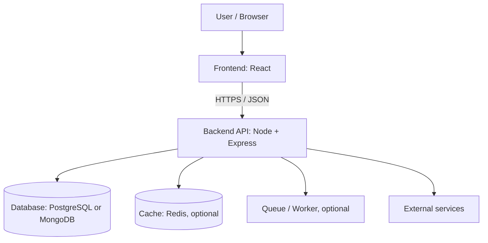

The browser renders the UI. The frontend calls the API. The API validates the request, checks permissions, performs business logic, reads or writes data, and sends a response. A cache, queue, or external service is added only when the use case benefits from it.

**Why separate layers?** Separation makes the system easier to test, secure, maintain, and scale. For a tiny demo, a simple monolith can be enough; complicated architecture is not automatically better.

## Q3. What happens when a user opens a website?

1. The browser resolves the domain using DNS.
2. It creates a network connection; HTTPS normally negotiates TLS.
3. It sends an HTTP request to a server, CDN, or load balancer.
4. The server returns HTML and/or static assets.
5. The browser parses HTML, builds the DOM, parses CSS, builds CSSOM, and renders the page.
6. JavaScript executes, hydrates or mounts the application, and may call APIs.
7. The browser updates the UI when responses or user interactions change state.

**Follow-up:** DNS, TLS, HTTP caching, DOM, hydration, CORS, and API latency are all useful topics to explain more deeply.

## Q4. What is the difference between frontend, backend, and database?

| Layer | Main responsibility | Typical technologies |
|---|---|---|
| Frontend | What users see and interact with | HTML, CSS, JavaScript, React |
| Backend | Rules, authorization, data processing | Node.js, Express, Java, Python |
| Database | Durable data storage and queries | PostgreSQL, MySQL, MongoDB |

The frontend must not be trusted to enforce permissions. The backend must validate and authorize requests, and the database must persist valid state reliably.

## Q5. What is a runtime, library, framework, and platform?

- **Runtime:** Executes code, e.g. Node.js for JavaScript outside the browser.
- **Library:** Your code calls its functions, e.g. date utilities or a validation library.
- **Framework:** Provides conventions and controls more of the application's lifecycle, e.g. Express or React-based frameworks (the exact classification can depend on how the term is used).
- **Platform:** A broader environment providing runtime and services, e.g. a cloud platform.

**Why does the distinction matter?** It helps you understand who controls application flow, what you must configure, and how difficult migration may be.

## Q6. What is the request-response cycle?

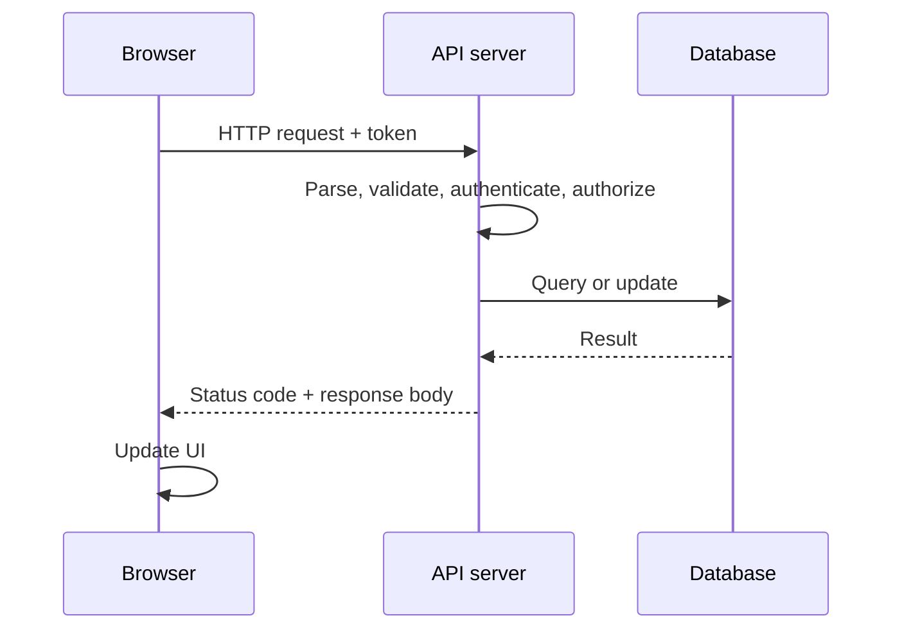

A request should have a clear method, URL, headers, optional body, and authentication context. The response should have a meaningful status code and a predictable shape. Avoid returning stack traces or secrets to the client.

## Q7. What is the difference between synchronous and asynchronous work?

**Synchronous** work completes before the next statement proceeds. **Asynchronous** work allows the program to continue while waiting for an operation such as a network response or file I/O.

```js
console.log("A");
setTimeout(() => console.log("C"), 0);
console.log("B");
// A, B, C
```

The timer callback runs later, even with a zero-millisecond delay. This is not the same as executing JavaScript on multiple threads.

## Q8. What should you clarify before designing a feature?

Ask about the users, core use cases, data volume, latency expectations, security, failure behavior, budget, and operational constraints. Separate **functional requirements** (what the system does) from **non-functional requirements** (how well it does it).

---

# 2. JavaScript: basics to advanced

## Q1. What is JavaScript?

JavaScript is a programming language commonly used in browsers and server environments such as Node.js. The language defines syntax and behavior; the browser or Node.js provides APIs such as the DOM, timers, file system, or networking.

**Why use it?** One language can be used across frontend and backend, its ecosystem is broad, and it supports event-driven applications. **Why not use it for everything?** CPU-heavy, memory-constrained, or specialized workloads may be better served by another language or a native module, depending on the requirements.

## Q2. Difference between `var`, `let`, and `const`?

| Keyword | Scope | Reassignment | Redeclaration in same scope | Typical use |
|---|---|---|---|---|
| `var` | Function-scoped | Yes | Usually allowed | Legacy code; avoid in new code unless needed |
| `let` | Block-scoped | Yes | No | Values that change |
| `const` | Block-scoped | No binding reassignment | No | Default for bindings that should not be reassigned |

`const` does **not** make an object immutable; it prevents rebinding the variable.

```js
const user = { name: "Asha" };
user.name = "Maya";      // allowed
// user = { name: "Dev" }; // TypeError: cannot reassign const binding
```

**Why prefer `const`?** It communicates intent and reduces accidental reassignment. Use `let` when reassignment is required.

## Q3. What are primitive and reference values?

Primitive types include `string`, `number`, `bigint`, `boolean`, `undefined`, `symbol`, and `null`. Objects, arrays, and functions are object values.

```js
let a = 10;
let b = a;
b = 20; // a remains 10

const x = { count: 1 };
const y = x;
y.count = 2; // x.count is now 2; both bindings refer to the same object
```

Technically JavaScript passes values. When the value is an object reference, the copied value refers to the same object.

## Q4. What is the difference between `==` and `===`?

- `==` permits type coercion for many comparisons.
- `===` checks value and type without that coercion.

```js
0 == false;  // true
0 === false; // false
```

Prefer `===` in most application code because it is easier to reason about. Use loose equality only when you intentionally need its coercion behavior and can explain the result.

## Q5. What are truthy and falsy values?

Falsy values include `false`, `0`, `-0`, `0n`, `""`, `null`, `undefined`, and `NaN`. Most other values—including empty arrays and empty objects—are truthy.

```js
if ([]) console.log("runs"); // runs
if ({}) console.log("also runs");
```

Do not confuse “empty” with “falsy.” Use explicit checks when zero, an empty string, or `null` has a meaningful business meaning.

## Q6. What are `null` and `undefined`?

- `undefined` commonly means a value has not been assigned or a property does not exist.
- `null` is commonly used to represent an intentional absence of a value.

The convention matters more than a universal rule. APIs and databases should define their use consistently.

## Q7. What are scope and lexical scope?

Scope determines where a variable can be accessed. JavaScript has global, function, and block scope. **Lexical scope** means access is determined by where functions are written in the source, not where they are called.

```js
function outer() {
  const message = "hello";
  return function inner() {
    return message;
  };
}
console.log(outer()()); // hello
```

## Q8. What is hoisting?

Hoisting describes how declarations are processed before code executes. Function declarations can be called before their position in the source. `var` bindings are initialized to `undefined`; `let` and `const` exist in the scope but cannot be accessed before initialization due to the **temporal dead zone**.

```js
console.log(a); // undefined
var a = 5;

// console.log(b); // ReferenceError
let b = 6;
```

Avoid relying on hoisting for readability; declare variables before using them.

## Q9. What is a closure?

A closure is a function together with access to its surrounding lexical environment. It lets a function retain access to variables after the outer function has finished.

```js
function makeCounter() {
  let count = 0;
  return () => ++count;
}
const next = makeCounter();
next(); // 1
next(); // 2
```

**Why use it?** For private state, callbacks, factories, and function composition. **What to watch for?** Long-lived closures can retain objects in memory; ensure subscriptions, timers, and handlers are cleaned up when no longer needed.

## Q10. What is `this` in JavaScript?

For ordinary functions, `this` is determined mainly by how the function is called. In an object method call, it commonly refers to the object before the dot. An arrow function captures `this` lexically and does not create its own `this`.

```js
const user = {
  name: "Ravi",
  show() { return this.name; },
  arrow: () => this?.name
};
user.show(); // "Ravi"
```

Do not choose an arrow function for a method that depends on a dynamic receiver. Use `.bind()`, `.call()`, or `.apply()` when a regular function needs an explicit receiver.

## Q11. Explain `call`, `apply`, and `bind`.

All can control `this` for ordinary functions:

- `call(thisArg, a, b)`: calls immediately with separate arguments.
- `apply(thisArg, [a, b])`: calls immediately with an array of arguments.
- `bind(thisArg, a)`: returns a new function with a bound receiver and optional preset arguments.

Modern spread syntax often makes `apply` less necessary, but the methods remain useful to understand.

## Q12. What is a prototype?

Objects can inherit properties from another object through their prototype chain. This is JavaScript's underlying inheritance mechanism.

```js
const animal = { speak() { return "sound"; } };
const dog = Object.create(animal);
dog.bark = () => "woof";
dog.speak(); // inherited: "sound"
```

Classes provide a more familiar syntax over JavaScript's prototype-based model. Use composition when inheritance creates a complicated hierarchy.

## Q13. What is the difference between a function declaration, function expression, and arrow function?

```js
function add(a, b) { return a + b; }       // declaration
const subtract = function(a, b) { return a - b; }; // expression
const multiply = (a, b) => a * b;          // arrow
```

Arrow functions have lexical `this`, cannot be called with `new`, and do not have their own `arguments` object. Choose the form that makes the intended behavior clearest.

## Q14. What are higher-order functions?

A higher-order function accepts a function as an argument, returns a function, or both.

```js
const numbers = [1, 2, 3];
const doubled = numbers.map(n => n * 2);
```

`map`, `filter`, `reduce`, and event callbacks are common examples. They make data transformations composable, but a simple loop can be clearer for complex logic.

## Q15. Explain `map`, `filter`, `find`, and `reduce`.

- `map`: transforms each element and returns a new array of the same length.
- `filter`: returns elements matching a condition.
- `find`: returns the first matching element or `undefined`.
- `reduce`: accumulates elements into a single result, which may be an object or array—not just a number.

```js
const values = [1, 2, 3, 4];
values.map(x => x * 2);          // [2, 4, 6, 8]
values.filter(x => x % 2 === 0); // [2, 4]
values.find(x => x > 2);         // 3
values.reduce((sum, x) => sum + x, 0); // 10
```

Provide an initial value to `reduce` when practical, especially for possibly empty arrays.

## Q16. What is destructuring?

Destructuring extracts values from arrays or properties from objects into variables.

```js
const user = { name: "Neha", role: "developer" };
const { name, role } = user;
const [first, second] = [10, 20];
```

It improves readability when extracting known fields. Avoid deeply nested destructuring when it makes code difficult to follow.

## Q17. What is the spread operator versus rest syntax?

Both use `...`, but context determines the meaning.

```js
const copy = { ...original };      // spread: expands values
function sum(...numbers) {         // rest: collects arguments
  return numbers.reduce((a, b) => a + b, 0);
}
```

Object spread is shallow. Nested objects remain shared references unless explicitly copied or transformed.

## Q18. What are shallow and deep copies?

A shallow copy copies only the top-level structure. Nested objects are still shared. A deep copy duplicates nested data according to the copying mechanism's supported types.

```js
const a = { profile: { city: "Pune" } };
const b = { ...a };
b.profile.city = "Mumbai";
console.log(a.profile.city); // "Mumbai"
```

Use `structuredClone()` for supported structured-cloneable values in environments that provide it. Do not use `JSON.parse(JSON.stringify(x))` as a universal deep-copy technique—it loses some types and cannot represent cycles.

## Q19. What are optional chaining and nullish coalescing?

- `obj?.name` safely returns `undefined` when the left side is `null` or `undefined`.
- `value ?? fallback` uses the fallback only if the value is `null` or `undefined`.
- `value || fallback` uses the fallback for any falsy value, including `0` and `""`.

```js
const count = response?.data?.count ?? 0;
```

Use `??` when zero and empty string are valid values.

## Q20. What are promises?

A Promise represents the eventual completion or failure of an asynchronous operation. It has pending, fulfilled, or rejected state.

```js
fetch("/api/users")
  .then(response => {
    if (!response.ok) throw new Error(`HTTP ${response.status}`);
    return response.json();
  })
  .then(users => console.log(users))
  .catch(error => console.error(error));
```

A rejected HTTP response does not automatically reject `fetch`; check `response.ok`. Network failures do reject.

## Q21. Explain `async` and `await`.

An `async` function always returns a Promise. `await` pauses that function's continuation until the awaited Promise settles; it does not block the entire JavaScript thread.

```js
async function getUser(id) {
  const response = await fetch(`/api/users/${id}`);
  if (!response.ok) throw new Error("Could not load user");
  return response.json();
}
```

Use `try/catch` around operations where you can handle errors. Do not silently swallow errors.

## Q22. `Promise.all` vs `Promise.allSettled` vs `Promise.race`?

- `Promise.all`: resolves when all resolve; rejects as soon as one rejects.
- `Promise.allSettled`: waits for all and reports each outcome.
- `Promise.race`: settles with the first settled Promise.
- `Promise.any`: fulfills with the first fulfillment; rejects if all reject.

Use `Promise.all` for independent requests that all must succeed. Use `allSettled` when partial results are useful. `Promise.race` alone does not cancel the losing operations.

## Q23. Explain the event loop, microtasks, and tasks.

JavaScript executes synchronous code on its execution thread. Async APIs arrange work for later. Promise reactions run as microtasks; timers and many events are task/“macrotask” sources. The exact browser and Node.js scheduling details differ.

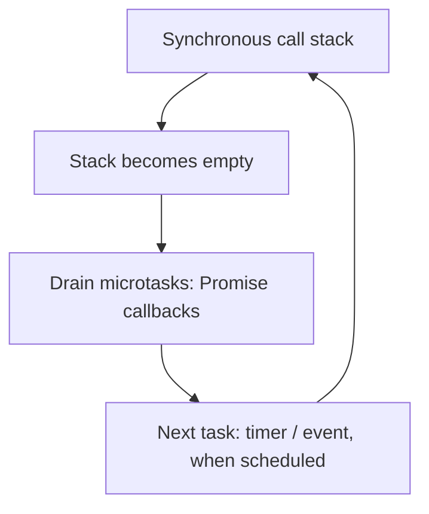

```js
console.log("1");
setTimeout(() => console.log("2"), 0);
Promise.resolve().then(() => console.log("3"));
console.log("4");
// Common browser result: 1, 4, 3, 2
```

Do not use timers as precise clocks. Long synchronous work blocks responsiveness.

## Q24. What is the difference between concurrency and parallelism?

- **Concurrency:** Multiple tasks make progress over overlapping periods.
- **Parallelism:** Multiple tasks execute at the same time, often on multiple CPU cores.

An event loop can handle many concurrent I/O operations without running JavaScript on multiple cores simultaneously. CPU-heavy work may need workers, processes, or another execution strategy.

## Q25. What are ES modules?

ES modules use `import` and `export` and define explicit module boundaries.

```js
// math.js
export const add = (a, b) => a + b;

// app.js
import { add } from "./math.js";
```

Modules improve reuse and separation. Node.js also supports CommonJS (`require`, `module.exports`) and interoperates with ES modules under defined rules. Check your project's module configuration before mixing them.

## Q26. What are `Map`, `Set`, `WeakMap`, and `WeakSet`?

- `Map`: key-value collection; keys can be any value.
- `Set`: collection of unique values.
- `WeakMap`: object keys are weakly held; not enumerable.
- `WeakSet`: weakly held object values; not enumerable.

Use `Map` for frequently changing keyed collections, `Set` for uniqueness, and weak collections for certain object-associated metadata without keeping objects alive solely because of that association. Do not use weak collections when you need to enumerate all entries.

## Q27. What is error handling in JavaScript?

Use exceptions for exceptional failures and return explicit results for ordinary expected cases when suitable. Handle rejected Promises. Add context while preserving the original error.

```js
try {
  const result = await saveRecord();
  return result;
} catch (error) {
  logger.error({ error }, "Saving record failed");
  throw error; // allow a suitable upper layer to handle it
}
```

Do not expose implementation details or sensitive data to users.

## Q28. What is debounce versus throttle?

- **Debounce:** Run after a period without new events. Good for search typing.
- **Throttle:** Limit how frequently work runs. Good for scroll or resize handlers.

```js
function debounce(fn, delay) {
  let timer;
  return (...args) => {
    clearTimeout(timer);
    timer = setTimeout(() => fn(...args), delay);
  };
}
```

Production versions should consider cancellation, `this`, maximum wait, cleanup, and whether the framework already provides an appropriate mechanism.

## Q29. How do you avoid memory leaks in frontend JavaScript?

Remove event listeners, clear timers, cancel or ignore obsolete requests, unsubscribe from stores, close WebSockets when no longer needed, and release references to large objects. In React, effects should return cleanup functions when they establish subscriptions or resources.

## Q30. What is Big O notation?

Big O describes how an algorithm's resource use grows as input size grows, ignoring constant factors for the purpose of asymptotic comparison.

| Complexity | Common example | Intuition |
|---|---|---|
| `O(1)` | Array access by index | Constant number of operations |
| `O(log n)` | Binary search on sorted data | Repeatedly cuts search space |
| `O(n)` | One scan through an array | Work grows with input |
| `O(n log n)` | Typical efficient comparison sorting | Common scalable sort complexity |
| `O(n²)` | Nested scan over all pairs | Growth becomes expensive quickly |

Always include assumptions. A linear scan may beat a theoretically better algorithm on small data, and actual performance depends on constants, memory, and I/O.

---

# 3. TypeScript essentials

## Q1. What is TypeScript, and why use it?

TypeScript adds a static type system to JavaScript and compiles to JavaScript. It catches many mistakes during development and improves editor support and refactoring.

**Why not use it?** For a tiny script, setup may be unnecessary. Types do not validate external data at runtime, and incorrect types can still compile if checks are bypassed or assertions are wrong.

## Q2. `type` versus `interface`?

Both can describe object shapes. Interfaces support declaration merging and are often convenient for extendable object contracts. Type aliases support unions, intersections, primitives, tuples, and other type expressions.

```ts
interface User { id: string; name: string }
type Status = "idle" | "loading" | "success" | "error";
type UserWithStatus = User & { status: Status };
```

Choose a consistent style rather than treating one as universally superior.

## Q3. What are generics?

Generics let a function or type work with multiple types while preserving type relationships.

```ts
function first<T>(items: T[]): T | undefined {
  return items[0];
}
```

Use generics when a reusable abstraction must retain type information. Do not add complicated generics if a simpler concrete type is clearer.

## Q4. What is a union type and a discriminated union?

A union permits one of several types. A discriminated union uses a shared literal property to let TypeScript narrow the case safely.

```ts
type Result<T> =
  | { ok: true; data: T }
  | { ok: false; error: string };

function display(r: Result<string>) {
  if (r.ok) return r.data;
  return r.error;
}
```

This is useful for explicit loading/error/success states because invalid state combinations become harder to represent.

## Q5. Are TypeScript types enough to validate API input?

No. TypeScript types are removed at runtime. Data from a request, file, environment variable, or external service must be validated at runtime using checks or a schema validation library such as Zod.

---

# 4. React: fundamentals to advanced

## Q1. What is React?

React is a JavaScript library for building user interfaces from reusable components. You describe the UI for a given state, and React updates the DOM when that state changes.

**Why use React?** Component reuse, declarative rendering, ecosystem, and state-driven UI. **Why not use it?** For a tiny static page, plain HTML/CSS/JavaScript may be simpler. React also requires decisions about routing, data fetching, forms, build tools, and sometimes server rendering.

## Q2. What is a component?

A component is a reusable unit of UI, commonly written as a function returning JSX.

```jsx
function Welcome({ name }) {
  return <h1>Hello, {name}</h1>;
}
```

Keep components focused. Extract a component when it clarifies responsibility or enables reuse—not just to reduce line count.

## Q3. What is JSX?

JSX is syntax that lets you write markup-like expressions in JavaScript. A build tool transforms it into JavaScript calls understood by React.

Key rules: return one parent expression (a fragment can be used), use `className` rather than HTML's `class`, use camelCase for many DOM properties, and place JavaScript expressions inside `{}`.

## Q4. What are props and state?

- **Props:** Inputs passed by a parent component. A child should not mutate them.
- **State:** Data owned by a component or store that affects rendering.

```jsx
function Counter() {
  const [count, setCount] = React.useState(0);
  return <button onClick={() => setCount(c => c + 1)}>{count}</button>;
}
```

Use state for information that changes over time and should affect UI. Do not duplicate values in state when they can safely be derived from existing props/state.

## Q5. Why should state not be mutated directly?

React relies on updates and identity comparisons to determine when to render. Mutating an existing object can make changes difficult to detect and can affect other code sharing that object.

```jsx
// Avoid:
// user.name = "Mina"; setUser(user);

// Prefer:
setUser(previous => ({ ...previous, name: "Mina" }));
```

For arrays, use methods that return new arrays, such as `map`, `filter`, or spread, rather than mutating the existing state array.

## Q6. What is the Virtual DOM?

It is a conceptual description of UI elements represented as JavaScript objects. React compares the new render result with the previous result and applies necessary changes to the host environment, such as the browser DOM. Do not claim React always performs fewer operations than every direct-DOM alternative; performance depends on the work and implementation.

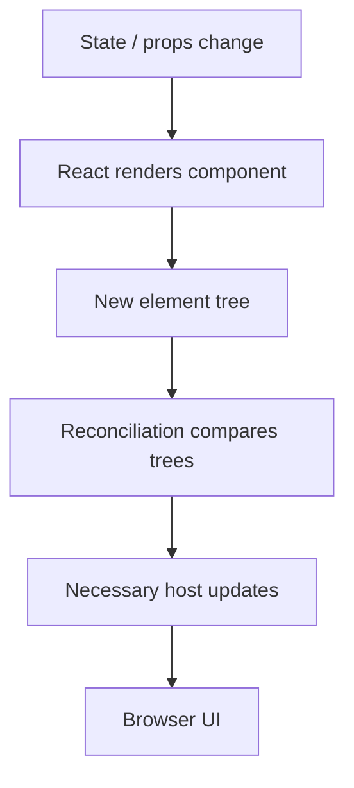

## Q7. What is reconciliation?

Reconciliation is React's process of comparing render results and determining what to update. Element type, tree position, and keys affect identity. If a component changes type or its key changes, React may recreate it and reset local state.

## Q8. Why are keys required in lists?

Keys give React stable identity for sibling elements across changes. Use stable IDs when possible.

```jsx
{users.map(user => <UserRow key={user.id} user={user} />)}
```

Do not use random keys because they change each render and force remounts. Index keys can cause state to attach to the wrong item when rows are inserted, deleted, or reordered. Index keys may be acceptable for truly static lists that never change order or membership.

## Q9. What are Hooks?

Hooks let function components use React features such as state, effects, refs, and context. Call Hooks at the top level of a component or custom Hook—not inside loops, conditions, or nested ordinary functions.

Common Hooks:
- `useState`: local state.
- `useEffect`: synchronize with external systems.
- `useRef`: keep a mutable reference without causing a render.
- `useMemo`: cache a calculated value when useful.
- `useCallback`: cache a function identity when useful.
- `useContext`: read context.
- `useReducer`: manage state transitions with a reducer.

## Q10. Explain `useEffect`.

`useEffect` synchronizes a component with an external system, such as a subscription, timer, or imperative browser API. It is not the default place for every calculation or event handler.

```jsx
useEffect(() => {
  const controller = new AbortController();
  fetch(`/api/users/${id}`, { signal: controller.signal })
    .then(r => { if (!r.ok) throw new Error("Request failed"); return r.json(); })
    .then(setUser)
    .catch(error => {
      if (error.name !== "AbortError") setError(error.message);
    });
  return () => controller.abort();
}, [id]);
```

The dependency list tells React which reactive values the effect uses. Do not silence dependency warnings without understanding them. Effects can run an extra setup/cleanup cycle in development Strict Mode; write effects to tolerate correct cleanup and re-setup.

## Q11. What is the difference between `useEffect` and `useLayoutEffect`?

`useEffect` normally runs after the browser has had a chance to paint. `useLayoutEffect` runs earlier in the commit process and can measure or adjust layout before paint, but it can block painting. Prefer `useEffect`; use layout effects only when visual timing makes it necessary.

## Q12. What is `useRef`?

`useRef` returns an object whose `.current` value persists across renders. Changing it does not itself trigger a render.

Use it for DOM nodes, timer IDs, and mutable values not used to determine displayed UI. Use state when a change should update the UI.

## Q13. `useMemo` versus `useCallback`?

- `useMemo(fn, deps)` caches the result of calling `fn`.
- `useCallback(fn, deps)` caches the function reference.

They are performance tools, not correctness tools. Memoization adds complexity and has a cost; measure before adding it everywhere. A component's memoization is useful only when the surrounding render behavior makes it beneficial.

## Q14. What is `React.memo`?

`React.memo` can skip rendering a component when its props compare equal by default shallow comparison. It may not help if props are freshly created objects/functions on every render or if the child must update for other reasons. Use it where profiling indicates value.

## Q15. What causes a React component to render?

Common reasons include its state changing, its parent rendering, context it uses changing, or an external store subscription reporting a change. A render does not necessarily mean the browser DOM will be changed; reconciliation decides necessary updates.

## Q16. Controlled versus uncontrolled inputs?

A controlled input gets its value from React state. An uncontrolled input keeps its current value in the DOM and is often read through a ref or form APIs.

```jsx
function NameForm() {
  const [name, setName] = React.useState("");
  return <input value={name} onChange={e => setName(e.target.value)} />;
}
```

Controlled inputs are useful for live validation and conditional UI. Uncontrolled inputs can be simpler for basic forms or integrations with native form behavior. Use `defaultValue` for an initial value, not as a continuously controlled value.

## Q17. What is lifting state up?

When multiple sibling components need the same state, move it to their nearest common owner and pass the value and callbacks down. This creates one source of truth. For deeply shared or complex state, context or a state library may be appropriate.

## Q18. What is Context API, and when should it be avoided?

Context shares a value across a component subtree without passing props through every intermediate component. It suits relatively stable cross-cutting data such as theme or authenticated user metadata. If a frequently changing context value is consumed by many components, updates can cause broad re-renders. Split contexts, stabilize values when useful, or use a dedicated store when complexity warrants it.

## Q19. What is `useReducer`?

`useReducer` centralizes state transitions in a reducer function that receives the current state and an action and returns the next state. It helps when transitions are related or complex.

```jsx
function reducer(state, action) {
  switch (action.type) {
    case "increment": return { count: state.count + 1 };
    case "reset": return { count: 0 };
    default: return state;
  }
}
```

A reducer should be pure. Do not perform requests or other side effects inside it.

## Q20. How do you fetch API data in React?

Represent the lifecycle explicitly: loading, success, and error. Cancel or ignore obsolete requests when inputs change. For large applications, a data-fetching library can manage caching, retries, invalidation, and request deduplication more consistently than hand-written effects.

```jsx
const [status, setStatus] = useState("loading");
const [users, setUsers] = useState([]);
const [error, setError] = useState("");
```

Do not fetch secret data only because a component hides it. Authorization belongs on the server.

## Q21. What are client-side routing and server-side routing?

Client-side routing changes which UI is rendered without requiring a full document request for every navigation. Server-side routing processes a URL on the server and returns a response or document. Many applications use both: the server serves the application and APIs, while a frontend router handles in-app navigation.

Ensure the production server returns the app entry page for appropriate client-side routes while still returning correct errors for API routes and missing static assets.

## Q22. What is an Error Boundary?

An Error Boundary catches certain rendering/lifecycle errors in descendant components and displays fallback UI. It does not automatically catch every event-handler error, rejected Promise, or server error. Handle those at their appropriate boundaries.

Use boundaries around UI regions that should fail independently, such as a complex editor panel.

## Q23. What is React Strict Mode?

Strict Mode enables development-time checks that help reveal unsafe patterns. In modern React development, it may re-run certain render/effect setup paths to help expose missing cleanup. It does not make production rendering double in the same way. Fix unsafe side effects rather than removing Strict Mode merely to hide symptoms.

## Q24. What are portals?

Portals render children into a DOM node outside the component's normal DOM hierarchy while retaining React tree behavior. They are useful for modals, tooltips, and overlays that otherwise face stacking or clipping issues.

## Q25. How do you improve React performance?

1. Measure with React DevTools Profiler and browser performance tools.
2. Avoid unnecessary state and expensive repeated calculations.
3. Use stable keys and correct component boundaries.
4. Split large bundles and lazy-load rarely used routes/components.
5. Virtualize very long lists.
6. Avoid excessive context-wide updates.
7. Keep API payloads and image sizes reasonable.
8. Consider `memo`, `useMemo`, and `useCallback` after identifying an actual bottleneck.

Do not assume a memoization hook is always faster.

## Q26. What is code splitting and lazy loading?

Code splitting separates a bundle into smaller chunks. Lazy loading downloads some chunks only when needed, which can improve initial load time. It adds loading states and can make navigation depend on chunk availability.

```jsx
const Settings = React.lazy(() => import("./Settings.jsx"));
```

Render lazy components under a Suspense boundary with a suitable fallback.

## Q27. What are Server Components and server-side rendering?

Server-side rendering (SSR) generates HTML on the server, which can improve first-render content availability and sometimes SEO. Hydration attaches client-side behavior to the returned HTML. React Server Components are a separate model for running components on the server and sending a serialized representation; they are commonly associated with frameworks that support them.

Use SSR when initial content delivery, SEO, or server data access benefits justify its operational complexity. A normal client-rendered SPA can be a good fit for authenticated internal tools.

## Q28. How do you test React components?

Test observable behavior: what users see and do. Use a component testing library, realistic user-event simulation, and assertions on the rendered result. Mock external boundaries such as APIs when appropriate, but keep some integration/end-to-end tests against real systems.

Avoid asserting implementation details such as internal Hook calls unless there is a very specific reason.

## Q29. What is hydration mismatch?

A hydration mismatch occurs when server-rendered HTML differs from the initial client render. Causes include timestamps, random values, locale-dependent output, reading browser-only APIs during server render, or inconsistent data. Make server and first client output deterministic and move browser-only work to appropriate client-side code.

## Q30. React security: is sanitizing input in React enough?

No. React escapes strings rendered as text in common JSX expressions, but this is not a complete security policy. Dangerous HTML insertion, URL handling, third-party scripts, and server-side input all require care. Validate and authorize on the backend; sanitize untrusted HTML with a maintained sanitizer if the product genuinely needs to render HTML.

---

# 5. Node.js and Express

## Q1. What is Node.js?

Node.js is a JavaScript runtime built on the V8 engine and runtime libraries. It is suited to network services, APIs, real-time applications, and I/O-heavy workloads.

**Why use it?** It shares JavaScript with the frontend, has a broad ecosystem, and handles many simultaneous I/O operations efficiently. **When not ideal?** CPU-heavy synchronous work can block the event loop. Use worker threads, separate worker processes, native computation, or another service where appropriate.

## Q2. Is Node.js single-threaded?

JavaScript execution in a typical Node.js event-loop thread is single-threaded, but Node.js also uses system facilities and a libuv thread pool for some operations, and it supports Worker Threads and multiple processes. Saying “Node.js is entirely single-threaded” is too simplistic.

## Q3. Explain the Node.js event loop.

The event loop lets Node.js coordinate callbacks for timers, I/O, and other asynchronous work. This allows a process to manage many concurrent connections without creating one JavaScript thread per connection. A long synchronous callback blocks the event loop and delays other work.

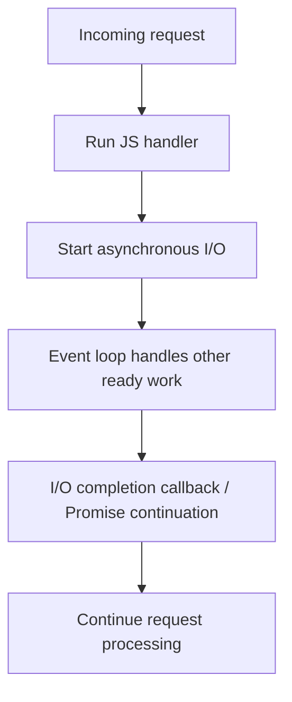

Exact phases and scheduling behavior are more nuanced; understand the high-level model first.

## Q4. What is blocking versus non-blocking I/O?

Blocking I/O waits for an operation to finish before the current thread can proceed. Non-blocking/asynchronous I/O lets the application do other work while the operation is in progress.

Avoid synchronous filesystem calls in request handlers for normal server workloads unless there is a specific reason, such as startup code where blocking is acceptable.

## Q5. What is Express middleware?

Middleware runs during request processing and can inspect or modify the request/response, end the response, or pass control onward.

```js
app.use(express.json());
app.use((req, res, next) => {
  console.log(req.method, req.path);
  next();
});
```

Middleware order matters. Authentication should run before protected routes; error middleware should be placed after routes. Never call `next()` after already sending a completed response unless the flow is specifically designed for it.

## Q6. How do you structure an Express application?

A common structure is:

```text
src/
  app.js              # Configure Express, middleware, routes
  server.js           # Start listening and shutdown handling
  routes/             # URL-to-controller mapping
  controllers/        # HTTP request/response concerns
  services/           # Business rules
  repositories/       # Database access
  middleware/         # Auth, validation, error handling
  config/             # Environment/configuration
  tests/
```

This is a convention, not a mandatory structure. Small apps can start simpler. Avoid adding layers that only forward arguments without providing meaningful separation.

## Q7. What is the difference between controller, service, and repository?

- **Controller:** Understands HTTP request/response.
- **Service:** Contains business rules and coordinates work.
- **Repository:** Encapsulates persistence operations.

The separation makes business rules easier to test without an HTTP server. For a small endpoint, these concepts can be kept together until separation improves clarity.

## Q8. How do you handle errors in Express?

Create a consistent error-handling strategy. Validate input early, use a known application error type where useful, and centralize safe HTTP responses. In Express, error middleware has four parameters: `(err, req, res, next)`.

```js
app.use((err, req, res, next) => {
  req.log?.error({ err }, "Request failed");
  if (res.headersSent) return next(err);
  res.status(err.statusCode || 500).json({
    error: err.publicMessage || "Internal server error"
  });
});
```

Log useful diagnostics privately; return no stack traces, credentials, SQL, or internal paths to untrusted clients.

## Q9. What are streams and why use them?

Streams process data incrementally rather than requiring the entire payload in memory. Common types are readable, writable, duplex, and transform streams.

**Use them for:** large file uploads/downloads, video, logs, compression, and piping process output. **Do not use them automatically:** small JSON responses are usually simpler with normal response objects.

```js
import { createReadStream } from "node:fs";
import { pipeline } from "node:stream/promises";

// Example for a controlled, already-authorized file path:
await pipeline(createReadStream(filePath), res);
```

Production code must safely resolve and authorize `filePath`; never let untrusted input directly select arbitrary filesystem paths.

## Q10. What are buffers?

A `Buffer` represents a sequence of bytes and is useful for binary data. Text must be encoded/decoded with the appropriate encoding. Avoid converting very large binary payloads into strings without a reason.

## Q11. What is the difference between `process.nextTick`, Promise microtasks, `setImmediate`, and `setTimeout`?

They schedule work in different queues or event-loop phases in Node.js. `process.nextTick` has special high-priority behavior and recursive overuse can starve I/O. Promise reactions are microtasks. `setImmediate` and timers have different scheduling behavior that depends on context. Avoid choosing one based on assumptions like “zero-delay means immediately.”

## Q12. How do you manage environment variables?

Read configuration from the environment and validate required values at startup. Keep secrets out of source control. Provide `.env.example` with placeholders, not real credentials. In production, use the platform's secret/configuration store.

```js
if (!process.env.DATABASE_URL) {
  throw new Error("DATABASE_URL is required");
}
```

## Q13. What is CORS?

Cross-Origin Resource Sharing is a browser-enforced mechanism in which the server uses response headers to declare which origins may read responses. CORS is not authentication and does not block all non-browser clients.

Allow only intended origins in production. If credentials are used, configure credential support and explicit allowed origins instead of a wildcard origin.

## Q14. What is authentication versus authorization?

- **Authentication:** Who are you?
- **Authorization:** What are you allowed to do?

After verifying identity, still check permissions for the requested resource and action. A valid JWT does not automatically mean the user can access every project ID.

## Q15. What is a JWT?

A JSON Web Token is a compact token format, commonly signed, carrying claims such as a subject and expiry. A signed JWT is usually readable by whoever possesses it; signing is not encryption.

Validate signature, accepted algorithm, issuer/audience when configured, expiry, and relevant claims. Keep access tokens short-lived when appropriate and have a revocation/refresh strategy. Do not place passwords or sensitive secrets in token payloads.

## Q16. How should passwords be stored?

Never store plaintext passwords or use a fast general-purpose hash like plain SHA-256. Use a password-hashing algorithm designed to resist guessing, such as Argon2id or bcrypt, with suitable parameters and salts. Rate-limit login attempts and protect password-reset flows.

## Q17. What is the difference between a process and a thread?

A process has its own execution environment and resources. Threads execute within a process and may share memory. Multiple Node.js processes can use multiple CPU cores and provide process-level isolation; worker threads can help with CPU-intensive JavaScript while sharing a process.

## Q18. How do you scale a Node.js backend?

Start by measuring. Common options include more instances behind a load balancer, a stateless application layer, caching, database indexing, pagination, connection pooling, background workers, and horizontal partitioning when necessary. If sessions are only stored in one process's memory, scaling to multiple instances creates consistency problems; use a shared session store or a token-based design with appropriate trade-offs.

## Q19. What are background jobs and queues?

A background job moves work out of the request-response path. A queue buffers jobs so workers can process them asynchronously. This is useful for emails, image processing, reports, retries, and other slow work.

Design for duplicate delivery and retries: jobs should often be idempotent, failures should be observable, and poison messages should not retry forever.

## Q20. How do you shut down a Node.js server gracefully?

When receiving a shutdown signal, stop accepting new requests, allow in-flight requests to finish within a timeout, close database and queue connections, stop workers, and exit. If the grace period expires, terminate safely and rely on durable state/retry mechanisms.

## Q21. What is the Node.js module system?

CommonJS uses `require()` and `module.exports`; ES modules use `import` and `export`. Both can be valid. Follow one consistent module style where practical and understand the project's `package.json` configuration and file extensions.

## Q22. What is an event emitter?

An event emitter lets code subscribe to named events and notify listeners. It can decouple components, but uncontrolled listeners can create memory leaks or make control flow hard to follow. Remove listeners when their lifetime ends and avoid using events when a direct function call is simpler.

---

# 6. Databases: SQL, MongoDB, and Redis

## Q1. What is a database?

A database stores data and provides mechanisms to query, update, protect, and recover it. A DBMS controls access and enforces capabilities such as transactions, constraints, indexes, and backup/restore.

Choose a database based on data relationships, query patterns, consistency needs, scale, team expertise, and operational cost—not popularity alone.

## Q2. SQL vs NoSQL?

| Topic | Relational SQL database | Document/NoSQL database |
|---|---|---|
| Data model | Tables, rows, relationships | Often documents, key-value, graph, or wide-column structures |
| Schema | Usually explicit schema and constraints | Often flexible, depending on the database |
| Relationships | Joins and relational constraints are central | May embed, reference, or use database-specific relationship features |
| Transactions | Strong transactional features are common | Capabilities vary; many support transactions with different trade-offs |
| Best fit | Structured relationships, reports, integrity | Document-shaped data or access patterns that benefit from the model |

SQL is not only for small systems, and NoSQL is not automatically more scalable. PostgreSQL can scale well; MongoDB can handle relational patterns too, but model choice affects complexity and performance.

## Q3. What is a primary key and foreign key?

A primary key uniquely identifies a row. A foreign key links a row to a row in another table (or the same table) and can enforce referential integrity.

```sql
CREATE TABLE users (
  id BIGSERIAL PRIMARY KEY,
  email TEXT NOT NULL UNIQUE
);

CREATE TABLE orders (
  id BIGSERIAL PRIMARY KEY,
  user_id BIGINT NOT NULL REFERENCES users(id)
);
```

Use constraints to protect data even if multiple API handlers or workers write to the database.

## Q4. What are normalization and denormalization?

Normalization organizes relational data to reduce unnecessary duplication and update anomalies. Denormalization duplicates or precomputes data to make particular reads faster or simpler, at the cost of consistency maintenance and storage.

Normalize first when relationships and correctness matter. Denormalize after measuring a real need and defining how duplicated data stays synchronized.

## Q5. Explain ACID properties.

- **Atomicity:** A transaction happens all together or not at all.
- **Consistency:** Constraints and rules remain satisfied across committed transactions.
- **Isolation:** Concurrent transactions have defined visibility/interaction guarantees.
- **Durability:** Committed results survive the failures promised by the system.

ACID properties do not remove the need to understand isolation levels, retries, deadlocks, or application-level invariants.

## Q6. What is a transaction?

A transaction groups operations into one logical unit. If a bank transfer debits one account and credits another, both changes should commit or roll back together. Do not make a transaction longer than necessary; long transactions can lock resources and reduce throughput.

## Q7. What are indexes?

An index is an auxiliary data structure that helps the database find rows without scanning the entire table for many queries. It can improve reads and ordering, but consumes storage and adds overhead to inserts, updates, and deletes.

Index the columns used by important filters, joins, and orderings based on query plans and real workloads. Avoid indexing every column automatically.

## Q8. Why might an index not be used?

Possible reasons include low selectivity, small table size, a function/cast that prevents use of a normal index, mismatched composite-index column order, stale statistics, or the optimizer estimating that a table scan is cheaper. Use `EXPLAIN` (and database-specific analysis tools) instead of guessing.

## Q9. What is a composite index?

A composite index covers multiple columns. Column order matters because the database can often use a leftmost prefix of the index effectively.

For a query filtering by `tenant_id` and sorting by `created_at`, an index such as `(tenant_id, created_at)` may be useful. Confirm with real queries and `EXPLAIN`.

## Q10. What is a join?

A join combines related rows from tables.

```sql
SELECT users.name, orders.id
FROM users
JOIN orders ON orders.user_id = users.id;
```

- `INNER JOIN`: only matching rows.
- `LEFT JOIN`: all left rows, plus matches from the right or NULLs.
- `RIGHT JOIN`: equivalent idea in the opposite direction; many teams prefer rewriting as a left join.
- `FULL OUTER JOIN`: all rows from both sides with matches where available, where supported.

Choose the join based on the result you need, not simply because one is faster by name.

## Q11. What is the N+1 query problem?

A common pattern first loads N parent records, then runs another query for each parent. That causes many database round trips. Fix it with joins, batch queries, eager loading, or a data-loader pattern where appropriate. Avoid blindly joining huge related datasets if it multiplies rows or transfers too much data.

## Q12. What is pagination? Offset vs cursor pagination?

Offset pagination uses `LIMIT` and `OFFSET`; it is simple but can become slow for large offsets and may show duplicates/missing rows when data changes. Cursor pagination uses an ordered cursor (often an ID or timestamp-plus-ID), which generally works better for large or changing datasets.

Stable ordering is essential. Cursor values should correspond to a deterministic sort order.

## Q13. What is MongoDB?

MongoDB is a document-oriented database that stores BSON documents in collections. Documents can naturally represent nested entities, but data modeling still matters. Flexible schema does not mean “no design.” Validate document structure and control unbounded arrays or uncontrolled duplication.

## Q14. Embed or reference documents in MongoDB?

- **Embed:** Data is commonly read together, bounded in size, and benefits from single-document updates.
- **Reference:** Data is shared among many records, grows independently, or needs separate lifecycle/querying.

For example, a small address object may be embedded in a user. A large, separately managed order history is often modeled separately. Choose based on reads, writes, growth, and consistency needs.

## Q15. What is a MongoDB aggregation pipeline?

It processes documents through stages such as `$match`, `$project`, `$group`, `$sort`, and `$lookup`.

```js
db.orders.aggregate([
  { $match: { status: "paid" } },
  { $group: { _id: "$userId", total: { $sum: "$amount" } } },
  { $sort: { total: -1 } }
]);
```

Put selective matches early when appropriate, index useful fields, and inspect query plans for expensive pipelines.

## Q16. What is Redis?

Redis is an in-memory data store often used for caching, ephemeral state, rate limiting, queues/streams, and coordination patterns. It can persist data depending on configuration, but it is not automatically a replacement for the main database.

Use a cache when repeated reads are expensive and stale data is acceptable under a defined policy. Think through cache invalidation, eviction, stampedes, and what happens when Redis is unavailable.

## Q17. What is caching?

Caching keeps a reusable copy of data closer to where it is needed. It can reduce latency and database load, but adds freshness and invalidation problems.

Common cache levels include browser, CDN, application memory, Redis, and database buffer caches. Set clear expiry/invalidation rules and avoid caching user-specific private responses publicly.

## Q18. What is optimistic locking?

Optimistic locking detects conflicting changes rather than locking data from the beginning. A record can include a version number; updates succeed only if the version has not changed. This works well when conflicts are uncommon and clients can handle retry/conflict responses.

## Q19. What is a database migration?

A migration changes schema or data in a controlled, versioned way. A safe production migration considers old and new application versions, locks, duration, rollback options, and data backfills. Large changes often use an expand-migrate-contract process rather than a single breaking deployment.

## Q20. What are connection pools?

A pool reuses database connections instead of opening a new one for every request. Too few connections can cause waiting; too many can overwhelm the database. Size pools across *all* application instances, and respect the database's connection limits.

## Q21. What are replication and sharding?

- **Replication:** Maintains copies of data, often to improve availability or read capacity. Replicas can lag.
- **Sharding/partitioning across nodes:** Splits data across multiple nodes. It can increase capacity but adds routing, rebalancing, query, and operational complexity.

Use indexes, query optimization, caching, and vertical scaling first when they solve the problem. Sharding is not a first step for most small applications.

---

# 7. HTTP, REST APIs, authentication, and real-time communication

## Q1. What is an API?

An API is a defined way for software components to communicate. A web API commonly accepts HTTP requests and returns structured responses, often JSON.

A good API has predictable resource names, validation, authorization, status codes, error shapes, pagination, and versioning/compatibility policies where needed.

## Q2. What is REST?

REST is an architectural style based on constraints such as resource-oriented interactions, stateless requests, cacheability where appropriate, and a uniform interface. In practice, “REST API” often means an HTTP API organized around resources and HTTP methods.

```http
GET    /api/users/42
POST   /api/users
PATCH  /api/users/42
DELETE /api/users/42
```

Do not use a route name alone as a security control; authorize every operation.

## Q3. Explain common HTTP methods.

- `GET`: Retrieve a representation; should not change application state in the intended business sense.
- `POST`: Submit data or request processing; not inherently idempotent.
- `PUT`: Replace a resource representation; designed to be idempotent.
- `PATCH`: Partially modify a resource.
- `DELETE`: Delete a resource; idempotence depends on resource semantics but repeating the same delete typically leaves it absent.
- `OPTIONS`: Discover communication options; used by CORS preflight.

Idempotent means repeating the same request has the same intended effect, not that every response must be byte-for-byte identical.

## Q4. What are common HTTP status codes?

| Code | Meaning | Example |
|---|---|---|
| `200` | OK | Successful read/update response |
| `201` | Created | New resource created |
| `202` | Accepted | Work accepted for asynchronous processing |
| `204` | No Content | Successful response with no body |
| `400` | Bad Request | Malformed input |
| `401` | Unauthenticated/invalid credentials | Missing or invalid token |
| `403` | Forbidden | Authenticated user lacks permission |
| `404` | Not Found | Resource absent or intentionally concealed |
| `409` | Conflict | Version conflict or duplicate business resource |
| `422` | Unprocessable Content | Semantically invalid input, if the API uses this distinction |
| `429` | Too Many Requests | Rate limit reached |
| `500` | Internal Server Error | Unexpected server failure |
| `502/503/504` | Gateway/service availability/time-out failures | Upstream or temporary service problem |

Use a consistent convention. Do not return `200` for every outcome.

## Q5. What are idempotency keys?

An idempotency key lets a client safely retry certain operations, such as creating a payment or job, without performing the side effect twice. The server stores the key and associated result under a defined scope and time policy. A key is not sufficient unless the server enforces it atomically.

## Q6. What is API validation?

Validation checks input shape and business constraints before the data reaches core logic. Validate parameters, body, query, content types, lengths, allowed values, and cross-field rules. Validate again where needed at domain/database boundaries. Never assume browser-side validation protects the server.

## Q7. What is API pagination?

Pagination returns a bounded amount of data per response. Include a limit, stable sorting, and either offset or cursor information. Set a maximum limit to prevent huge responses. Return enough metadata for the client to request the next page.

## Q8. How should API errors be designed?

Use a stable error shape with a machine-readable code, a safe human-readable message, and optional field errors or a correlation ID.

```json
{
  "error": {
    "code": "VALIDATION_ERROR",
    "message": "Please check the submitted fields.",
    "fields": { "email": "Enter a valid email address." }
  }
}
```

Keep internal stack traces and secrets in protected logs, not the response.

## Q9. JWT versus sessions?

| Session | JWT |
|---|---|
| Server stores session state; client carries an opaque session ID | Client carries a signed token with claims |
| Easy central invalidation when server/session store is available | Often convenient for distributed APIs, but revocation needs design |
| Requires a session store or shared state across servers | Requires strict signature/claim validation and token lifecycle design |
| Session cookie can be `HttpOnly`, `Secure`, and `SameSite` | Storage location creates different exposure risks; cookies also have CSRF considerations |

Neither is universally safer. Choose based on revocation requirements, client types, infrastructure, and threat model. A JWT is not encrypted just because it is signed.

## Q10. What is OAuth 2.0 and OpenID Connect?

OAuth 2.0 is an authorization framework that allows an application to obtain limited access through tokens. OpenID Connect adds an identity layer for authentication. Do not describe OAuth by itself as simply “logging in.” Use a maintained provider/library and the correct authorization flow for the client, commonly Authorization Code with PKCE for public clients.

## Q11. What is CSRF?

Cross-Site Request Forgery tricks a browser into sending an authenticated request to a site where the user has a session. Cookie-based authentication needs defenses appropriate to the app, such as SameSite cookie policy and CSRF tokens or origin checks for sensitive operations. `HttpOnly` prevents JavaScript from reading a cookie; it does not itself prevent CSRF.

## Q12. What is CORS preflight?

For certain cross-origin requests, the browser sends an `OPTIONS` request to ask whether the real request is permitted. The server responds with relevant `Access-Control-Allow-*` headers. CORS is browser policy, not a replacement for authentication, authorization, or CSRF protection.

## Q13. What is rate limiting?

Rate limiting restricts request rates by a key such as account, IP, or token. It protects against abuse and accidental overload. In multi-instance deployments, use shared state or a gateway-level solution when limits must be consistent across instances. Be careful with proxies so clients cannot spoof IP information.

## Q14. What is WebSocket?

WebSocket provides a persistent two-way connection between a client and server, useful for chat, collaborative editing, live notifications, and terminal streams.

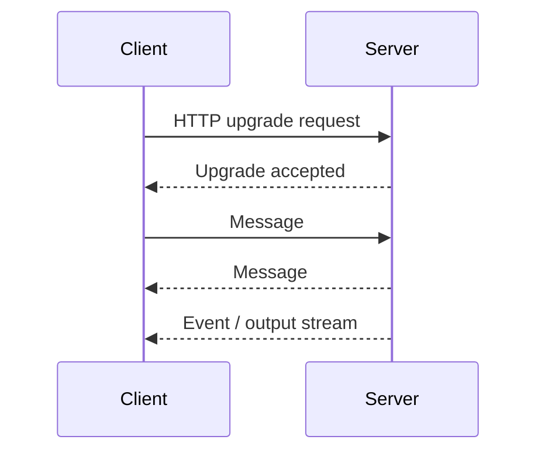

It needs authentication, message validation, authorization, reconnect handling, heartbeat/timeout policy, backpressure, and cleanup. REST is usually simpler for one-off requests.

## Q15. Server-Sent Events vs WebSocket?

- **Server-Sent Events (SSE):** Simple one-way server-to-client event stream over HTTP; client-to-server actions use separate HTTP requests.
- **WebSocket:** Two-way real-time messaging.

Use SSE for one-way updates when its constraints fit. Use WebSocket for collaborative editing or terminals that require frequent client-to-server and server-to-client data.

## Q16. REST vs GraphQL?

REST exposes resource-oriented endpoints. GraphQL lets clients request a shaped selection of fields through a schema and query language. GraphQL can reduce over-fetching for complex clients but adds schema, authorization, query-cost, caching, and tooling considerations. REST is often simpler for standard CRUD APIs. Neither is universally faster.

## Q17. What is API versioning?

Versioning manages incompatible contract changes. Options include URL versions (`/v1`), headers, or compatible additive changes. Prefer backward-compatible evolution where possible. Avoid breaking all clients just to rename a field when a deprecation path can work.

## Q18. What are webhooks?

A webhook is an HTTP callback sent by one system to another when an event occurs. Verify signatures, reject replays where appropriate, handle retries and duplicate delivery, respond quickly, and process heavy work asynchronously. Expect deliveries to be at-least-once unless the provider states otherwise.

## Q19. What is OpenAPI?

OpenAPI is a standard way to describe HTTP APIs, including paths, methods, parameters, schemas, responses, and security. It supports documentation, client generation, and contract testing. Keep the spec aligned with actual behavior.

## Q20. What is content negotiation?

Content negotiation lets client and server agree on representation details using headers such as `Accept` and `Content-Type`. `Content-Type` describes the request or response body format; `Accept` expresses which response formats the client can handle.

---

# 8. System design and architecture

## Q1. How do you approach a system design interview?

Follow a repeatable process:

1. Clarify users and functional requirements.
2. Identify non-functional requirements: latency, availability, consistency, privacy, scale, budget.
3. Estimate rough traffic and storage if useful.
4. Design APIs and data model.
5. Draw the high-level components and request flow.
6. Identify bottlenecks and failure modes.
7. Discuss trade-offs and evolution.

Do not start with microservices or a database choice before understanding the requirements.

## Q2. Monolith vs microservices?

- **Monolith:** One deployable application, potentially with well-separated internal modules.
- **Microservices:** Multiple independently deployable services communicating over network boundaries.

A modular monolith is often best early because it is simpler to test, deploy, and operate. Microservices can help independent scaling and team ownership, but add network failure, observability, deployment, versioning, and data-consistency complexity.

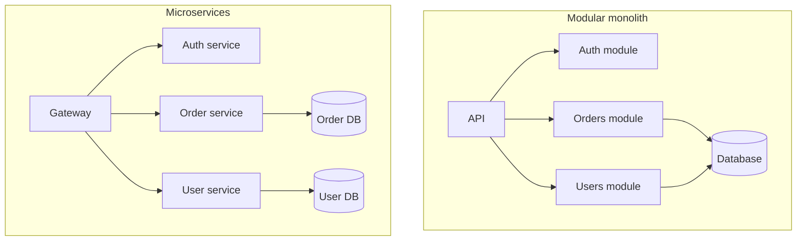

Choose microservices when independent deployment/team boundaries or scaling needs justify operating multiple services—not as a résumé decoration.

## Q3. What is horizontal vs vertical scaling?

- **Vertical scaling:** Give one machine more CPU/RAM/resources.
- **Horizontal scaling:** Add more instances and distribute traffic.

Vertical scaling is simpler up to hardware limits. Horizontal scaling improves capacity and can improve availability but needs load balancing, shared state, health checks, and careful data consistency.

## Q4. What is a load balancer?

A load balancer distributes requests among healthy backend instances according to configured rules. It can support health checks, TLS termination, routing, and failover. It does not by itself make an application stateless or fix slow database queries.

## Q5. What is a CDN?

A Content Delivery Network caches and serves eligible assets from locations closer to users. It is useful for images, CSS, JS, fonts, and cacheable public content. Configure cache headers carefully; private user-specific content must not be accidentally shared through a public cache.

## Q6. What are caching strategies?

- **Cache-aside:** Application checks cache, loads from DB on miss, then stores result.
- **Write-through:** Write updates cache and backing store according to a defined strategy.
- **Write-behind:** Acknowledge cache updates before asynchronous persistence; it introduces data-loss risk if poorly designed.
- **Read-through:** Cache abstraction loads missing data for the caller.

Cache-aside is common because it is straightforward. Every strategy needs invalidation, expiry, stampede protection, and a plan for cache failure.

## Q7. What is eventual consistency?

Eventual consistency means replicas or derived views may temporarily differ but converge if updates stop and processing succeeds. It can improve availability and throughput, but users may read slightly stale data. Use stronger consistency where the business invariant requires it, such as certain financial operations.

## Q8. What is a message queue?

A queue decouples request handling from slower work. Producers publish messages, consumers process them, and the queue supports buffering and retry policies. It helps smooth spikes, but adds delay, monitoring, duplicate processing, and dead-letter handling.

## Q9. Explain the CAP theorem simply.

During a network partition, a distributed data system must trade off between strong consistency and availability for the affected operation. CAP is not the claim that every system can only ever have two of three properties in every situation; the trade-off becomes important when partitions occur.

## Q10. What is a circuit breaker?

A circuit breaker stops repeatedly calling a failing dependency. It can have closed (normal), open (reject calls), and half-open (test recovery) states. It prevents cascading failure but requires sensible timeouts, thresholds, and fallback behavior. A circuit breaker does not replace request timeouts.

## Q11. What are timeouts, retries, and backoff?

- **Timeout:** Stop waiting past a defined duration.
- **Retry:** Attempt an operation again after a retryable failure.
- **Exponential backoff:** Increase wait duration between attempts, often with jitter to avoid synchronized retry storms.

Retry only when safe. Retrying a non-idempotent payment request without idempotency controls can charge twice.

## Q12. How would you design a URL shortener?

Requirements: accept a long URL, generate a short ID, redirect users, optionally provide analytics and expiration.

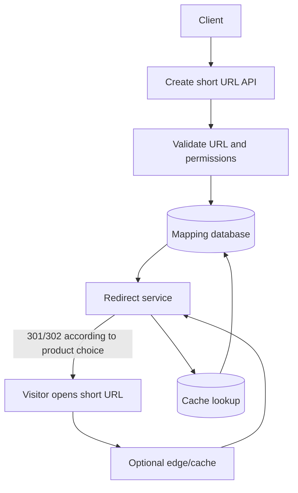

Use collision-resistant ID generation or a unique constraint with retry; validate schemes and abuse. Cache popular mappings. Choose redirect status based on whether behavior should be temporary/permanent and how clients cache it. Analytics can be asynchronous so redirect latency stays low.

## Q13. How would you design a chat application?

Core components: authentication, conversations, message persistence, WebSocket gateway, online presence, notifications, and history pagination.

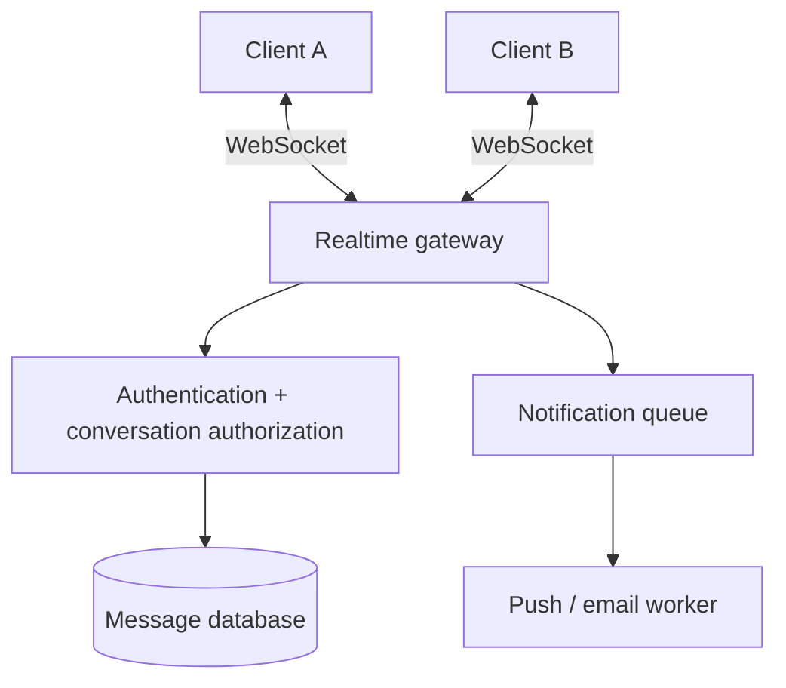

Messages should have IDs, conversation IDs, sender IDs, timestamps, and delivery/read state if required. Plan reconnection, message ordering, duplicate delivery, offline recipients, pagination, abuse prevention, and retention. WebSocket presence alone is not durable message storage.

## Q14. How would you design notifications?

Store notification/event state as required, enqueue delivery work, process through workers, retry transient failures, and track outcomes. Use idempotency to avoid duplicate notifications. Separate in-app notification persistence from email/push delivery where their guarantees differ.

## Q15. How would you design file uploads?

A robust design commonly has the client request an upload authorization, send the file to object storage via a presigned URL or controlled upload endpoint, and notify the backend to verify metadata and permissions. Validate file size/type, generate safe object keys, scan where required, and serve private files through authorized routes or signed URLs.

Avoid sending huge files through every application server if object storage can accept uploads directly. However, direct upload requires correct signing, CORS, access controls, and post-upload validation.

## Q16. How would you design a live coding collaboration tool?

Core components: project/auth service, persisted files, collaborative editing protocol, terminal/workspace service, language/build runtime, preview proxy, and permission checks.

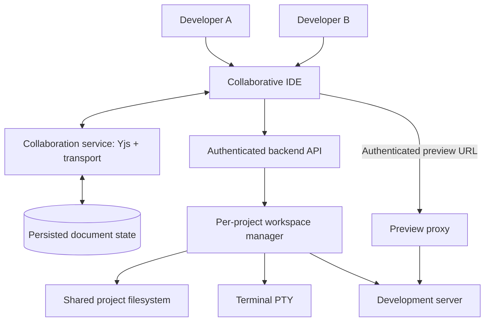

Key issues are project isolation, file sync, conflict behavior, terminal session ownership, workspace lifecycle, preview access, resource limits, secrets, and recovery after disconnect. A successful code editor does not automatically imply the filesystem and running application are synchronized.

## Q17. What is multi-tenancy?

Multi-tenancy means one service serves multiple customers/organizations while keeping their data and resources correctly separated. Isolation may be implemented with tenant IDs, separate schemas/databases, separate containers, or a combination. Every access path must check tenant/project membership; relying on frontend hiding is not security.

## Q18. What is a single point of failure?

A component whose failure takes down the whole service is a single point of failure. Examples may include one unreplicated database, one proxy, or a single region. Mitigation depends on cost and required availability: redundancy, backups, failover, and recovery testing are common methods.

## Q19. What is observability?

Observability uses logs, metrics, and traces to understand system behavior.

- Logs explain events.
- Metrics show numeric behavior over time, such as latency/error rate.
- Traces show a request's path through multiple components.

Use request/correlation IDs, structured logs, latency percentiles, error rates, resource metrics, and alerts. Do not log secrets or personal data unnecessarily.

## Q20. What is SLI, SLO, and SLA?

- **SLI:** A measured indicator, such as successful request percentage or p95 latency.
- **SLO:** An internal target for that indicator over a defined window.
- **SLA:** An agreement with consequences or commitments, often contractual.

Set indicators around user experience, not only CPU usage. For example, “preview becomes ready within a target time” may be more meaningful than “container started.”

---

# 9. Security

## Q1. What is the principle of least privilege?

Give each user, service, and component only the permissions needed to perform its task. A user who can view a project may not be allowed to delete it, execute arbitrary commands, or read another team's files.

## Q2. What is SQL injection?

SQL injection occurs when untrusted input is interpreted as SQL syntax. Use parameterized queries or ORM parameterization and avoid string-building SQL from user input.

```js
// Prefer parameterized queries; example API varies by database library:
await db.query("SELECT * FROM users WHERE email = $1", [email]);
```

ORMs do not make every raw query safe automatically. Validate input and apply authorization too.

## Q3. What is XSS?

Cross-Site Scripting occurs when untrusted content executes as script in a user's browser. Prevent it through contextual output escaping, safe DOM APIs, carefully sanitized HTML where required, secure dependency practices, and Content Security Policy as an additional layer.

## Q4. What is CSRF and when does it matter?

CSRF targets automatically attached browser credentials, commonly cookies. Use SameSite cookies where compatible, CSRF tokens or robust origin checks for sensitive state changes, and appropriate content types. Bearer tokens kept only in an Authorization header have a different CSRF profile but can introduce token-theft risks if stored insecurely.

## Q5. What is SSRF?

Server-Side Request Forgery tricks a server into making requests to destinations selected by an attacker. If users can supply URLs for imports, previews, webhooks, or URL fetches, restrict destinations, block internal/metadata IP ranges where appropriate, validate redirects and DNS results, and enforce egress/network controls.

## Q6. How do you secure file uploads?

Limit size, validate the actual file content rather than trusting an extension alone, generate safe filenames, restrict storage and permissions, prevent path traversal, scan files if required, avoid executing uploads, and authorize download access.

## Q7. How do you secure Docker-based code execution?

Treat project code as untrusted. Use isolated containers, non-root users, CPU/memory/process limits, restricted capabilities, controlled filesystem mounts, network egress rules, timeouts, and strict authorization. Never expose the Docker daemon to untrusted clients. A container is an isolation layer, not a magical guarantee against every attack.

## Q8. How should secrets be handled?

Store secrets in environment/secret management systems, restrict who can read them, rotate compromised credentials, never commit real `.env` files, and avoid logging secrets. If a secret is accidentally exposed, removing it from the code is not enough: revoke or rotate it.

## Q9. What security headers are useful?

Common headers include Content-Security-Policy, Strict-Transport-Security (over HTTPS), X-Content-Type-Options, and suitable Referrer-Policy. Configure them for the application's actual behavior; a strict CSP may require nonce/hash design for scripts.

## Q10. Why is rate limiting not enough to stop abuse?

Requests may be distributed across IPs, use stolen accounts, or abuse expensive legitimate operations. Combine rate limits with authentication, quotas, authorization, input validation, bot/abuse detection, concurrency limits, cost budgets, and monitoring.

---

# 10. Testing and code quality

## Q1. Unit vs integration vs end-to-end tests?

- **Unit test:** Tests a small unit in isolation.
- **Integration test:** Tests multiple components working together, such as API plus database.
- **End-to-end (E2E):** Tests a user workflow through the real application boundaries, often using a browser.

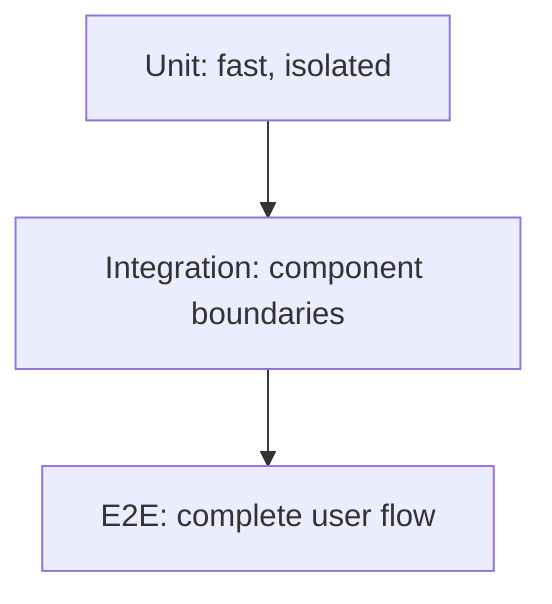

A healthy test strategy usually contains many focused unit tests, integration tests for important boundaries, and E2E tests for critical workflows. Mocks alone cannot prove real infrastructure works.

## Q2. What is mocking?

Mocking replaces a dependency with a controlled test double. It allows tests to simulate errors and edge cases without contacting a real service. Too much mocking can hide incorrect assumptions about the real API, so keep contract/integration coverage too.

## Q3. What is test-driven development?

TDD is a cycle: write a failing test, implement enough to pass, then refactor while tests remain green. It can clarify expected behavior and protect regressions; it requires good test boundaries and is not a substitute for exploratory testing.

## Q4. What should you test in an API?

Test success, validation errors, authentication, authorization, missing resources, conflict conditions, rate limits, database failures, pagination, and retry/idempotency behavior where relevant. Verify status codes and response contracts, not merely that a request did not crash.

## Q5. How do you test async behavior?

Await the returned Promise, assert the expected result, and ensure timers/subscriptions are cleaned up. Avoid tests that pass only because of arbitrary sleeps. Prefer waiting for a specific observable condition with a timeout.

## Q6. What are linting and formatting?

Linting identifies patterns that may be incorrect or inconsistent; formatting enforces a consistent source layout. They are complementary. Keep rules useful and automate them in development/CI; avoid ignoring warnings wholesale.

---

# 11. Git, Docker, CI/CD, deployment, and operations

## Q1. What is Git?

Git is a distributed version-control system. It records snapshots as commits, supports branches for parallel work, and allows merges/rebases to combine changes. A remote such as GitHub hosts repositories and collaboration features; Git itself can work locally.

## Q2. Merge vs rebase?

- **Merge:** Combines histories with a merge commit when needed, preserving branch structure.
- **Rebase:** Replays commits on a new base, producing a more linear history but changing commit IDs.

Do not rebase shared public history without coordination. Resolve conflicts thoughtfully, test afterward, and never assume a successful merge guarantees correct runtime behavior.

## Q3. What is Docker?

Docker packages an application and its runtime dependencies into images and runs containers from those images. Images are templates; containers are runtime instances. Volumes persist or share data; networks allow containers to communicate.

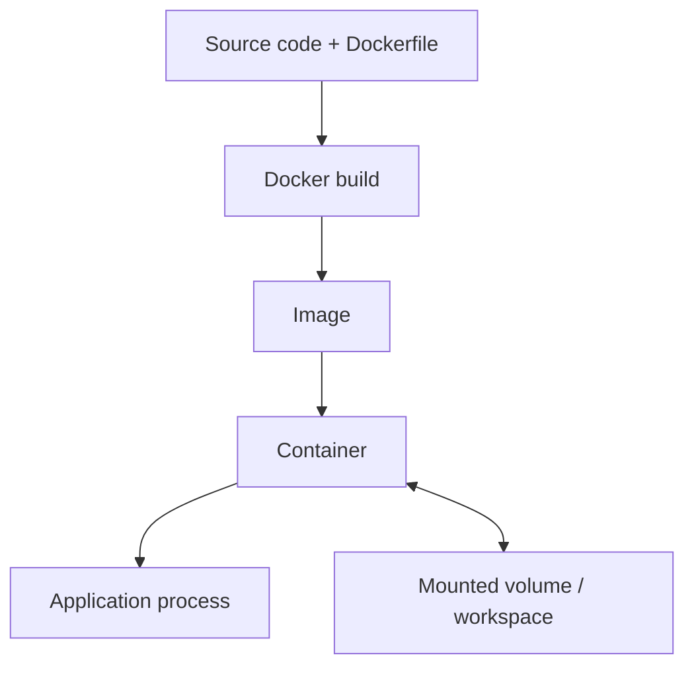

## Q4. Image vs container?

An image is an immutable-ish packaged template consisting of layers. A container is a running or stopped instance of an image plus its configuration and writable layer. Removing a container can remove data stored only in its writable layer; important project data should live in deliberately managed volumes or persistent storage.

## Q5. What is a Docker volume or bind mount?

- **Volume:** Docker-managed persistent storage.
- **Bind mount:** Maps a host path into a container.

Bind mounts are convenient for local development but depend on the host path and permissions. Volumes can be more portable for persistent container data. In cloud deployment, consider the platform's actual storage semantics, not just local Docker behavior.

## Q6. How do you persist `node_modules`?

Install dependencies inside the project's workspace and decide deliberately whether to keep `node_modules` on persistent storage. Some deployments cache dependencies and recreate them from a lockfile. If the workspace is ephemeral, package installation may need to run again after recreation. Never assume an ephemeral container preserves its writable filesystem.

## Q7. What is a multi-stage Docker build?

It uses separate build/runtime stages so compilers and development-only dependencies do not need to exist in the final runtime image. This can make images smaller and reduce attack surface. It requires correctly copying build outputs and runtime dependencies.

## Q8. What is CI/CD?

- **CI (Continuous Integration):** Frequently validate changes with automated build, lint, and tests.
- **CD:** Can mean continuous delivery (always ready to release) or continuous deployment (automatically released to production after checks).

A pipeline might run lint → unit tests → integration tests → build → security checks → deploy to staging → smoke tests → promote/rollback.

## Q9. What is blue-green deployment?

Two environments exist: one serves traffic while the other receives the new release. After validation, traffic switches to the new environment. It can make rollback fast, but requires extra capacity and careful handling of database compatibility and session state.

## Q10. What is a rolling deployment?

Instances are updated in groups rather than all at once. It reduces a full stop, but old and new versions may coexist. APIs and schema migrations must be backward compatible during that period.

## Q11. What is a health check?

A health endpoint reports whether an instance or a specific dependency is ready/healthy. Distinguish **liveness** (process is alive) from **readiness** (instance should receive traffic). A deep readiness check that depends on every external service can cause unnecessary mass restarts if a shared service briefly fails.

## Q12. How do you deploy a full-stack application?

A common approach:
1. Build the frontend into static assets.
2. Deploy the API backend with runtime configuration.
3. Configure database and network access securely.
4. Set environment variables and secrets.
5. Configure a domain, HTTPS, routing, CORS, and reverse proxy/CDN as needed.
6. Run migrations safely.
7. Add logs, metrics, alerting, backups, and rollback procedures.

Exact steps differ by platform. Do not commit `.env` secrets or depend on a local path that does not exist in production.

## Q13. What is a reverse proxy?

A reverse proxy receives client requests and forwards them to backend services. It can handle TLS termination, routing, compression, static assets, and some rate limiting. It must be configured for correct forwarded headers, timeouts, WebSocket upgrades when needed, and access restrictions.

## Q14. What is HTTPS/TLS?

TLS protects data in transit and helps the client verify the server's identity. HTTPS is HTTP over TLS. Use valid certificates, modern configurations provided by reputable infrastructure, and secure cookie settings. TLS does not encrypt data stored in a database by itself and does not replace authorization.

## Q15. What is a deployment rollback?

Rollback returns to a known-good application version when a release fails. It is easy only if database changes and external side effects remain compatible. Use reversible/compatible migrations where possible and define how to handle data written by the failed version.

## Q16. How do you manage configuration across environments?

Separate code from environment configuration. Keep local, test, staging, and production settings distinct and validated. Never use production secrets in tests unnecessarily. Avoid hardcoded URLs and ports; inject them through configuration or service discovery.

---

# 12. Performance and debugging

## Q1. How do you investigate a slow website?

1. Reproduce the problem and measure it.
2. Separate network, server, database, and browser time.
3. Inspect browser network waterfall and performance tools.
4. Check backend latency percentiles, traces, database query plans, and error logs.
5. Make one evidence-based change at a time.
6. Compare before/after metrics and check for regressions.

Do not guess that the frontend or database is the bottleneck without measurements.

## Q2. What is Core Web Vitals?

Core Web Vitals are user-experience metrics. Commonly discussed metrics include Largest Contentful Paint (loading), Interaction to Next Paint (responsiveness), and Cumulative Layout Shift (visual stability). Review current official guidance because definitions and thresholds can evolve.

## Q3. How do you improve API performance?

Measure endpoints, optimize expensive DB queries/indexes, avoid N+1 queries, use pagination, limit payloads, cache suitable data, reduce synchronous CPU work, and move slow noncritical tasks to queues. Add timeouts and concurrency limits. Do not cache sensitive responses publicly.

## Q4. What is a memory leak?

A memory leak occurs when objects that are no longer needed remain reachable, so memory cannot be reclaimed. Common web causes include unremoved event listeners, never-cleared intervals, unbounded caches, retained DOM nodes, and unbounded queues.

Use heap snapshots, allocation profiling, runtime metrics, and reproduction under load to find the cause.

## Q5. How do you debug a production-only bug?

Compare environment/configuration, collect a minimal reproduction, inspect structured logs and traces, verify versions and data shape, test safe feature flags, and use a controlled rollout. Avoid printing secrets or attaching a debugger in a way that compromises the service.

## Q6. What is a race condition?

A race condition occurs when outcome depends on the timing/order of concurrent operations. Examples include two requests creating the same resource or a stale async response overwriting a newer UI state. Mitigate with database constraints/transactions, idempotency, cancellation or response versioning, and correct locking where necessary.

## Q7. What is a deadlock?

A deadlock occurs when processes/transactions wait on resources held by each other so none can proceed. Use consistent lock ordering, keep transactions short, handle deadlock errors with safe retries, and inspect database deadlock diagnostics.

## Q8. What is backpressure?

Backpressure prevents a producer from overwhelming a slower consumer. Streams can signal when the writable side is full and producers should pause. In real-time systems, bound queues, apply flow control, or drop noncritical data according to an explicit policy.

---

# 13. Practical coding and debugging questions

The exact syntax may vary by environment. Practice explaining time and space complexity as well as correctness.

## Q1. Reverse a string.

```js
function reverseString(value) {
  return [...value].reverse().join("");
}
```

This handles code points better than splitting into UTF-16 code units, but it does not fully handle all grapheme clusters such as certain emoji sequences. Explain the input assumptions in an interview.

## Q2. Check whether a string is a palindrome.

```js
function isPalindrome(value) {
  const normalized = value.toLowerCase().replace(/[^a-z0-9]/g, "");
  return normalized === [...normalized].reverse().join("");
}
```

The normalization rule depends on the problem. Unicode letters, accents, and locale may require a more complete solution.

## Q3. Find duplicates in an array.

```js
function findDuplicates(items) {
  const seen = new Set();
  const duplicates = new Set();
  for (const item of items) {
    if (seen.has(item)) duplicates.add(item);
    else seen.add(item);
  }
  return [...duplicates];
}
```

Average time is `O(n)` with hash-set operations; space is `O(n)` in the worst case.

## Q4. Count character frequency.

```js
function frequency(text) {
  const result = new Map();
  for (const char of text) {
    result.set(char, (result.get(char) ?? 0) + 1);
  }
  return result;
}
```

Using `Map` avoids conflicts with object prototype names and makes keys explicit.

## Q5. Remove duplicates from an array.

```js
const unique = values => [...new Set(values)];
```

This works for primitive equality and object identity. Two different objects with identical properties are not deduplicated automatically.

## Q6. Flatten a nested array one level or completely.

```js
const oneLevel = values => values.flat();
const allLevels = values => values.flat(Infinity);
```

For very deep or untrusted nesting, discuss recursion depth and memory. `flat(Infinity)` is concise but not always the best option for very large or specially structured input.

## Q7. Group objects by a property.

```js
function groupBy(items, key) {
  return items.reduce((groups, item) => {
    const value = item[key];
    (groups[value] ??= []).push(item);
    return groups;
  }, {});
}
```

If keys can be arbitrary values or prototype-sensitive strings, use a `Map` instead of a plain object.

## Q8. Debounce a search input.

A debounce waits until the user pauses typing before starting a request. Also cancel stale network requests or ignore stale responses, so a slower old result cannot overwrite a newer search result.

```js
let controller;
async function search(query) {
  controller?.abort();
  controller = new AbortController();
  const response = await fetch(`/api/search?q=${encodeURIComponent(query)}`, {
    signal: controller.signal
  });
  if (!response.ok) throw new Error("Search failed");
  return response.json();
}
```

The debounce timer and request cancellation solve different problems: one reduces request starts; the other stops or ignores obsolete work.

## Q9. Implement an async retry helper.

```js
async function retry(operation, { attempts = 3, delayMs = 200 } = {}) {
  let lastError;
  for (let attempt = 0; attempt < attempts; attempt++) {
    try {
      return await operation();
    } catch (error) {
      lastError = error;
      if (attempt === attempts - 1) break;
      const jitter = Math.random() * delayMs;
      await new Promise(resolve => setTimeout(resolve, delayMs * 2 ** attempt + jitter));
    }
  }
  throw lastError;
}
```

In production, retry only transient failures, use a total time budget, honor cancellation, and ensure non-idempotent operations cannot run twice unexpectedly.

## Q10. Find the most frequent item.

```js
function mostFrequent(items) {
  const count = new Map();
  let best;
  let bestCount = 0;
  for (const item of items) {
    const n = (count.get(item) ?? 0) + 1;
    count.set(item, n);
    if (n > bestCount) {
      best = item;
      bestCount = n;
    }
  }
  return items.length ? { item: best, count: bestCount } : null;
}
```

Time complexity is average `O(n)`, space `O(k)` for k distinct values. The code keeps the first encountered value in ties.

## Q11. How would you debug an API returning 500?

1. Reproduce the request with the same method, URL, headers, and body.
2. Find the matching request ID in backend logs.
3. Identify whether the failure is validation, authorization, code, database, or upstream.
4. Inspect the stack and safe contextual data privately.
5. Fix the root cause and add a regression test.
6. Confirm the client receives a safe error response.

Do not expose stack traces to users or change `500` to `200` to hide the issue.

## Q12. How would you debug `npm install` that appears stuck?

Confirm the command is actually executing in the intended workspace. Inspect `pwd`, `node --version`, `npm --version`, `package.json`, terminal output, process state, and registry connectivity. Check DNS/network rules, lockfile URLs, proxy configuration, disk/permissions, and whether another process is deleting `node_modules`. Compare the actual exit code, not just the UI's “running” label. Avoid deleting lockfiles or caches as a first guess.

## Q13. How would you debug a React component not updating?

Check whether state is mutated instead of replaced, whether the component is actually subscribed to the state source, whether keys cause remounting/identity problems, whether memoization blocks expected renders, and whether the update request completed. Use React DevTools and logs to inspect props/state and test a minimal reproduction.

## Q14. How would you debug duplicate React key warnings?

Inspect the exact `.map()` producing siblings, identify the duplicated data IDs and their origin, then fix tree construction/API/database duplication or choose stable context-aware keys if the same entity legitimately appears in different contexts. Do not suppress the warning with random keys or array indexes as a generic fix.

## Q15. How would you debug preview not loading from Docker?

Trace the whole chain: development server running → listening on the right interface (often `0.0.0.0` inside a container) → container/host port mapping → secure proxy → authentication/authorization → iframe URL and headers → WebSocket upgrade for HMR. Confirm the workspace and project IDs match. An internal container IP or `localhost` URL is not automatically reachable from the user's browser.

---

# 14. Project discussion and behavioral questions

## Q1. “Tell me about yourself.”

Use a simple 45–90 second structure:
1. Your current education/role.
2. The technical areas you are strongest in.
3. One or two projects and the problem each solved.
4. What kind of role you are looking for.

Avoid listing every technology without evidence. Connect skills to work you have actually done.

**Example structure:**

> “I am a computer engineering student focused on full-stack development. I have worked with React on the frontend and Node.js/Express APIs on the backend, and I use databases to persist application data. In my projects, I have worked on authentication, API integration, and deployment. I am looking for a role where I can apply these fundamentals, learn from experienced engineers, and build reliable user-facing software.”

Personalize this only with claims you can defend in follow-up questions.

## Q2. “Explain your project architecture.”

Use this order:
1. What problem does it solve and who uses it?
2. What are its main features?
3. Draw frontend → API → database → external services.
4. Explain authentication and authorization.
5. Explain a full request flow.
6. Explain deployment and configuration.
7. Describe one difficult bug and how you solved it.
8. Explain what you would improve next.

An architecture diagram is more effective than reading the technology list.

## Q3. “Why did you choose this stack?”

Answer with the constraints. Example: “We chose React because the UI has reusable interactive components. Node/Express allowed our team to use JavaScript on both client and server and had the middleware ecosystem we needed. We chose PostgreSQL because these entities have relationships and data integrity matters.” Then admit the trade-offs: “A different stack could also work; this was a reasonable choice for our requirements, team skills, and project size.”

Never claim one framework is always the fastest or best without context.

## Q4. “What was your biggest technical challenge?”

Use STAR:
- **Situation:** Context.
- **Task:** Your responsibility.
- **Action:** What you personally investigated and changed.
- **Result:** Measurable outcome, test evidence, or clear lesson.

Be honest about what you personally built versus what teammates or tools built. Interviewers may ask about exact files, logs, choices, and failed attempts.

## Q5. “How do you handle a disagreement with a teammate?”

Clarify the shared goal, list technical constraints, compare options against evidence, run a small experiment if possible, document the decision, and commit to the team decision once made. Do not present disagreement as a personal contest.

## Q6. “What do you do when you do not know an answer?”

State what you know, identify the uncertain part, explain how you would investigate it, and avoid bluffing. In real engineering, structured problem solving is more valuable than pretending to know every API.

## Q7. “Why should we hire you?”

Connect your current strengths to the role, give evidence from projects or practice, and explain how you learn. Avoid generic claims like “I am perfect” or guarantees about performance. Keep the answer specific and credible.

## Q8. Questions you can ask the interviewer

- What would success look like in the first three months?
- How does the team review code and ship changes?
- What are the main technical challenges for this role?
- How do engineering, product, and design collaborate?
- What testing and observability practices does the team use?

---

# 15. Quick comparison tables

## JavaScript and frontend choices

| Choice | Prefer when | Avoid/consider alternative when |
|---|---|---|
| `const` | Binding should not be reassigned | Use `let` when reassignment is part of the design |
| `async/await` | Sequential async flow is easier to read | Use Promise combinators for parallel work where appropriate |
| React | UI is component-heavy and interactive | Static page may need only HTML/CSS/JS |
| Context | Values are shared through a subtree | High-frequency complex state may need a store or narrower contexts |
| `useMemo` | Measured expensive calculation or identity need | Adds noise if calculation is already cheap |
| SSR | Initial HTML/SEO/data-on-server benefits justify it | SPA may be simpler for internal authenticated apps |

## Backend and communication choices

| Choice | Prefer when | Trade-off |
|---|---|---|
| Express | Minimal flexible Node HTTP layer | You must establish architecture and conventions |
| REST | Clear resource operations and broad tooling | Many endpoints may be needed for complex views |
| GraphQL | Clients need flexible shaped queries | Query cost, caching, schema and authorization complexity |
| WebSocket | Bidirectional real-time communication | Connection lifecycle, auth, scaling, backpressure |
| SSE | One-way server updates | Client-to-server messages require other requests |
| Queue | Work can happen asynchronously | Delays, retries, duplicates and operations to manage |
| Monolith | Small/medium team and domain not yet proven | Independent deployment/scaling is less granular |
| Microservices | Clear boundaries and independent ownership justify them | Distributed failures and operations become harder |

## Database choices

| Technology/type | Strengths | Trade-offs / poor fit |
|---|---|---|
| PostgreSQL | Relational integrity, transactions, joins, rich queries | Requires schema/query/index design; not every workload needs relational features |
| MySQL | Mature relational database and broad hosting support | Query features and operational choices differ from PostgreSQL |
| MongoDB | Document model and flexible nested records | Cross-document relationships and data consistency require deliberate modeling |
| Redis | Low-latency in-memory structures and cache/coordination use cases | Memory cost, eviction, and persistence semantics; not a default primary database replacement |
| Object storage | Durable large files and media | Not a queryable relational database; access metadata separately |

## Scaling choices

| Technique | Helps with | Does not automatically solve |
|---|---|---|
| Index | Expensive query lookup/sort | Bad query design, oversized payload, all write bottlenecks |
| Cache | Repeated expensive reads | Invalidation and stale data |
| CDN | Static/edge content delivery | Private dynamic API bottlenecks |
| Queue | Slow async tasks and burst smoothing | Correctness, duplicate handling, and queue backlogs |
| Horizontal scaling | Stateless request capacity and availability | Shared-state conflicts or database limits by itself |
| Sharding | Data scale beyond simpler database topology | Operational complexity and cross-shard queries |

---

# 16. Interview revision checklist

Before an interview, confirm that you can explain each item without reading notes.

## JavaScript
- [ ] `var`, `let`, `const`, scope, hoisting, TDZ
- [ ] Closure, `this`, prototype chain
- [ ] Equality, coercion, truthy/falsy
- [ ] Objects, arrays, spread/rest, destructuring
- [ ] Promises, `async/await`, event loop
- [ ] Microtasks, timers, concurrency vs parallelism
- [ ] Modules, errors, memory leaks, Big O

## React
- [ ] Components, JSX, props and state
- [ ] Immutable state updates and list keys
- [ ] Effects, refs, memoization, context, reducer
- [ ] Controlled forms and data fetching
- [ ] Routing, error boundaries, Strict Mode
- [ ] Performance profiling, code splitting, lazy loading
- [ ] SSR, hydration, testing, security

## Node.js / Express
- [ ] Runtime and event loop
- [ ] Async I/O vs CPU-bound work
- [ ] Middleware order and error handling
- [ ] Controller/service/repository separation
- [ ] Streams, buffers, environment configuration
- [ ] Authentication, authorization, validation
- [ ] Process/thread model, queues, graceful shutdown

## Databases
- [ ] SQL vs NoSQL
- [ ] Primary/foreign keys and constraints
- [ ] Normalization, transactions, ACID
- [ ] Indexes, composite indexes, `EXPLAIN`
- [ ] Joins and N+1 queries
- [ ] MongoDB embedding vs references and aggregation
- [ ] Redis, cache invalidation, connection pools
- [ ] Pagination, replication, sharding, migrations

## APIs and security
- [ ] HTTP methods and status codes
- [ ] REST, GraphQL, OpenAPI, versioning
- [ ] JWT vs sessions, OAuth/OIDC
- [ ] CORS vs CSRF
- [ ] XSS, SQL injection, SSRF
- [ ] Rate limiting, idempotency, webhooks
- [ ] Authorization and least privilege

## System design and operations
- [ ] Requirements and high-level diagrams
- [ ] Monolith vs microservices
- [ ] Horizontal/vertical scaling and load balancing
- [ ] Cache, CDN, queues, retries, circuit breakers
- [ ] Consistency, CAP, replication, sharding
- [ ] Docker image/container/volume/network
- [ ] CI/CD, migrations, health checks, rollback
- [ ] Logs, metrics, tracing, SLI/SLO
- [ ] Environment variables, secrets, HTTPS, backups

## Project discussion
- [ ] Explain your project in 90 seconds
- [ ] Draw its architecture
- [ ] Explain one request from UI to database and back
- [ ] Explain auth and access control
- [ ] Explain one difficult bug and verified fix
- [ ] Explain why each major technology was chosen
- [ ] State limitations honestly and name the next improvement

---

# 17. Suggested learning order and practice plan

This is an example four-week revision plan. Adjust the pace to your interview date and current knowledge.

| Week | Focus | Daily practice |
|---|---|---|
| 1 | JavaScript fundamentals and async behavior | Write small examples; solve arrays/strings/hash-map questions; explain the event loop aloud |
| 2 | React and TypeScript | Build forms, API loading/error states, list operations, reusable components, and one tested feature |
| 3 | Node/Express, APIs, and databases | Build a validated CRUD API with authentication, pagination, indexes, and integration tests |
| 4 | System design, security, deployment, project interview | Draw 2–3 architectures; containerize a project; explain trade-offs and debug practice failures |

## A practical daily routine (60–120 minutes)

1. **20 minutes:** Review concepts and explain them aloud.
2. **30–45 minutes:** Implement a small coding example.
3. **20 minutes:** Answer interview questions without notes.
4. **10–15 minutes:** Record mistakes and revisit weak topics.
5. **Optional:** Practice one project explanation or system design diagram.

## Final advice

- Understand why a tool fits a problem; avoid saying a technology is universally “best.”
- Give short direct answers first, then expand with an example.
- For every trade-off, explain the requirement that drives the choice.
- In code reviews, value correctness, security, readability, tests, and maintainability—not clever syntax.
- In system design, start simple and add complexity only to meet a demonstrated requirement.
- For project work, distinguish what is implemented from what is tested in a real environment.
- If unsure, state assumptions, reason from fundamentals, and explain how you would verify the answer.

---

## Further reading (official documentation)

Use documentation for the precise behavior of the version you work with; framework APIs and recommended practices can evolve.

- JavaScript guide (MDN): https://developer.mozilla.org/en-US/docs/Web/JavaScript/Guide
- JavaScript reference (MDN): https://developer.mozilla.org/en-US/docs/Web/JavaScript/Reference
- React docs: https://react.dev/learn
- TypeScript handbook: https://www.typescriptlang.org/docs/handbook/intro.html
- Node.js docs: https://nodejs.org/docs/latest/api/
- Express docs: https://expressjs.com/
- PostgreSQL docs: https://www.postgresql.org/docs/
- MongoDB manual: https://www.mongodb.com/docs/manual/
- Redis docs: https://redis.io/docs/latest/
- HTTP overview (MDN): https://developer.mozilla.org/en-US/docs/Web/HTTP/Overview
- OWASP Top 10: https://owasp.org/www-project-top-ten/
- Docker docs: https://docs.docker.com/
- Git reference: https://git-scm.com/doc

*End of guide.*
