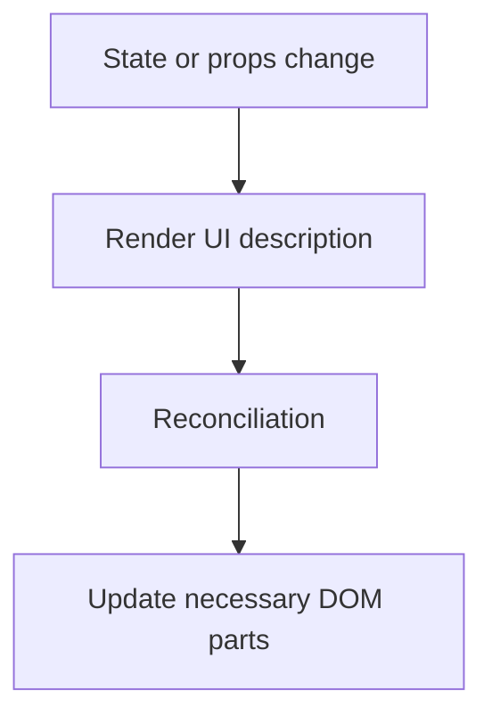
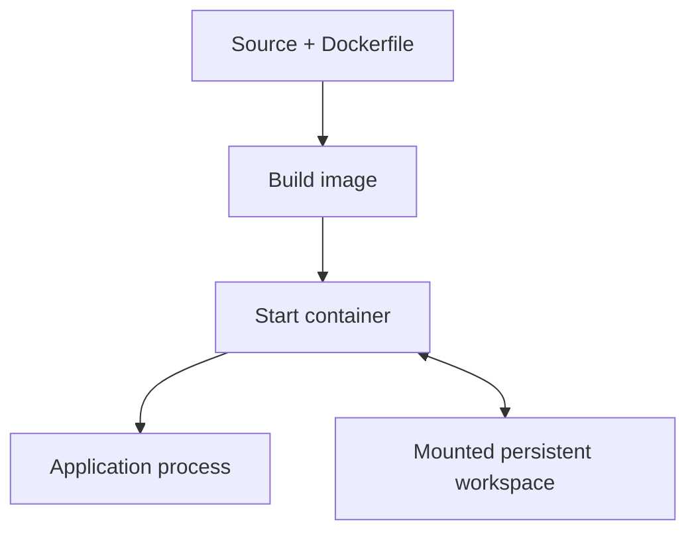
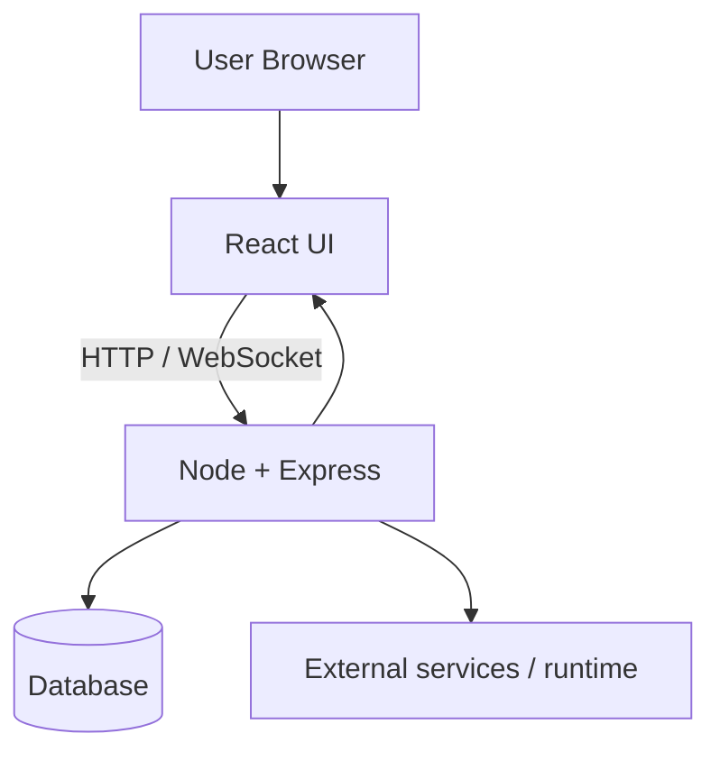
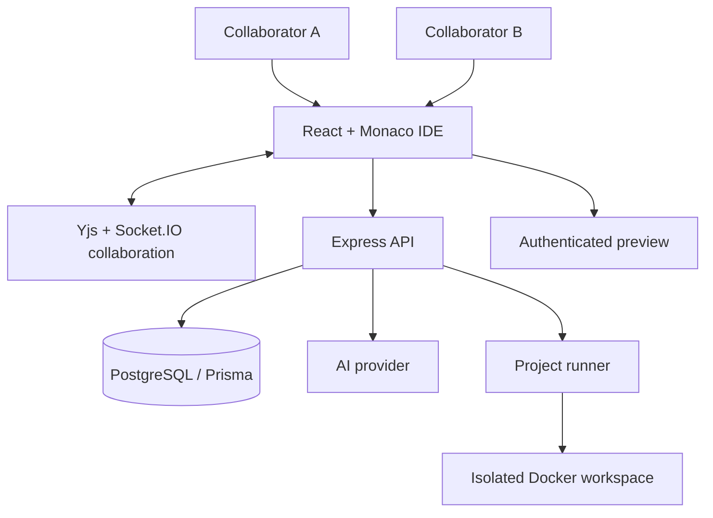

# Full-Stack Developer Interview Preparation — Simple Notes

> **Style:** Short points • Easy English • Small examples • Clear spacing • Basic to advanced • Project interview questions included

This guide covers common full-stack developer interview topics. No guide can contain literally every question an interviewer might ask, so use this as a core question bank and practise explaining the ideas in your own words.

## How to use this README

- Read one question at a time.
- Learn the **main idea**, not a memorized paragraph.
- Explain every answer in 30–90 seconds.
- Practise the examples yourself.
- For every technology, know **why to use it, when not to use it, and one alternative**.
- In project interviews, explain only features you have actually implemented and tested.

## Contents

1. [Full-stack basics](#1-full-stack-basics)
2. [HTML, CSS, and browser basics](#2-html-css-and-browser-basics)
3. [JavaScript: basic to advanced](#3-javascript-basic-to-advanced)
4. [TypeScript](#4-typescript)
5. [React: basic to advanced](#5-react-basic-to-advanced)
6. [Node.js and Express](#6-nodejs-and-express)
7. [Databases: SQL, PostgreSQL, MongoDB, Redis](#7-databases-sql-postgresql-mongodb-redis)
8. [HTTP, REST APIs, and authentication](#8-http-rest-apis-and-authentication)
9. [Security](#9-security)
10. [System design](#10-system-design)
11. [Git, Docker, CI/CD, and deployment](#11-git-docker-cicd-and-deployment)
12. [Testing, debugging, and performance](#12-testing-debugging-and-performance)
13. [Common coding questions](#13-common-coding-questions)
14. [Project interview questions](#14-project-interview-questions)
15. [CodeCollabAI project interview preparation](#15-codecollabai-project-interview-preparation)
16. [HR and behavioral questions](#16-hr-and-behavioral-questions)
17. [Quick comparison tables](#17-quick-comparison-tables)
18. [Final revision checklist](#18-final-revision-checklist)

---

# 1. Full-stack basics

## Q1. What is a full-stack developer?

- A developer who can work on the frontend, backend, and database parts of an application.
- **Frontend:** What users see.
- **Backend:** Business logic and APIs.
- **Database:** Stores data.
- **Deployment:** Makes the application available to users.

**Example:** A user submits a signup form → React sends data to Express → Express validates it → PostgreSQL stores the user → API returns a response.

## Q2. What happens when a user opens a website?

- Browser finds the server's address through DNS.
- Browser creates a connection and sends an HTTP/HTTPS request.
- Server returns HTML, CSS, JavaScript, or data.
- Browser renders the page.
- Frontend JavaScript may call APIs for more data.

**Example:** Opening `https://example.com` may load the page first and then request `/api/products`.

## Q3. Explain frontend, backend, and database.

- **Frontend:** UI, forms, buttons, state, accessibility.
- **Backend:** Validation, business rules, authentication, APIs.
- **Database:** Persistent records and queries.
- They communicate through clear interfaces, usually HTTP APIs and database drivers.

## Q4. What is a client-server architecture?

- Client asks for a resource or action.
- Server processes the request and responds.
- Client and server can run on different machines.

```text
Browser / React  -- HTTP request -->  Express API  -->  Database
Browser / React  <-- JSON response -- Express API  <--  Database
```

## Q5. What is a runtime, library, framework, and API?

- **Runtime:** Executes code. Example: Node.js.
- **Library:** Your code calls it. Example: date-formatting library.
- **Framework:** Provides structure and controls parts of the flow. Example: Express is often described as a web framework.
- **API:** A defined way for two software components to communicate.

## Q6. What is JSON?

- A text format used to exchange structured data.
- Supports objects, arrays, strings, numbers, booleans, and `null`.
- It does not support functions or `undefined`.

```json
{
  "name": "Rahul",
  "role": "developer",
  "active": true
}
```

## Q7. What is the difference between authentication and authorization?

- **Authentication:** Who are you?
- **Authorization:** What are you allowed to do?

**Example:** Logging in proves identity. Checking whether the user owns a project determines whether they can delete it.

## Q8. What is an environment variable?

- A setting provided to an application at runtime.
- Commonly stores ports, database URLs, and API keys.
- Secrets must stay on the server; never put private API keys in frontend code.

**Example:** `process.env.DATABASE_URL` in Node.js.

## Q9. What is the difference between development and production?

- **Development:** Debugging tools, source maps, hot reload, detailed logs.
- **Production:** Built assets, hardened configuration, controlled logging, monitoring, and security limits.
- Test production builds; a development server is not automatically a production server.

## Q10. What are functional and non-functional requirements?

- **Functional:** What the system does.
- **Non-functional:** How well it does it, such as speed, availability, security, and scalability.

**Example:** “Users can upload files” is functional. “Uploads finish within an agreed time and cannot expose private files” is non-functional.

---

# 2. HTML, CSS, and browser basics

## Q1. What is semantic HTML?

- It uses elements according to their meaning, such as `<header>`, `<nav>`, `<main>`, `<article>`, and `<button>`.
- It improves accessibility, maintainability, and sometimes SEO.
- Use a real `<button>` for an action instead of a clickable `<div>` when possible.

## Q2. What is the difference between `id` and `class`?

- `id` should uniquely identify one element in a document.
- `class` can be reused on many elements.
- CSS classes are normally better for reusable styling.

## Q3. Explain the CSS box model.

- Every element has content, padding, border, and margin.
- `box-sizing: border-box` includes padding and border in the declared width/height.

```css
* { box-sizing: border-box; }
.card { width: 300px; padding: 16px; border: 1px solid #ccc; }
```

## Q4. Flexbox vs Grid?

- **Flexbox:** Best for arranging items in one main direction—row or column.
- **Grid:** Best for two-dimensional layouts involving rows and columns.
- They can be combined in one page.

## Q5. What is responsive design?

- UI adjusts to different screen sizes.
- Use flexible units, responsive images, Flexbox/Grid, and media queries.
- Test mobile, tablet, and desktop layouts.

```css
.cards { display: grid; grid-template-columns: repeat(auto-fit, minmax(220px, 1fr)); }
```

## Q6. What is the DOM?

- The Document Object Model represents the HTML document as a tree of nodes.
- JavaScript can read and update elements through DOM APIs.
- React typically manages UI updates declaratively rather than requiring manual DOM changes for every update.

## Q7. What is event bubbling?

- An event often travels from the target element up through its ancestors.
- `event.stopPropagation()` stops propagation; use it only when appropriate.
- Event delegation uses a parent handler to handle events from child elements.

## Q8. What is accessibility?

- Make software usable with keyboards, screen readers, and different abilities.
- Use semantic elements, labels, visible focus, sufficient contrast, and accessible error messages.
- Do not rely on color alone to convey meaning.

---

# 3. JavaScript: basic to advanced

## Q1. What is JavaScript?

- A programming language used in browsers and server runtimes such as Node.js.
- Supports functions, objects, asynchronous programming, and modules.
- **Why use it?** It can be used for both frontend and backend work.
- **When not ideal?** Heavy CPU work may be better moved to workers, native code, or another service.

## Q2. `var`, `let`, and `const`?

- `var`: function-scoped; older behavior; avoid in most new code.
- `let`: block-scoped and can be reassigned.
- `const`: block-scoped; binding cannot be reassigned.
- Prefer `const` unless reassignment is needed.

```js
const name = "Asha";
let count = 0;
count++;
```

## Q3. Primitive vs reference values?

- Primitives include string, number, boolean, `null`, `undefined`, bigint, and symbol.
- Objects and arrays are reference-type values.
- Copying an object reference does not create a new object.

```js
const a = { score: 1 };
const b = a;
b.score = 9;
console.log(a.score); // 9
```

## Q4. `==` vs `===`?

- `==` allows type coercion for many comparisons.
- `===` compares without that coercion.
- Prefer `===` for predictable behavior.

```js
5 == "5";  // true
5 === "5"; // false
```

## Q5. What are `null` and `undefined`?

- `undefined`: a value is missing or has not been assigned.
- `null`: often used to mean an intentional absence.
- Agree on a consistent convention in APIs and application code.

## Q6. What are truthy and falsy values?

- Falsy values include `false`, `0`, `-0`, `0n`, `""`, `null`, `undefined`, and `NaN`.
- Empty arrays `[]` and empty objects `{}` are truthy.
- Use explicit conditions when zero or an empty string is valid data.

## Q7. What is scope?

- Scope decides where a variable can be accessed.
- Common types: global, function, and block scope.
- `let` and `const` are block-scoped; `var` is function-scoped.

## Q8. What is hoisting?

- Declarations are processed before normal execution.
- Function declarations can commonly be called before their source position.
- `var` is initialized to `undefined`; `let` and `const` are inaccessible before initialization because of the temporal dead zone.

## Q9. What is a closure?

- A function remembers variables from the scope in which it was created.
- Useful for private state, callbacks, and function factories.

```js
function makeCounter() {
  let count = 0;
  return () => ++count;
}
const counter = makeCounter();
counter(); // 1
counter(); // 2
```

## Q10. What is `this`?

- For regular functions, `this` depends mainly on how the function is called.
- In `user.show()`, `this` commonly refers to `user`.
- Arrow functions inherit `this` from their surrounding scope.

## Q11. Arrow function vs regular function?

- Arrow functions have lexical `this` and no own `arguments`.
- Regular functions can have a call-dependent `this` and can be constructors.
- Use arrow functions for many callbacks; use a regular method when dynamic `this` is required.

## Q12. What are `map`, `filter`, `find`, and `reduce`?

- `map`: transforms every item.
- `filter`: keeps matching items.
- `find`: returns the first match.
- `reduce`: combines items into a result.

```js
const nums = [1, 2, 3, 4];
nums.map(n => n * 2);             // [2, 4, 6, 8]
nums.filter(n => n > 2);          // [3, 4]
nums.find(n => n > 2);            // 3
nums.reduce((sum, n) => sum + n, 0); // 10
```

## Q13. Destructuring, spread, and rest?

- Destructuring extracts values.
- Spread expands values into a new array/object/call.
- Rest collects remaining values.

```js
const user = { name: "Maya", age: 21 };
const { name, age } = user;
const copy = { ...user };
function total(...numbers) { return numbers.reduce((a, b) => a + b, 0); }
```

## Q14. Shallow copy vs deep copy?

- Shallow copy duplicates only the outer structure.
- Nested objects may still be shared.
- `structuredClone()` supports many common data types but not every possible value.

```js
const a = { profile: { city: "Pune" } };
const b = { ...a };
b.profile.city = "Nashik";
console.log(a.profile.city); // Nashik
```

## Q15. What are optional chaining and nullish coalescing?

- `user?.address?.city` avoids errors when an intermediate value is nullish.
- `value ?? fallback` uses the fallback only for `null` or `undefined`.
- `value || fallback` also falls back for `0`, `false`, and `""`.

```js
const page = response?.data?.page ?? 1;
```

## Q16. What is a Promise?

- It represents the eventual success or failure of asynchronous work.
- States: pending, fulfilled, rejected.
- Use `.then()`, `.catch()`, or `async/await` to work with it.

```js
fetch("/api/users")
  .then(r => { if (!r.ok) throw new Error("Request failed"); return r.json(); })
  .then(console.log)
  .catch(console.error);
```

## Q17. What is `async/await`?

- `async` functions return Promises.
- `await` pauses that async function's continuation until the Promise settles.
- It does not block the whole JavaScript thread.
- Use `try/catch` when handling failures.

## Q18. `Promise.all()` vs `Promise.allSettled()`?

- `Promise.all()`: fails when one input rejects; useful when all results are required.
- `Promise.allSettled()`: waits for every result, success or failure; useful when partial results are acceptable.
- Neither automatically cancels other operations.

## Q19. Explain the event loop.

- JavaScript executes synchronous code on its execution thread.
- Async I/O can make progress while JavaScript handles other work.
- Promise callbacks are microtasks; timers run through task/event-loop scheduling.

```js
console.log("A");
setTimeout(() => console.log("C"), 0);
Promise.resolve().then(() => console.log("B"));
console.log("D");
// Common browser output: A, D, B, C
```

## Q20. Concurrency vs parallelism?

- **Concurrency:** Tasks make progress during overlapping time periods.
- **Parallelism:** Tasks execute at the same time on separate execution resources.
- Node.js handles I/O concurrency well, but long CPU-bound JavaScript can block its event loop.

## Q21. What is a prototype?

- Objects can inherit properties from other objects through a prototype chain.
- JavaScript `class` syntax builds on this model.
- Use composition when a complicated inheritance hierarchy becomes difficult to maintain.

## Q22. `call`, `apply`, and `bind`?

- `call`: invokes now with separate arguments and a selected `this`.
- `apply`: invokes now with arguments in an array-like value.
- `bind`: returns a new function with a bound `this` and optional preset arguments.

## Q23. `Map` vs `Set`?

- `Map`: key-value pairs; keys can be any value.
- `Set`: unique values.
- Use `Map` for a lookup table and `Set` for membership/deduplication.

## Q24. Debounce vs throttle?

- **Debounce:** Run after events pause. Example: search box.
- **Throttle:** Limit how often a function runs. Example: scroll handler.
- Clean up timers/listeners when a component unmounts.

## Q25. What is Big O?

- Describes how time or memory grows as input size grows.
- `O(1)`: array index lookup (typical case).
- `O(log n)`: binary search in sorted data.
- `O(n)`: one array scan.
- `O(n log n)`: common efficient comparison sort.
- `O(n²)`: compare every pair.

## Q26. ES modules vs CommonJS?

- ES modules: `import` and `export`.
- CommonJS: `require()` and `module.exports`.
- Follow the project's module configuration; mixing formats needs care.

## Q27. What is memory leakage in JavaScript?

- Unneeded objects remain reachable and cannot be garbage-collected.
- Common causes: uncleared timers, retained event handlers, unbounded caches, and forgotten subscriptions.
- Use browser/Node profiling tools to find the source.

## Q28. What is immutability?

- Treat data as unchanged and create an updated copy instead of mutating shared state.
- Helpful for predictable state changes and React rendering.
- It may add allocations, so use appropriate data structures and avoid unnecessary copying of huge objects.

---

# 4. TypeScript

## Q1. What is TypeScript?

- JavaScript plus a static type system; it compiles to JavaScript.
- Finds many errors during development and improves autocomplete/refactoring.
- It does not validate incoming HTTP data at runtime by itself.

## Q2. `type` vs `interface`?

- Both can describe object shapes.
- `interface` is useful for extendable object contracts and supports declaration merging.
- `type` supports unions, intersections, primitives, tuples, and more.

## Q3. What are generics?

- They make reusable functions/types while preserving type relationships.

```ts
function first<T>(items: T[]): T | undefined {
  return items[0];
}
```

## Q4. What is a union type?

- A value may be one of several types.
- A discriminated union uses a shared property to identify each case.

```ts
type Result<T> =
  | { ok: true; data: T }
  | { ok: false; error: string };
```

## Q5. What is `any` vs `unknown`?

- `any` disables many type checks.
- `unknown` requires checking/narrowing before using the value.
- Prefer `unknown` for untrusted values.

## Q6. Why is runtime validation still required?

- TypeScript types are removed during compilation.
- API inputs, environment variables, and external JSON can be invalid.
- Use validation code or a schema library such as Zod when needed.

---

# 5. React: basic to advanced

## Q1. What is React?

- A JavaScript library for building component-based user interfaces.
- You describe the UI from state and props; React updates the rendered output.
- **Use it:** Interactive, reusable UI.
- **Alternative:** Plain HTML/CSS/JS may be simpler for a very small static page.

## Q2. What is a component?

- A reusable UI unit, often a function returning JSX.

```jsx
function Welcome({ name }) {
  return <h1>Hello, {name}</h1>;
}
```

## Q3. What is JSX?

- Syntax that looks like HTML but is written inside JavaScript.
- It is transformed by build tools into JavaScript React can use.
- Use `className`, and place JavaScript expressions inside `{}`.

## Q4. Props vs state?

- **Props:** Inputs from a parent; treat them as read-only.
- **State:** Data owned by a component/store that can change over time.
- State changes can trigger a render.

## Q5. Why not mutate state directly?

- React relies on updates and object identity to track changes.
- Create a new object/array for the next state.

```jsx
setUser(old => ({ ...old, name: "Neha" }));
```

## Q6. What is the Virtual DOM?

- A representation of UI elements in JavaScript.
- React reconciles the new render result with the previous one and updates the host environment as needed.
- It is not a promise that React is always faster than every direct-DOM implementation.



## Q7. Why are list keys important?

- Keys help React track which sibling item is which after changes.
- Use stable IDs where possible.
- Avoid random keys; index keys can misidentify items when a list changes.

```jsx
users.map(user => <UserRow key={user.id} user={user} />)
```

## Q8. What are Hooks?

- Hooks let function components use state, effects, refs, context, and other React features.
- Call them at the top level—not inside loops or conditions.
- Common Hooks: `useState`, `useEffect`, `useRef`, `useMemo`, `useCallback`, `useContext`, `useReducer`.

## Q9. What is `useState`?

- Stores state for a component.
- Updating state schedules a render.
- If the new state depends on the previous state, use an updater function.

```jsx
setCount(previous => previous + 1);
```

## Q10. What is `useEffect`?

- Synchronizes a component with an external system such as a network request, subscription, or timer.
- Return a cleanup function for subscriptions/timers that need cleanup.
- Do not use effects for every calculation; derived values can often be calculated during render.

## Q11. What is `useRef`?

- Stores a mutable value across renders without triggering a render when `.current` changes.
- Useful for DOM references, timer IDs, and external object references.
- Use state when the changed value should update the UI.

## Q12. `useMemo` vs `useCallback`?

- `useMemo` caches a calculated value.
- `useCallback` caches a function identity.
- They are performance tools; measure before using them everywhere.

## Q13. What is `React.memo`?

- It can skip re-rendering a component when its props compare equal.
- It may not help if new object/function props are created every render.
- Use React DevTools Profiler to find real performance problems.

## Q14. Controlled vs uncontrolled input?

- Controlled: value comes from React state.
- Uncontrolled: browser maintains the value; React can read it through a ref or form API.
- Controlled inputs help with live validation and conditional UI; uncontrolled inputs can be simpler for basic forms.

## Q15. What is lifting state up?

- Move shared state to the nearest common parent.
- Pass values and callbacks to children.
- Use context/store only when it provides a real benefit over simpler props.

## Q16. What is Context API?

- Shares values through a component subtree without passing props through every intermediate component.
- Useful for themes or user/session context.
- Split frequently changing contexts if broad updates become costly.

## Q17. What is `useReducer`?

- Manages related state transitions through actions and a reducer.
- Useful when state logic is complex or has many transitions.
- Reducers should be pure; do side effects outside them.

## Q18. How do you fetch data in React?

- Represent loading, success, and error states.
- Handle non-2xx HTTP responses explicitly.
- Cancel or ignore obsolete requests when inputs change.
- A data-fetching library can manage caching and refetching in larger applications.

## Q19. Client-side routing vs server-side routing?

- Client-side routing changes the visible UI without a full document load for every navigation.
- Server-side routing handles URLs on the server.
- Many applications use both frontend routes and backend API routes.

## Q20. What is an Error Boundary?

- Catches certain rendering errors in descendant components and shows fallback UI.
- It does not catch every event-handler error or rejected Promise automatically.
- Use it around areas that should fail independently.

## Q21. What is Strict Mode?

- Development checks that help uncover unsafe patterns and missing effect cleanup.
- Some lifecycle/effect paths may run again in development.
- Fix unsafe code rather than disabling Strict Mode just to hide warnings.

## Q22. What are portals?

- Render a component into a DOM node outside its normal DOM placement.
- Useful for modals, tooltips, and overlays.

## Q23. How do you improve React performance?

- Measure first with React DevTools Profiler.
- Split bundles and lazy-load rarely used screens.
- Virtualize very large lists.
- Reduce unnecessary state/context updates.
- Use memoization only when it helps a measured bottleneck.

## Q24. What is code splitting?

- Divides a large JavaScript bundle into smaller chunks.
- Lazy-loaded pages can reduce the initial download.
- Loading states and chunk error handling are needed.

## Q25. What are SSR and hydration?

- SSR generates HTML on the server.
- Hydration attaches client-side behavior to that HTML.
- SSR may improve initial content/SEO but adds deployment and data-fetching complexity.
- Hydration mismatches occur when server and initial client HTML differ.

## Q26. React security basics?

- React escapes string values rendered as text in standard JSX.
- This does not protect every HTML, URL, or script scenario.
- Be careful with `dangerouslySetInnerHTML`, sanitize untrusted HTML, and authorize data on the backend.

## Q27. How do you test React?

- Test what users see and do.
- Use unit/component tests for components and E2E tests for important user journeys.
- Avoid relying only on internal implementation details or mocked tests.

---

# 6. Node.js and Express

## Q1. What is Node.js?

- A JavaScript runtime outside the browser, built around the V8 engine and system APIs.
- Good for APIs, network applications, and I/O-heavy services.
- CPU-heavy synchronous work can block the event loop; use workers or separate services when appropriate.

## Q2. Is Node.js single-threaded?

- JavaScript commonly runs on an event-loop thread.
- Node.js also uses operating-system facilities and a thread pool for some tasks and supports worker threads/processes.
- “Node.js is entirely single-threaded” is an oversimplification.

## Q3. Blocking vs non-blocking I/O?

- Blocking I/O waits before continuing the current execution.
- Non-blocking/asynchronous I/O lets other work proceed while waiting.
- Avoid synchronous file/database-like work in request handlers unless there is a specific reason.

## Q4. What is Express middleware?

- A function that runs during request processing.
- It may inspect/modify the request, send a response, or call `next()`.
- Middleware order matters.

```js
app.use(express.json());
app.use((req, res, next) => {
  console.log(req.method, req.path);
  next();
});
```

## Q5. Controller vs service vs repository?

- **Controller:** HTTP request and response.
- **Service:** Business rules and orchestration.
- **Repository:** Database access.
- Small projects may keep these together initially; split when it improves testing and clarity.

## Q6. How do you handle Express errors?

- Validate input at the boundary.
- Pass failures to consistent error handling.
- Return safe messages and appropriate status codes.
- Log details securely on the server; do not return stack traces to users.

## Q7. What are streams?

- Handle data in chunks instead of loading the entire content into memory.
- Useful for large uploads, downloads, logs, compression, and process output.
- Use appropriate error handling and backpressure.

## Q8. What is a Buffer?

- A Node.js object representing bytes.
- Useful for binary data and encoding/decoding.
- Choose the correct encoding when converting bytes to text.

## Q9. What is CORS?

- A browser mechanism controlled through server response headers for cross-origin access.
- It is not authentication and does not stop all non-browser clients.
- Allow only intended origins; configure credentialed requests carefully.

## Q10. What are environment variables?

- Runtime configuration such as port, database URL, and API key.
- Validate required variables at startup.
- Keep secrets out of Git and client bundles.

## Q11. What is JWT?

- A compact token format often signed and containing claims such as subject and expiry.
- Signed does not mean encrypted.
- Validate signature, expiry, expected algorithm, and relevant issuer/audience claims.

## Q12. Process vs thread?

- A process has its own execution environment and resources.
- Threads run within a process and may share memory.
- Multiple processes can use multiple CPU cores; workers can handle CPU-intensive jobs.

## Q13. How do you scale Node.js?

- Measure response time, resource usage, and error rates.
- Use more instances and a load balancer when useful.
- Keep request handling stateless or use shared state/session storage.
- Optimize database queries and offload slow work to workers/queues.

## Q14. What is a queue/background job?

- Executes work outside the main HTTP request path.
- Useful for emails, reports, image processing, and retries.
- Handle duplicate jobs, retry policies, timeouts, and dead-letter cases.

## Q15. How do you shut down a Node.js server gracefully?

- Stop accepting new work.
- Allow in-flight requests to finish within a timeout.
- Close database and queue connections.
- Stop workers and exit safely.

## Q16. What is an EventEmitter?

- An event-based mechanism for registering listeners and emitting named events.
- Useful for decoupled notifications.
- Remove listeners when their lifetime ends to avoid leaks.

## Q17. What is a worker thread?

- Runs JavaScript in a separate thread within a Node.js process.
- Useful for CPU-intensive tasks that would block the main event loop.
- Adds message-passing and lifecycle complexity; ordinary I/O often does not need a worker thread.

## Q18. CommonJS vs ES Modules in Node.js?

- CommonJS: `require`, `module.exports`.
- ES modules: `import`, `export`.
- Follow `package.json` module settings and file extensions.

---

# 7. Databases: SQL, PostgreSQL, MongoDB, Redis

## Q1. What is a database?

- A system that stores, queries, and manages data.
- Choose one based on data relationships, queries, consistency, scale, and team experience.

## Q2. SQL vs NoSQL?

- SQL databases use relational tables, constraints, joins, and transactions.
- NoSQL is a broad category; document/key-value/graph/wide-column systems have different models.
- NoSQL is not automatically faster or more scalable.

## Q3. What are primary and foreign keys?

- Primary key uniquely identifies a row.
- Foreign key connects rows and may enforce referential integrity.

```sql
CREATE TABLE users (
  id BIGSERIAL PRIMARY KEY,
  email TEXT NOT NULL UNIQUE
);
```

## Q4. What is normalization?

- Organizes relational data to reduce unnecessary duplication and update problems.
- Denormalization intentionally duplicates or precomputes data for selected reads.
- Normalize for correctness first; denormalize when measurements justify it.

## Q5. Explain ACID.

- **Atomicity:** All transaction operations commit together or roll back.
- **Consistency:** Rules and constraints remain satisfied.
- **Isolation:** Concurrent operations have defined behavior.
- **Durability:** Committed data survives the failures the database promises to withstand.

## Q6. What is a transaction?

- A group of database operations treated as one logical unit.
- Example: deduct from one bank account and credit another within one transaction.
- Keep transactions short and handle deadlocks/retries safely.

## Q7. What is an index?

- An extra data structure that helps find/sort rows for suitable queries.
- Can speed reads.
- Uses storage and adds write overhead.
- Use query plans to decide which indexes help.

## Q8. What is a composite index?

- An index on multiple columns.
- Column order matters for which filters and sort orders it can support efficiently.
- Example: `(project_id, created_at)` for project-filtered chronological records.

## Q9. What is a JOIN?

- Combines rows from related tables.
- `INNER JOIN`: matching rows only.
- `LEFT JOIN`: every left row plus matching right rows or NULL.

```sql
SELECT u.name, o.id
FROM users u
JOIN orders o ON o.user_id = u.id;
```

## Q10. What is the N+1 query problem?

- Load a list, then run one more query per item.
- It causes many database round trips.
- Fix with batching, suitable joins, or eager loading—but avoid joins that create huge duplicated result sets.

## Q11. Offset vs cursor pagination?

- Offset is simple but large offsets can become slow and concurrent changes can shift results.
- Cursor pagination uses a stable ordering cursor and often works better for large changing datasets.
- Always use deterministic ordering.

## Q12. What is MongoDB?

- A document-oriented database that stores BSON documents in collections.
- Flexible structure can fit nested data.
- Flexible schema does not mean no data modeling or validation.

## Q13. Embed vs reference in MongoDB?

- **Embed:** Small/bounded data usually read and updated with its parent.
- **Reference:** Data is shared, large, independently managed, or queried separately.
- Example: embed a small address; keep a large order history in a separate collection.

## Q14. What is an aggregation pipeline?

- Processes documents through stages such as `$match`, `$group`, `$project`, and `$sort`.

```js
db.orders.aggregate([
  { $match: { status: "paid" } },
  { $group: { _id: "$userId", total: { $sum: "$amount" } } }
]);
```

## Q15. What is Redis?

- An in-memory data store often used for caching, rate limiting, queues/streams, and temporary state.
- It is not automatically a replacement for the main database.
- Define expiry, invalidation, eviction, and failure behavior.

## Q16. What is cache invalidation?

- Deciding when cached data is stale and must be refreshed or removed.
- Common strategies include TTL and explicit invalidation after writes.
- Caches improve repeated reads but add consistency complexity.

## Q17. What is optimistic locking?

- Updates only if the record's version has not changed.
- Useful when conflicts are relatively rare.
- On conflict, reload/merge or ask the user to resolve it.

## Q18. What is a database migration?

- A versioned change to schema or data.
- Production migrations should consider old/new application compatibility, data backfill, locks, and rollback.
- Do not treat every migration as instantly reversible.

## Q19. What is a connection pool?

- Reuses database connections.
- Too few connections increase waiting; too many can overwhelm the database.
- Consider total connections across all service instances.

## Q20. Replication vs sharding?

- **Replication:** Copies data to other nodes; replicas may lag.
- **Sharding:** Splits data across nodes.
- Both add operational complexity; optimize queries and indexes first when they solve the need.

---

# 8. HTTP, REST APIs, and authentication

## Q1. What is an API?

- A defined contract for two components to communicate.
- A web API commonly accepts HTTP requests and returns JSON.
- Good APIs define validation, permissions, status codes, errors, and pagination.

## Q2. What is REST?

- An API style commonly organized around resources and HTTP methods.
- Example routes: `GET /api/users/42`, `POST /api/users`, `PATCH /api/users/42`.
- REST does not remove the need for validation or authorization.

## Q3. Explain HTTP methods.

- `GET`: Read data; should not intentionally change business state.
- `POST`: Create or trigger processing.
- `PUT`: Replace a resource representation; designed to be idempotent.
- `PATCH`: Partially update a resource.
- `DELETE`: Remove a resource.
- `OPTIONS`: Describe communication options, including CORS preflight.

## Q4. Important HTTP status codes?

- `200`: Successful request.
- `201`: Resource created.
- `204`: Success with no response body.
- `400`: Invalid request.
- `401`: Missing/invalid authentication.
- `403`: Authenticated but not permitted.
- `404`: Resource not found (sometimes used to conceal protected resource existence).
- `409`: Conflict.
- `422`: Semantically invalid input if used by the API.
- `429`: Rate limit.
- `500`: Unexpected server error.
- `502/503/504`: Upstream, availability, or timeout problems.

## Q5. What is idempotency?

- Repeating a request has the same intended effect as performing it once.
- Helpful for safe retries.
- Payments and job creation can use idempotency keys enforced by the server.

## Q6. How do you validate an API request?

- Validate path parameters, query, body, types, lengths, allowed values, and business rules.
- Treat all client input as untrusted.
- TypeScript types do not perform runtime validation.

## Q7. What makes a good error response?

- Stable error code.
- Safe message.
- Optional field errors and request/correlation ID.
- Keep stack traces and secrets in server logs.

## Q8. REST vs GraphQL?

- REST uses resource-oriented endpoints and familiar HTTP semantics.
- GraphQL lets clients request selected fields using a schema.
- GraphQL can help complex clients but requires query-cost limits, authorization, and caching design.
- REST is often simpler for ordinary CRUD APIs.

## Q9. What is WebSocket?

- A long-lived two-way connection between client and server.
- Useful for chat, collaborative editors, presence, and terminal streams.
- Requires authentication, authorization, reconnection handling, rate limits, and cleanup.

## Q10. WebSocket vs SSE?

- WebSocket: two-way communication.
- SSE: one-way server-to-client stream over HTTP; client can send messages through normal HTTP requests.
- Choose based on the direction and frequency of communication.

## Q11. What is CORS preflight?

- The browser may send an `OPTIONS` request before a cross-origin request.
- Server replies with permitted origins, methods, and headers.
- CORS is not an authentication system.

## Q12. What is OAuth 2.0 and OpenID Connect?

- OAuth 2.0 is an authorization framework.
- OpenID Connect adds an identity/authentication layer.
- Use a maintained provider/library and an appropriate flow such as Authorization Code with PKCE for public clients.

## Q13. What are webhooks?

- One service sends an HTTP request to another when an event occurs.
- Verify signatures, handle retries and duplicates, and process heavy work asynchronously.

## Q14. What is OpenAPI?

- A standard format for documenting HTTP API paths, schemas, responses, and security.
- Can support generated clients and contract tests.

---

# 9. Security

## Q1. What is least privilege?

- Give every user/service only the permissions it needs.
- A user who can view a project should not automatically be able to delete it or run commands.

## Q2. What is SQL injection?

- Untrusted input changes the meaning of a SQL statement.
- Use parameterized queries and avoid concatenating raw user input into SQL.

## Q3. What is XSS?

- Attacker-controlled content executes as script in another user's browser.
- Use contextual escaping, safe DOM APIs, and sanitization when rendering untrusted HTML.

## Q4. What is CSRF?

- Tricks a browser into sending an authenticated request to a site.
- Cookie-based apps may use SameSite cookies, CSRF tokens, and origin checks.
- `HttpOnly` helps protect cookie reading but does not by itself prevent CSRF.

## Q5. What is SSRF?

- Tricks the backend into making requests to attacker-selected destinations.
- Restrict destinations, redirects, private IP ranges, and network egress for URL-fetching features.

## Q6. How do you store passwords?

- Never store plaintext passwords.
- Use a dedicated password hashing algorithm such as Argon2id or bcrypt with appropriate parameters.
- Rate-limit login attempts and protect reset flows.

## Q7. How do you protect API keys?

- Keep keys on the backend in environment/secret management.
- Do not commit them to Git or include them in frontend builds.
- Rotate a key if it is exposed.

## Q8. How do you secure Docker code execution?

- Treat user code as untrusted.
- Run in isolated containers with non-root users and resource limits.
- Restrict filesystem mounts, privileges, and network access.
- Never expose the Docker socket to user-controlled code.

## Q9. What is rate limiting?

- Limits how many operations a user/IP/token can perform over time.
- Helps protect login, expensive APIs, and code execution from abuse.
- It should work across instances where consistent limits are required.

## Q10. What are security headers?

- Examples: Content-Security-Policy, HSTS over HTTPS, X-Content-Type-Options, and Referrer-Policy.
- Configure them for the real app; avoid disabling browser security to make an embed work.

---

# 10. System design

## Q1. How do you start a system design answer?

- Clarify users and main use cases.
- List functional and non-functional requirements.
- Estimate scale if helpful.
- Design APIs and data model.
- Draw components and data flow.
- Discuss failures, bottlenecks, security, and trade-offs.

## Q2. Monolith vs microservices?

- **Monolith:** One deployable app; simpler to start, test, and operate.
- **Microservices:** Independently deployed services; can support separate scaling and ownership.
- Start with a modular monolith unless independent deployment/scaling needs justify the extra complexity.

## Q3. Vertical vs horizontal scaling?

- **Vertical:** Give one machine more resources.
- **Horizontal:** Add more instances and distribute requests.
- Horizontal scaling needs load balancing and a shared-state strategy.

## Q4. What is a load balancer?

- Distributes requests across healthy service instances.
- Can support health checks and TLS termination.
- Does not fix poor database queries or make a stateful app stateless automatically.

## Q5. What is a CDN?

- Delivers/cacheable assets closer to users.
- Useful for images, JS, CSS, fonts, and public static content.
- Configure caching carefully for private/user-specific data.

## Q6. What is a message queue?

- Buffers tasks between producers and workers.
- Useful for email, reports, and slow background work.
- Design retry, duplicate handling, backpressure, and dead-letter behavior.

## Q7. What is eventual consistency?

- Replicas or derived views may be temporarily stale but can converge.
- Useful where brief staleness is acceptable.
- Use stronger transaction/consistency guarantees where business correctness requires them.

## Q8. Explain CAP in simple words.

- During a network partition, a distributed system must choose how to trade off consistency and availability for affected operations.
- It is not a statement that every system always has only two of three properties in every circumstance.

## Q9. What is a circuit breaker?

- Stops repeated calls to a failing dependency.
- Common states: closed, open, half-open.
- Complements timeouts and retries; does not replace them.

## Q10. What are retries and backoff?

- Retry transient failures when safe.
- Exponential backoff increases the wait between attempts; jitter avoids synchronized retries.
- Do not blindly retry non-idempotent operations.

## Q11. How would you design a URL shortener?

- API validates the URL and creates a unique short ID.
- Store `shortId -> destination` in a database.
- Redirect requests look up the mapping; cache popular mappings if needed.
- Consider collisions, abuse, expiry, analytics, and redirect caching.

```text
Create API --> Validate URL --> Generate ID --> Database
Visitor --> Short URL --> Lookup mapping --> Redirect to destination
```

## Q12. How would you design a chat app?

- Auth service identifies users.
- API/WebSocket gateway handles requests and live messages.
- Database stores durable messages.
- Queue/push workers notify offline users.
- Plan ordering, duplicate delivery, history pagination, reconnect, and room permissions.

## Q13. How would you design a file upload service?

- Authenticate and authorize the uploader.
- Validate file size/type and generate a safe storage key.
- Upload to controlled object storage, often through a short-lived signed URL.
- Verify upload metadata and protect downloads.
- Do not put huge binary files through the API server if direct storage upload is suitable.

## Q14. What is a single point of failure?

- One component whose failure stops the whole system.
- Examples: one non-redundant database or proxy.
- Mitigate with backups, redundancy, failover, and recovery tests according to the required availability.

## Q15. What are logs, metrics, and traces?

- **Logs:** Individual events.
- **Metrics:** Numbers over time, such as latency and error rate.
- **Traces:** A request's path through multiple components.
- Avoid logging tokens, passwords, and unnecessary personal data.

---

# 11. Git, Docker, CI/CD, and deployment

## Q1. What is Git?

- A distributed version-control system.
- Commits record project snapshots; branches let people work separately.
- GitHub/GitLab are hosting/collaboration platforms, not Git itself.

## Q2. Merge vs rebase?

- Merge combines histories and can preserve branch structure.
- Rebase replays commits onto a new base and changes their IDs.
- Do not rewrite shared branch history without coordination.

## Q3. What is Docker?

- Packages an application and its environment into an image.
- Runs containers from images.
- Volumes store/share data; networks connect containers.



## Q4. Image vs container?

- Image: packaged template.
- Container: configured running/stopped instance.
- Data stored only in a container's writable layer can disappear when it is removed; persist important files intentionally.

## Q5. Volume vs bind mount?

- Volume: Docker-managed storage.
- Bind mount: maps a host path into a container.
- Bind mounts are convenient locally but depend on host paths and permissions.

## Q6. What is a Dockerfile?

- Instructions to build an image.
- Common instructions: `FROM`, `WORKDIR`, `COPY`, `RUN`, `ENV`, `EXPOSE`, `CMD`, `ENTRYPOINT`.
- `EXPOSE` documents a port; it does not publish it by itself.

## Q7. What is Docker Compose?

- Defines and runs related services, networks, and volumes from a YAML file.
- Useful for local stacks such as frontend, backend, and database.
- Production deployment may use a different orchestration platform.

## Q8. Why does `npm i` inside Docker not install on the host?

- It installs into the container's current working directory.
- The files appear on the host only if that directory is mapped to a host folder/volume or synchronized.
- Confirm `pwd`, the mount, and the actual `node_modules` path.

## Q9. What is CI/CD?

- CI validates changes with automated checks.
- Continuous delivery keeps releases ready; continuous deployment automatically releases passing changes.
- A pipeline can run lint, tests, build, security checks, deploy, then smoke tests.

## Q10. What is a health check?

- Reports whether a process is alive or ready to receive traffic.
- Liveness and readiness answer different questions.
- A health endpoint should not cause unnecessary restarts because one optional dependency is temporarily slow.

## Q11. What is a reverse proxy?

- Accepts client requests and routes them to backend services.
- Can handle TLS, routing, compression, and some limits.
- Needs correct timeouts, forwarded headers, WebSocket configuration, and access controls.

## Q12. How do you deploy a full-stack app?

- Build and host frontend assets.
- Deploy backend API with correct environment settings.
- Configure database, network, HTTPS, routing, and secrets.
- Run migrations safely, configure logs/alerts/backups, and prepare rollback.

## Q13. What is a rollback?

- Returns to a known-good application release.
- Database changes and external side effects can make rollback difficult.
- Prefer compatible migrations and test rollback/recovery plans.

## Q14. Can a normal frontend host run Docker containers for users?

- A static frontend host only serves built assets; it cannot run arbitrary project containers by itself.
- User-code execution requires an execution service/VM/container platform with safe isolation and resource limits.
- Hosting and compute quotas/costs must be considered separately.

---

# 12. Testing, debugging, and performance

## Q1. Unit vs integration vs E2E testing?

- **Unit:** One function/component in isolation.
- **Integration:** Multiple real components work together, e.g. API + database.
- **E2E:** Full user workflow, often through a browser.
- Mocked tests are useful but do not prove real Docker, database, or network integration works.

## Q2. What is mocking?

- Replaces a dependency with a controlled test double.
- Useful for errors and edge cases without contacting a real service.
- Keep integration tests because mocks can hide incorrect assumptions about the real API.

## Q3. How do you debug an HTTP 500?

- Reproduce the request.
- Find the matching backend log/stack trace.
- Identify validation, permission, database, code, or upstream failure.
- Fix the cause and add a regression test.
- Never hide the issue by returning success status for a failure.

## Q4. How do you debug `npm i` that appears stuck?

- Confirm a real shell received the command.
- Check `pwd`, Node version, npm version, and `package.json`.
- Inspect npm output, exit code, registry/network access, and disk/permissions.
- Verify where `node_modules` was created.
- Do not assume a displayed command was executed.

## Q5. How do you debug a React component that does not update?

- Check for direct state mutation.
- Check whether the component subscribes to the correct state.
- Check props, keys, context, memoization, and async response order.
- Use React DevTools and a minimal reproduction.

## Q6. How do you fix duplicate React key warnings?

- Find the list rendering `.map()` and the duplicate IDs.
- Fix duplicate tree data or choose stable context-aware keys where an item legitimately appears in different contexts.
- Do not silence the warning with random IDs or array indexes as a generic fix.

## Q7. How do you investigate a slow page?

- Measure browser network timing and performance.
- Separate client, API, database, and third-party delays.
- Inspect query plans and payload sizes.
- Fix the measured bottleneck and compare before/after results.

## Q8. What is a memory leak?

- Unneeded objects remain reachable.
- Common causes: forgotten subscriptions, timers, listeners, and unbounded caches.
- Use heap snapshots and memory profiles.

## Q9. What is a race condition?

- Result depends on the timing/order of concurrent work.
- Example: an older search request returns after a newer one and replaces its result.
- Use cancellation, version checks, transactions, or locking as appropriate.

## Q10. What is backpressure?

- Prevents a fast producer from overwhelming a slow consumer.
- Important for streams, logs, and terminal output.
- Pause, bound queues, or drop noncritical data according to the requirements.

## Q11. What is performance profiling?

- Collect evidence about CPU, memory, rendering, network, or query performance.
- Fix high-impact measured issues first.
- Avoid guessing and avoid micro-optimizing code that is not a bottleneck.

---

# 13. Common coding questions

Practise explaining the approach and time/space complexity. The examples use JavaScript.

## Q1. Reverse a string.

```js
function reverseString(text) {
  return [...text].reverse().join("");
}
```

- Uses a spread array and `reverse()`.
- O(n) time and O(n) extra space.
- Unicode grapheme clusters may need special handling in production.

## Q2. Check a palindrome.

```js
function isPalindrome(text) {
  const s = text.toLowerCase().replace(/[^a-z0-9]/g, "");
  return s === [...s].reverse().join("");
}
```

- Normalize first if the problem asks to ignore case/punctuation.
- O(n) time and O(n) extra space.

## Q3. Find duplicates.

```js
function findDuplicates(values) {
  const seen = new Set();
  const duplicates = new Set();
  for (const value of values) {
    if (seen.has(value)) duplicates.add(value);
    else seen.add(value);
  }
  return [...duplicates];
}
```

- Average O(n) time and O(n) space.
- Objects are compared by identity, not deep equality.

## Q4. Count character frequency.

```js
function frequency(text) {
  const counts = new Map();
  for (const char of text) counts.set(char, (counts.get(char) ?? 0) + 1);
  return counts;
}
```

- One pass through the input.
- Average O(n) time.

## Q5. Remove duplicates from an array.

```js
const unique = values => [...new Set(values)];
```

- Simple for primitive values and object identity.
- Different objects with the same fields are not automatically equal.

## Q6. Find the maximum number.

```js
function maxNumber(nums) {
  if (nums.length === 0) return undefined;
  let max = nums[0];
  for (const n of nums) if (n > max) max = n;
  return max;
}
```

- O(n) time, O(1) extra space.
- Handle an empty input explicitly.

## Q7. FizzBuzz.

```js
for (let i = 1; i <= 100; i++) {
  if (i % 15 === 0) console.log("FizzBuzz");
  else if (i % 3 === 0) console.log("Fizz");
  else if (i % 5 === 0) console.log("Buzz");
  else console.log(i);
}
```

- Check divisibility by 15 before 3 or 5.
- O(n) time.

## Q8. Two Sum.

```js
function twoSum(nums, target) {
  const indexByValue = new Map();
  for (let i = 0; i < nums.length; i++) {
    const need = target - nums[i];
    if (indexByValue.has(need)) return [indexByValue.get(need), i];
    indexByValue.set(nums[i], i);
  }
  return [];
}
```

- Hash map avoids checking every pair.
- Average O(n) time, O(n) space.

## Q9. Binary search.

```js
function binarySearch(nums, target) {
  let left = 0, right = nums.length - 1;
  while (left <= right) {
    const mid = left + Math.floor((right - left) / 2);
    if (nums[mid] === target) return mid;
    if (nums[mid] < target) left = mid + 1;
    else right = mid - 1;
  }
  return -1;
}
```

- Input must be sorted.
- O(log n) time, O(1) space.

## Q10. Check balanced parentheses.

```js
function isBalanced(text) {
  const stack = [];
  const pairs = { ")": "(", "]": "[", "}": "{" };
  for (const ch of text) {
    if ("([{".includes(ch)) stack.push(ch);
    else if (Object.hasOwn(pairs, ch) && stack.pop() !== pairs[ch]) return false;
  }
  return stack.length === 0;
}
```

- Uses a stack: last opened bracket must close first.
- O(n) time and O(n) space.
- In an actual editor, check the source string carefully when copying code; use standard ASCII quote characters.

## Q11. Find the first non-repeating character.

```js
function firstUnique(text) {
  const count = new Map();
  for (const ch of text) count.set(ch, (count.get(ch) ?? 0) + 1);
  for (const ch of text) if (count.get(ch) === 1) return ch;
  return null;
}
```

- Two passes: count, then find.
- O(n) time and O(k) space.

## Q12. Flatten a nested array.

```js
const oneLevel = values => values.flat();
const allLevels = values => values.flat(Infinity);
```

- Simple for normal arrays.
- Very deep or unusual data may need an explicit iterative approach.

## Q13. Group objects by a field.

```js
function groupBy(items, key) {
  const groups = new Map();
  for (const item of items) {
    const value = item[key];
    if (!groups.has(value)) groups.set(value, []);
    groups.get(value).push(item);
  }
  return groups;
}
```

- A `Map` supports keys without object-property naming issues.
- O(n) average time.

## Q14. Debounce a search request.

- Wait until the user pauses before starting a request.
- Cancel or ignore outdated requests as well; debounce alone does not prevent old responses arriving later.
- Clean up the timer on unmount.

## Q15. Retry a failed operation.

- Retry only transient failures.
- Use a small attempt limit, exponential backoff, and jitter.
- Do not retry non-idempotent operations unless duplicate effects are prevented.

---

# 14. Project interview questions

Use these questions for **any project**. Replace example wording with what you actually built.

## Q1. Tell me about your project.

Answer in this order:
- Problem being solved.
- Target users.
- Main features.
- Technology stack and why you chose it.
- One challenge and how you solved it.
- Current limitation and next improvement.

**Short example:** “It is a collaborative workspace where users can work on project files, communicate, and run development tasks. I will explain the architecture, data flow, and the parts I implemented.” Only claim features that are implemented and tested.

## Q2. Why did you choose this tech stack?

- React: reusable interactive UI.
- Node/Express: JavaScript backend and flexible HTTP middleware.
- PostgreSQL: relationships, constraints, and transactions.
- MongoDB: choose it when document-shaped data and access patterns fit.
- Docker: isolated, repeatable project runtimes.
- Explain one alternative and why it was not necessary for your project's scale.

**Example:** “We used PostgreSQL because users, projects, and memberships have clear relationships and permission checks.”

## Q3. Explain your project architecture.



- Describe each box in one sentence.
- Explain one complete request from button click to response.
- Identify where authentication and authorization occur.

## Q4. Explain one feature from UI to database.

- User action triggers a frontend handler.
- Frontend sends an authenticated request.
- Backend validates input and permissions.
- Service performs business logic.
- Database stores or returns data.
- Backend responds; frontend updates state.

**Example:** Create project → validate name → check session → insert project and owner membership → return project ID → navigate to workspace.

## Q5. How do you handle errors?

- Validate inputs at the boundary.
- Return appropriate status codes and safe messages.
- Log diagnostic information with a request ID.
- Show useful error UI and provide retry when safe.
- Test expected failures such as missing permissions and database errors.

## Q6. How do you secure your project?

- Validate every request on the backend.
- Check resource ownership or membership for each project operation.
- Store tokens/secrets safely.
- Rate-limit sensitive endpoints.
- Validate uploaded file names, paths, sizes, and types.
- Test unauthorized access, not just successful login.

## Q7. What was the hardest bug you fixed?

Use this structure:
- **Symptom:** What did the user see?
- **Evidence:** Which logs, tests, or stack trace helped?
- **Root cause:** What was actually wrong?
- **Fix:** What code/configuration changed?
- **Verification:** Which test proved the issue was fixed?

Do not say “I fixed it” without explaining how you verified it.

## Q8. How did you test your project?

- Unit tests for functions and components.
- Integration tests for API/database boundaries.
- E2E tests for key user workflows.
- Manual cross-browser or multi-user tests where required.
- Distinguish mocked tests from tests using real infrastructure.

## Q9. How is the project deployed?

- Explain frontend hosting, backend hosting, database, domain, HTTPS, environment variables, and build process.
- Explain logs, health checks, backups, and rollback if implemented.
- If a feature only works locally, clearly say it is not yet verified in production.

## Q10. How would you scale your project?

- Measure current bottlenecks first.
- Optimize database queries and add appropriate indexes.
- Cache repeated expensive reads if safe.
- Keep backend instances stateless where possible.
- Add background workers for slow work.
- Add horizontal scaling only when demand justifies it.

## Q11. What would you improve next?

- Choose a real limitation from the current project.
- Explain why it matters to users.
- Suggest a measurable fix.
- Describe how you would test it.

## Q12. How do you handle team conflicts or merge conflicts?

- Communicate ownership and interface expectations.
- Use small, focused branches and commits.
- Resolve code conflicts by understanding both changes, not by blindly accepting one side.
- Run tests after merging.

---

# 15. CodeCollabAI project interview preparation

> These are example answers based on the stated project design: collaborative code editing, files/folders, chat/presence, authentication, AI assistance, Yjs/Socket.IO, and a Docker project runner. **Only claim each feature is production-ready if you have personally verified it.**

## Q1. What is CodeCollabAI?

- An AI-assisted collaborative coding workspace for teams.
- Intended to bring editing, file management, team communication, presence/access control, and project execution into one place.
- Its goal is to reduce switching between separate tools.

## Q2. What problem does it solve?

- Team members often share code through separate editors, chat, and file services.
- This can cause version conflicts, fragmented communication, and unclear project state.
- CodeCollabAI aims to bring these workflows together.

## Q3. What is its high-level architecture?



- React renders the IDE.
- Express handles project APIs, validation, and permissions.
- PostgreSQL/Prisma stores supported application data.
- Yjs and Socket.IO support real-time collaboration paths.
- The project runner handles code execution when the runtime integration is enabled and verified.

## Q4. Why Monaco Editor?

- It provides a code-editor experience with syntax highlighting and editor APIs.
- It supports familiar coding interactions and language configurations.
- A plain textarea would be simpler but would not provide the same editing experience.
- Monaco itself does not automatically provide multi-user collaboration; a synchronization layer is needed.

## Q5. Why Yjs?

- Yjs is a CRDT framework for synchronizing shared data across collaborators.
- CRDT operations help concurrent edits converge without requiring every user to take turns.
- It still needs network transport, document persistence, lifecycle management, and careful binding to the editor.
- Yjs does not by itself synchronize every file written by an external terminal; a filesystem bridge is separate.

## Q6. Why Socket.IO?

- Provides event-based real-time communication and reconnect support.
- Useful for room-based events, presence, chat, and runtime status.
- It adds persistent connection handling, authentication, scaling, and lifecycle concerns.
- Plain REST is simpler for one-off operations; WebSocket-style communication is useful for live events.

## Q7. What is the difference between Yjs and Socket.IO in this project?

- Yjs manages collaborative shared document state and operations.
- Socket.IO provides a transport/event channel for messages and real-time events.
- They work together but are not interchangeable.
- A connected socket does not prove that documents, files, and terminal output are synchronized correctly.

## Q8. Why use PostgreSQL and Prisma?

- PostgreSQL stores relational entities and can enforce constraints and transactions.
- Prisma provides schema-driven database access and migrations/type support.
- They fit structured data such as users, projects, members, roles, and activities.
- Prisma does not eliminate the need for database indexes, authorization, or query analysis.

## Q9. How does project authorization work?

- Authenticate the user.
- Verify their membership/role for the requested project.
- Check the permission required for the requested action.
- Apply checks on the backend for every protected API, workspace, terminal, and preview path.
- Never rely only on hiding buttons in React.

## Q10. Why use Docker for project execution?

- Provides a repeatable runtime with project dependencies.
- Isolates user processes and files from the backend host when configured correctly.
- Helps run different projects with different runtime needs.
- Requires resource limits, network restrictions, lifecycle cleanup, persistent storage, and security review.
- A Docker container is not a complete security guarantee by itself.

## Q11. How should the project terminal work?

- Frontend terminal UI uses a terminal emulator such as xterm.js.
- Backend authenticates the session and connects to a persistent PTY/shell in the authorized project's container.
- Input goes to the shell; output streams back to the terminal.
- Long-running processes need separate terminal sessions or process-management behavior.
- A text input that merely echoes commands is not a real terminal.

## Q12. Where should `npm i` install dependencies?

- In the current project root inside the execution workspace, where `package.json` exists.
- `node_modules` is created in that runtime workspace.
- To display it in the Explorer, the UI must know that it exists; huge package contents should usually not be stored as thousands of normal database file rows.
- Confirm with `pwd`, `npm --version`, the real exit code, and a filesystem check.

## Q13. How does the Preview panel work?

- Start the project's configured development server.
- Determine the actual listening port.
- Make the port reachable through an authenticated, project-scoped preview proxy.
- Load the reachable URL into the Preview UI.
- Support WebSocket/HMR where required.
- A container's `localhost` or internal IP is not automatically reachable from a user's browser.

## Q14. What is HMR in CodeCollabAI?

- Hot Module Replacement updates supported frontend modules while the Vite dev server stays running.
- Saved changes must reach the same workspace watched by Vite.
- The preview proxy must support the HMR connection.
- HMR does not synchronize code between teammates; Yjs/filesystem sync is a separate requirement.

## Q15. How should team members share a running project?

- They must access the same logical project files.
- The system must define whether they share one runtime or use separate synchronized runtimes.
- Each user must be authorized for workspace/terminal/preview access.
- A shared editor alone does not guarantee shared terminal state or preview.

## Q16. How should file import work?

- Preserve relative paths and nested folder structure.
- Validate names, size, paths, and permissions.
- Upload in batches or use a suitable upload strategy to avoid oversized requests.
- Prevent duplicate creation on retry and show progress/errors.
- Avoid importing generated folders such as `node_modules`, `.git`, or build output by default.

## Q17. How do you avoid duplicate file-tree keys?

- Each displayed sibling should have a stable unique key.
- Find the root cause of duplicate nodes in API data or recursive tree construction.
- A virtual folder such as `node_modules` should not duplicate a database node.
- Avoid random keys or array indexes as a generic fix.

## Q18. How would you debug terminal `npm i` failure?

- Confirm the terminal is a genuine interactive shell/PTY.
- Confirm the correct Docker container and project ID.
- Run `pwd`, `node --version`, and `npm --version`.
- Confirm `package.json` exists in the current directory.
- Inspect actual npm output, exit code, network access, and directory permissions.
- Confirm `node_modules` exists on disk and is reflected in the Explorer.

## Q19. What should happen when no one is using a workspace?

- The system may stop or hibernate an idle workspace to save resources.
- It should persist project files and remember the workspace mapping.
- When a member returns, it should resume or safely recreate the runtime.
- It must not stop a workspace that still has active sessions/processes unless that is an explicit policy.

## Q20. How would you secure a code runner?

- Never run untrusted commands directly on the application host.
- Use per-project containers, non-root users, resource limits, scoped mounts, and network controls.
- Authenticate every request and verify project membership.
- Restrict preview routing to authorized projects.
- Prevent arbitrary Docker socket access and cross-project filesystem access.

## Q21. What is the biggest technical challenge in CodeCollabAI?

A useful answer structure:
- Explain the observed symptom.
- Show the evidence (log, test, or stack trace).
- State the confirmed root cause.
- Explain the smallest safe fix.
- Show the test that verifies the fix.

**Example:** “The terminal looked functional but commands were only echoed in the UI. I traced the frontend socket namespace and backend gateway, then verified the corrected flow using a real container and checked the command exit code.” Use this only if it matches your own verified work.

## Q22. What are the current limitations and future improvements?

Potential discussion topics—mention only what is still true:
- Complete end-to-end tests for shared filesystem/Yjs synchronization.
- Secure multi-project resource quotas and abuse protection.
- Reliable preview routing/HMR for multiple apps/ports.
- Runtime recovery, persistent workspace policy, and observability.
- More language images and better handling of project-specific dependencies.

A strong candidate is honest about limitations and has a measurable plan to address them.

---

# 16. HR and behavioral questions

## Q1. Tell me about yourself.

Use these points:
- Current education/role.
- Main technical strengths.
- One project and the problem it solves.
- What role you want and what you want to learn.

**Template:** “I am a computer engineering student focused on full-stack development. I have practised building React interfaces and backend APIs, and I am improving my database, testing, and deployment skills through projects. I enjoy debugging issues and understanding how the full system works.” Personalize with true details.

## Q2. Why should we hire you?

- Connect your skills to the role.
- Give proof from a project, assignment, or internship.
- Explain how you learn and respond to feedback.
- Avoid claiming expertise you cannot demonstrate.

## Q3. Describe a failure or mistake.

- State what happened without blaming others.
- Explain your responsibility.
- Explain the fix and what you changed in your process.
- Include the lesson and how you prevent it now.

## Q4. How do you handle a deadline?

- Break work into priorities and smaller tasks.
- Identify risky dependencies early.
- Communicate blockers early.
- Deliver the most valuable tested functionality first.
- Do not hide unfinished work.

## Q5. What if you do not know an answer?

- Be honest about the gap.
- Explain what you do know.
- State how you would investigate or test it.
- Avoid bluffing or pretending to have verified something.

## Q6. How do you handle disagreement with a teammate?

- Clarify the shared goal.
- Compare options against constraints and evidence.
- Run a small experiment if useful.
- Record the decision and move forward as a team.

## Q7. Where do you see yourself in a few years?

- Discuss growing technical depth and ownership.
- Mention learning to design, build, test, and operate reliable systems.
- Keep the answer realistic and connected to the role.

## Q8. Do you have questions for the interviewer?

- What would success look like in the first three months?
- How does the team review code and deploy changes?
- What are the team's current technical challenges?
- How are testing, mentoring, and learning handled?

---

# 17. Quick comparison tables

## JavaScript and React

| Choice | Use when | Alternative / trade-off |
|---|---|---|
| `const` | Binding should not be reassigned | `let` when reassignment is needed |
| `async/await` | Sequential async flow is easier to read | Promise combinators for parallel operations |
| React | UI has interactive reusable components | Plain HTML/JS for tiny static pages |
| Context | Data is shared through a component subtree | Props or a store for other cases |
| `useMemo` | A measured expensive calculation needs caching | Calculate normally if it is cheap |
| SSR | Initial HTML/SEO benefits justify extra complexity | Client-rendered SPA for many internal tools |

## Backend and API

| Choice | Good for | Trade-off |
|---|---|---|
| Express | Flexible Node.js API | You must set conventions and architecture |
| REST | Resource-based endpoints | Complex screens may need multiple requests |
| GraphQL | Flexible client-selected data | Query-cost/security/caching complexity |
| WebSocket | Two-way real-time communication | Persistent connection and lifecycle management |
| SSE | One-way live updates | Client-to-server messages need normal HTTP |
| Queue | Slow background work | Retries, duplicates, monitoring, and lag |

## Databases

| Technology | Strength | Watch out for |
|---|---|---|
| PostgreSQL | Relationships, constraints, transactions | Query/index/schema design still matters |
| MySQL | Mature relational database | Features and operations differ by version/provider |
| MongoDB | Document-shaped data | Model relationships and consistency carefully |
| Redis | Fast in-memory data and caching | Expiry, memory cost, persistence, and invalidation |
| Object storage | Large files and media | Needs access policy and metadata management |

## Scaling

| Technique | Helps with | Does not automatically solve |
|---|---|---|
| Index | Query lookups and sorting | Bad query logic or huge payloads |
| Cache | Repeated expensive reads | Stale data and invalidation |
| CDN | Static/public content delivery | Private dynamic database workload |
| Queue | Background work and burst smoothing | Duplicate jobs and queue backlog |
| Horizontal scaling | More request capacity | Shared-state/database bottlenecks by itself |

---

# 18. Final revision checklist

## JavaScript
- [ ] Scope, hoisting, closures, `this`, prototypes
- [ ] Equality, coercion, truthy/falsy values
- [ ] Arrays, objects, destructuring, spread/rest
- [ ] Promises, `async/await`, event loop
- [ ] Concurrency, errors, modules, Big O

## React
- [ ] Components, JSX, props, state, immutable updates
- [ ] Keys, Hooks, effects, refs, context, reducers
- [ ] Forms, API loading/error states, routing
- [ ] Performance, code splitting, SSR, testing, security

## Backend and databases
- [ ] Node event loop, Express middleware, errors, streams
- [ ] REST methods/status codes, JWT/sessions, OAuth
- [ ] SQL joins, transactions, indexes, migrations
- [ ] MongoDB schema/aggregation, Redis/caching
- [ ] Authentication, authorization, validation, rate limiting

## System design and deployment
- [ ] Requirements, diagrams, APIs, data modelling
- [ ] Monolith vs microservices, scaling, cache, queues
- [ ] Docker images, containers, networks, volumes
- [ ] CI/CD, health checks, HTTPS, monitoring, rollback
- [ ] Secrets, backup/recovery, testing and debugging

## Project interview
- [ ] Explain your project in 60–90 seconds
- [ ] Draw the architecture from memory
- [ ] Explain one complete request flow
- [ ] Explain a major technology choice and its alternative
- [ ] Explain one bug with root cause and test evidence
- [ ] State current limitations honestly
- [ ] Explain what you personally implemented

---

# Suggested 4-week practice plan

| Week | Focus | Practice |
|---|---|---|
| 1 | JavaScript + HTML/CSS | Small code examples, arrays, strings, async questions |
| 2 | React + TypeScript | Forms, API calls, component state, tests |
| 3 | Node.js + databases + APIs | Build a CRUD API with validation, auth, pagination, and indexes |
| 4 | System design + Docker + project interview | Draw architectures, deploy a project, practise a 90-second project explanation |

**Daily 60–90 minute routine:**
- 15 minutes: revise definitions.
- 25 minutes: write code.
- 20 minutes: explain interview answers aloud.
- 10 minutes: review mistakes and weak topics.

## Official documentation

Use official documentation to confirm details for the versions you use:

- JavaScript / MDN: https://developer.mozilla.org/en-US/docs/Web/JavaScript/Guide
- HTML / MDN: https://developer.mozilla.org/en-US/docs/Web/HTML
- CSS / MDN: https://developer.mozilla.org/en-US/docs/Web/CSS
- React: https://react.dev/learn
- TypeScript: https://www.typescriptlang.org/docs/
- Node.js: https://nodejs.org/docs/latest/api/
- Express: https://expressjs.com/
- PostgreSQL: https://www.postgresql.org/docs/
- MongoDB: https://www.mongodb.com/docs/manual/
- Redis: https://redis.io/docs/latest/
- HTTP / MDN: https://developer.mozilla.org/en-US/docs/Web/HTTP/Overview
- OWASP: https://owasp.org/www-project-top-ten/
- Docker: https://docs.docker.com/
- Git: https://git-scm.com/doc

---

**Final interview rule:** Give a direct answer first, then a short explanation, then an example. Explain trade-offs honestly. Do not claim a feature works unless you have tested it.
